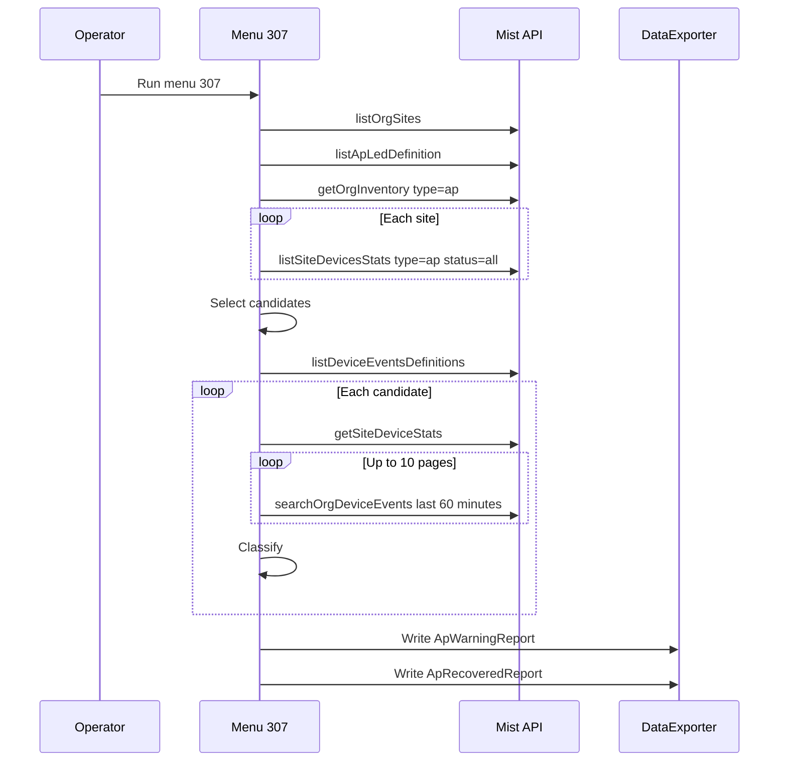

# AP_WARNING_REPORT_MENU_307

> **This runbook is for a report, not for an alarm.** Menu 307 finds each access point (AP) that shows a connectivity LED trouble code now. It then removes each AP that has a verified recovery. This runbook tells NOC operators how to run the report and how to read it. It also tells developers how the report reads the Mist API and how it filters the APs, so that they can copy the logic.

## 1. Overview

| Field | Value |
|---|---|
| **Alert Name** | AP_WARNING_REPORT_MENU_307 |
| **Mist alarm key** | n/a. The report reads the `last_trouble` field of the AP statistics. |
| **Platform** | Juniper Mist access points in one organization. |
| **Mist native severity** | n/a |
| **NOC severity** | **Warning** for a `retained` row. **Major** for a `repeated` row. **Info** for a `recovered` row. |
| **Group** | `infrastructure` |
| **Clear event key** | n/a. The report uses the `AP_CONNECTED` event as recovery evidence. |
| **Correlated alarms** | `ap_offline`, `ap_disconnected`, `switch_down`, `sw_critical_port_down`, `port_flap`, `bad_cable` |
| **Prerequisites** | A Mist API token with read access to the organization. A selected organization ID. MistHelper with menu 307 (merge commit `ba5d60a63` or later for the recovery filter). |
| **Description** | Menu 307 lists each AP whose current LED trouble code is not zero and is recent. It then reads the recent device event history of each AP. If the AP has a verified reconnection after the trouble and the fresh statistics show no trouble, the report moves the AP to the recovered file. Each other AP stays in the warning file. |

### Severity rationale

An AP keeps its last trouble code for some time after it connects again. Without the recovery filter, the report shows APs that are already healthy, and the NOC loses time on them. The filter keeps an AP in the warning file when it cannot prove recovery. A `repeated` row gets a higher severity because three or more interruptions in 60 minutes show an unstable uplink.

## 2. Impact

- **Retained AP.** The AP reports a connectivity trouble code, and no evidence shows a recovery. Clients near the AP can lose service.
- **Repeated AP.** The AP had three or more disconnections in the last 60 minutes. The AP is unstable even when it shows as connected now.
- **Recovered AP.** The AP connected again after the trouble, and the fresh statistics show no trouble code. No action is necessary unless the AP returns to the warning file.
- The report is read-only. It does not change an AP, a site, or the organization.

## 3. Required Information

| Category | Data to capture |
|---|---|
| Report | Organization ID, report time (`reported_at`), file name, number of rows |
| AP identity | `mac`, `name`, `serial`, `model`, `device_id` |
| Location | `site_id`, `site_name`, `site_lookup_status` |
| Trouble | `code`, `code_key`, `code_name`, `code_description`, `trouble_timestamp` |
| Recovery decision | `recovery_status`, `recovery_reason`, `evidence_status`, `interruptions_60m` |
| Fresh evidence | `recovery_connection_at`, `statistics_observed_at`, `fresh_connection_status`, `fresh_trouble_code`, `fresh_trouble_timestamp` |
| History window | `history_start`, `history_end` |
| Upstream | Switch name and port of the AP, PoE state, recent switch alarms at the site |

## 4. Validation

| Check | Command or action |
|---|---|
| Run the report | Interactive menu: select `307`. Command line: `python MistHelper.py --menu 307`. Web portal: open **AP Warning Reports**. |
| Read the scan summary | Read `data/script.log`. Find the line with `inventory_aps`, `site_statistics_aps`, `missing_trouble`, `excluded_trouble`, and `matched`. |
| Read each decision | Find one log line for each MAC with its `recovery_status` and `recovery_reason`. |
| Read the recovery summary | Find the line with the candidate, retained, and recovered counts. |
| Open the files | `data/ApWarningReport_<org_id>.csv` and `data/ApRecoveredReport_<org_id>.csv`, or the selected SQLite or ArangoDB target. |
| Confirm one AP in Mist | Open the AP in the Mist GUI. Compare the LED trouble code, the status, and the last seen time with the row. |
| Confirm the uplink | Use the switch commands in Shared Appendix §6 on the switch port of the AP. |

## 5. Resolution

| Area | Action |
|---|---|
| `repeated` row | Treat the AP uplink as unstable. Examine the switch port for flaps, errors, and PoE events. Replace the cable or move the port if the errors continue. |
| `retained` row, code 02 | No Ethernet link. Examine the cable, the patch panel, and the switch port state. |
| `retained` row, codes 03 to 08 | IP, gateway, or DNS failure. Examine the VLAN, the DHCP scope, the gateway, and the DNS servers for the AP network. |
| `retained` row, codes 12 to 16 | The AP cannot reach the Mist cloud, or authentication fails. Examine the firewall rules, the proxy, NTP, and the clock of the AP. |
| `retained` row, `incomplete_history_or_catalogue` | Run the report again. If the reason stays, open the AP in the Mist GUI and verify it manually. |
| `recovered` row | No action. Monitor the AP. If the AP appears in the warning file in a later run, treat it as a new problem. |
| Report wrote no file | No AP has a recent connectivity trouble code. Record the result. |

## 6. Closure Criteria

- A later run of menu 307 does not show the AP in the warning file.
- The Mist GUI shows the AP as connected with no LED trouble code.
- The switch port of the AP shows no new flaps or errors.
- The NOC ticket records the cause and the action.

## 7. Mist GUI Navigation

| Task | Navigation |
|---|---|
| Find the AP | Organization > Inventory > Access Points. Search for the MAC. |
| Read the AP status | Access Points > select the AP > Properties and Insights. |
| Read the AP events | Access Points > select the AP > Insights > Access Point Events. |
| Read the switch port | Switches > select the switch > Ports. Select the port of the AP. |
| Read site alarms | Monitor > Alerts. Filter for the site. |

## 8. Junos Commands (quick reference)

Use these commands on the switch that serves the AP. See Shared Appendix §6 for the full Junos command reference.

```text
show interfaces ge-0/0/<port> extensive
show poe interface ge-0/0/<port>
show lldp neighbors interface ge-0/0/<port>
show log messages | match ge-0/0/<port>
```

## 9. Cross-references

- [AP warning report operator guide](../ap-warning-report.md)
- [SW_CRITICAL_PORT_DOWN](SW_CRITICAL_PORT_DOWN.md)
- [Shared Appendix](_shared_common.md)

## 10. Escalation

Per Shared Appendix §8. Tier 1 NOC can clear cable, port, and PoE causes. Escalate to Tier 2 when many APs at one site show codes 03 to 16, because the cause is then upstream. Escalate to Tier 2 when an AP stays `repeated` after a cable or port change.

## Appendix A. How the report works

The report has four phases.

1. **Read.** The report reads the sites, the LED code definitions, the AP inventory, and the AP statistics of each site.
2. **Select.** The report keeps each AP with a nonzero trouble code that is recent or has no time.
3. **Recheck.** For each candidate, the report reads fresh statistics and the device events of the last 60 minutes.
4. **Classify and write.** The report gives each candidate a status and a reason. It then writes two files.

The report does not wait, and it does not use the AP uptime. A long uptime does not prove recovery, because an AP can lose its cloud connection and keep its uptime.

The report never exports a partial read of the organization. If one source read fails, the report writes no file and shows "The AP report source read failed. No report was written."

## Appendix B. API call sequence

All calls use the `mistapi` SDK. The page limit is `DEFAULT_API_PAGE_LIMIT`, which is 1000 by default.

| Step | SDK call | Calls | Purpose |
|---|---|---|---|
| 1 | `ConfigUtils.get_cached_or_prompted_org_id()` | 1 | Get the organization ID. The report validates it as a UUID. If no organization is selected, the report writes nothing. |
| 2 | `orgs.sites.listOrgSites(session, org_id, limit=page_limit)` | 1, all pages | Map each site ID to a site name. |
| 3 | `const.ap_led_status.listApLedDefinition(session)` | 1 | Read the LED code names and descriptions. |
| 4 | `orgs.inventory.getOrgInventory(session, org_id, type="ap", limit=page_limit)` | 1, all pages | List each AP in the organization, also unassigned APs. |
| 5 | `sites.stats.listSiteDevicesStats(session, site_id, type="ap", status="all", limit=page_limit)` | 1 for each site, all pages | Read `last_trouble`, `status`, and `last_seen` for each AP. |
| 6 | `const.device_events.listDeviceEventsDefinitions(session)` | 1 | Verify that the event catalogue has `AP_CONNECTED` and `AP_DISCONNECTED`. |
| 7 | `sites.stats.getSiteDeviceStats(session, site_id, device_id)` | 1 for each candidate | Read fresh statistics for the candidate. |
| 8 | `orgs.devices.searchOrgDeviceEvents(session, org_id, mac=mac, device_type="ap", start=end-3600, end=end, limit=page_limit, sort="timestamp", search_after=cursor)` | 1 to 10 pages for each candidate | Read the AP events of the last 60 minutes. |
| 9 | `DataExporter.write_with_format_selection(..., fieldnames=REPORT_COLUMNS)` | 1 or 2 | Write the warning file and the recovered file. |

Steps 7 and 8 run only for candidates. Step 6 runs once, before step 7. A failure in step 6 does not stop the run, but no candidate can then recover.



### Rules for the event search

- The response must be HTTP 200. Another code gives `history_http_<code>`.
- The body must contain the same `start` and `end` that the request sent.
- `results` must be a list of objects.
- `total` must be an integer, at least the number of results, and the same on each page.
- The next cursor is the `search_after` value in the `next` URL. A repeated cursor is an error.
- The report reads at most 10 pages. If the number of events equals `total`, the status is `complete`. Otherwise the status is `history_truncated`.
- A request error, a runtime error, a value error, or an attribute error gives `history_unavailable`.

## Appendix C. Candidate selection

The report reads the inventory APs in sorted order. For each AP:

1. Find the statistics of the AP by normalized MAC. A duplicate MAC or a bad MAC stops the run.
2. If the statistics have no `last_trouble`, add 1 to `missing_trouble`. Skip the AP.
3. If the code is absent or zero, skip the AP.
4. If the code has a time and the time is not in the last 15 minutes, add 1 to `excluded_trouble`. Skip the AP.
5. If the code has no time, keep the AP as a candidate.
6. Get `site_id` from the statistics, then from the inventory. Set `site_lookup_status` to `found`, `missing`, or `unassigned`.
7. Get `connection_status` from the statistics, then from the inventory `connected` flag. Otherwise use `unknown`.

If no candidate exists, the report writes no file.

### Trouble codes

The report pads each code to two digits. It rejects a code that is not a number. A code that is not in the definitions gets `definition_status=unknown`.

| Code | Key | Meaning |
|---|---|---|
| 02 | `NO_ETHERNET_LINK` | No Ethernet link |
| 03 | `NO_IP_ADDRESS` | No IP address |
| 04 | `NO_DEFAULT_GW` | No default gateway |
| 05 | `DEFAULT_GW_UNREACHABLE` | Default gateway not reachable |
| 06 | `NO_DNS` | No DNS server |
| 07 | `NO_DNS_RESPONSE` | No DNS response |
| 08 | `EMPTY_DNS_RESPONSE` | Empty DNS response |
| 12 | `CLOUD_UNREACHABLE` | Mist cloud not reachable |
| 13 | `NO_CLOUD_RESPONSE` | No response from the Mist cloud |
| 14 | `CLOUD_CERT_TIME_CHECK_FAILED` | Certificate time check failed |
| 15 | `CLOUD_CERT_INVALID` | Cloud certificate not valid |
| 16 | `MUTUAL_AUTH_FAILED` | Mutual authentication failed |

Only these connectivity codes can recover. Each other code stays in the warning file.

## Appendix D. Recovery classification

The report checks these rules in order. The first rule that matches gives the reason.

| Order | Condition | `recovery_reason` | `recovery_status` |
|---|---|---|---|
| 1 | 3 or more interruptions in 60 minutes | `repeated_interruptions` | `repeated` |
| 2 | The code is not a connectivity code, or the code key does not agree | `code_not_verified_connectivity` | `retained` |
| 3 | The history is not complete, or the catalogue is not verified | `incomplete_history_or_catalogue` | `retained` |
| 4 | No trouble time, or no `AP_CONNECTED` event | `missing_trouble_time_or_connection` | `retained` |
| 5 | The last connection is at or before the trouble time | `connection_not_after_trouble` | `retained` |
| 6 | A blocker event is at or after the last connection | `later_connection_blocker` | `retained` |
| 7 | The fresh MAC or site ID does not agree | `missing_or_mismatched_fresh_statistics` | `retained` |
| 8 | The fresh status is not `connected`, or no `last_seen` | `not_confirmed_connected` | `retained` |
| 9 | `last_seen` is before max(connection, history end - 300 seconds) or after the history end | `stale_or_future_statistics` | `retained` |
| 10 | No fresh `last_trouble`, or a fresh code of None | `missing_fresh_trouble_evidence` | `retained` |
| 11 | The fresh code is zero or empty | `verified_recovery` | `recovered` |
| 12 | A nonzero fresh code has no time | `missing_fresh_trouble_time` | `retained` |
| 13 | The fresh code is different, or its time is at or after the connection | `newer_or_changed_trouble` | `retained` |
| 14 | Each other case | `verified_recovery` | `recovered` |

The blocker events are `AP_DISCONNECTED`, `AP_CONFIG_FAILED`, `AP_RESTARTED`, `AP_UNASSIGNED`, and `AP_UNCLAIMED`.

A `ValueError`, `TypeError`, or `KeyError` during the classification gives `evidence_status=invalid_evidence` and `recovery_status=retained`.

### Event rules

- The report rejects an event with a different or absent MAC, an absent type, an absent time, or a time outside the window.
- The report removes duplicate events with the same time and type. It then sorts the events by time.
- An `AP_DISCONNECTED` event counts as an interruption only after a change from the previous connect or disconnect event.
- The connection time is the time of the last `AP_CONNECTED` event.
- If the history is not complete, `interruptions_60m` is a lower limit.

### Evidence status values

| `evidence_status` | Meaning |
|---|---|
| `complete` | The report read all events in the window. |
| `history_truncated` | The window has more events than 10 pages hold. |
| `history_http_<code>` | The event search returned that HTTP code. |
| `history_unavailable` | The event search failed. |
| `catalogue_unavailable` | The event catalogue does not have the necessary event types. |
| `invalid_evidence` | The evidence has a bad value. |

### Developer pseudocode

```text
for ap in candidates:
    fresh = get_site_device_stats(ap.site_id, ap.device_id) if ok else {}
    events, evidence = search_device_events(ap.mac, now - 3600, now)
    events = dedupe_and_sort(validate(events, ap.mac))
    interruptions = count_disconnect_transitions(events)
    connected_at = last_time(events, "AP_CONNECTED")
    if interruptions >= 3: status = "repeated"
    elif all_rules_2_to_13_pass(ap, fresh, events, evidence, connected_at):
        status = "recovered"
    else: status = "retained"
write(warning_file, rows where status != "recovered")
write(recovered_file, rows where status == "recovered")
```

## Appendix E. Output files

| File | Rows |
|---|---|
| `ApWarningReport_<org_id>.csv` | `retained` and `repeated` rows |
| `ApRecoveredReport_<org_id>.csv` | `recovered` rows |

If each candidate recovers, the report writes only the recovered file. The SQLite primary key is the organization ID and the MAC. A write that fails stops the run with an error.

The 29 columns, in order: `org_id`, `device_id`, `mac`, `name`, `serial`, `model`, `site_id`, `site_name`, `site_lookup_status`, `connection_status`, `code`, `definition_status`, `code_key`, `code_name`, `code_description`, `trouble_source`, `trouble_timestamp`, `reported_at`, `recovery_status`, `recovery_reason`, `evidence_status`, `interruptions_60m`, `recovery_connection_at`, `statistics_observed_at`, `fresh_connection_status`, `fresh_trouble_code`, `fresh_trouble_timestamp`, `history_start`, `history_end`.

`trouble_source` is always `statistics`.

## Appendix F. Example results

A live run read 3,101 sites, 14,997 inventory APs, and statistics for 14,903 APs. It found 11 candidates and retained all 11. A replay of 20 earlier records retained 16 and recovered 4. Each recovered AP had a disconnection, then the trouble code, then a reconnection 2 seconds later.

## Appendix G. Troubleshooting

| Symptom | Cause | Action |
|---|---|---|
| No file is written | No candidate exists, or no organization is selected | Read the scan summary in `data/script.log`. |
| "The AP report source read failed" | A source read failed | Examine the token, the network, and the rate limit. Run the report again. |
| All rows show `incomplete_history_or_catalogue` | The event catalogue or the event search failed | Examine the log for the event search error. Run the report again. |
| A healthy AP stays retained | The fresh statistics are older than 300 seconds, or a blocker event came after the connection | Run the report again after 5 minutes. |
| `missing_trouble` is high | Many APs have no `last_trouble` field | This is normal. These APs report no trouble. |

## Appendix H. Source files

- `src/operations/exporting/ap_warning_report/operation.py`: `run()` and `REPORT_COLUMNS`.
- `src/operations/exporting/ap_warning_report/client.py`: the source read and the event history read.
- `src/operations/exporting/ap_warning_report/rows.py`: the candidate selection.
- `src/operations/exporting/ap_warning_report/codes.py`: the code definitions and `RecoveryClassifier`.
