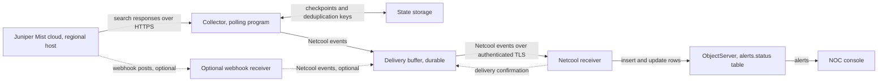

# MIST_NETCOOL_ALARM_INTEGRATION

## 1. Overview

| Field | Value |
| --- | --- |
| Document type | NOC runbook and integration procedure |
| Platform | Juniper Mist cloud and IBM Netcool/OMNIbus |
| Purpose | Collect Juniper Mist alarms and events, send them to IBM Netcool, and operate, verify, and repair the feed |
| Audience | NOC operator, NOC lead, integration engineer, Mist administrator, Netcool administrator, change approver, and security owner |
| Author | Joseph Morrison |
| Version | `1.0` |
| Date | `2026-11-26` |
| Status | Draft for review |
| Verification | See section 13.3 |

| Mark | Meaning |
| --- | --- |
| Verified (live) | A read-only call to the Mist API on the date in section 13.3 showed it. |
| Verified (OpenAPI) | The Mist OpenAPI file in `documentation/` shows it. |
| Verified (MistHelper) | The MistHelper source code shows it. |
| Verified (vendor documentation) | Official vendor documentation shows it. |
| Proposal | A design proposal. An owner must approve it. |
| Open decision | An owner must decide. [Section 15](#15-open-decisions) lists it. |

Use this list to open a section of the runbook.

- [1. Overview](#1-overview)

- [2. How to Use This Runbook](#2-how-to-use-this-runbook)

- [3. Purpose and Scope](#3-purpose-and-scope)

- [4. Architecture](#4-architecture)

- [5. Prerequisites](#5-prerequisites)

- [6. Mist Data Sources](#6-mist-data-sources)

- [7. Alarm and Event Selection](#7-alarm-and-event-selection)

- [8. Collection Design](#8-collection-design)

- [9. Netcool Integration](#9-netcool-integration)

- [10. AP Warning Report (Menu 307)](#10-ap-warning-report-menu-307)

- [11. NOC Operating Procedures](#11-noc-operating-procedures)

- [12. Troubleshooting](#12-troubleshooting)

- [13. Verification and Smoke Test](#13-verification-and-smoke-test)

- [14. Acceptance Criteria and UAT Plan](#14-acceptance-criteria-and-uat-plan)

- [15. Open Decisions](#15-open-decisions)

- [Appendix A. Endpoint Reference](#appendix-a-endpoint-reference)

- [Appendix B. Verified Catalog Names](#appendix-b-verified-catalog-names)

- [Appendix C. Sample Payloads](#appendix-c-sample-payloads)

- [Appendix D. Glossary](#appendix-d-glossary)

- [Appendix E. Revision History](#appendix-e-revision-history)

## 2. How to Use This Runbook

### 2.1 Audience and Reading Paths

Read the sections in the sequence of the table for each role.

| Role | Read first | Then |
| --- | --- | --- |
| NOC operator | [Section 1](#1-overview) and [section 11](#11-noc-operating-procedures) | [Section 12](#12-troubleshooting) |
| NOC lead | [Section 3](#3-purpose-and-scope) and [section 7](#7-alarm-and-event-selection) | [Section 15](#15-open-decisions) |
| Integration engineer | [Section 4](#4-architecture) and [section 5](#5-prerequisites) | [Section 8](#8-collection-design), [section 12](#12-troubleshooting), and [section 13](#13-verification-and-smoke-test) |
| Mist administrator | [Section 5](#5-prerequisites) and [section 6](#6-mist-data-sources) | Section 5.2 and section 11.5 |
| Netcool administrator | [Section 9](#9-netcool-integration) | [Section 4](#4-architecture) and section 5.4 |
| Change approver | [Section 3](#3-purpose-and-scope) | [Section 14](#14-acceptance-criteria-and-uat-plan) |
| Security owner | [Section 5](#5-prerequisites) | [Section 11](#11-noc-operating-procedures) |

### 2.2 Conventions

Replace each placeholder in a command with your local value. Do not write the value in a ticket, a document, or a screenshot.

| Placeholder | Replace it with |
| --- | --- |
| `{api_host}` | The regional host name from [section 5.5](#55-regional-api-hosts) |
| `{org_id}` | The identifier of the Mist organization |
| `{site_id}` | The identifier of one Mist site |
| `{device_mac}` | The MAC address of one Mist device |
| `{token}` | The token value from the approved secret store. Never write it in a command. |
| `{alarm_id}` | The identifier of one alarm |
| `{event_id}` | The identifier of one event |
| `{mxedge_id}` | The identifier of one Mist Edge |
| `{webhook_id}` | The identifier of one webhook |
| `{start_epoch}` | The start of a collection window in UTC epoch seconds |
| `{end_epoch}` | The end of a collection window in UTC epoch seconds |

The `start` and `end` parameters accept an epoch timestamp in seconds or a relative value such as `-1d` (Verified (OpenAPI)).

The search and count endpoints accept the `limit` parameter (Verified (OpenAPI)). Each request to these endpoints uses `limit=1000` (Proposal).

Use `bash` as the code block language for curl commands, `powershell` for PowerShell commands, `yaml` for configuration, `json` for payloads, and `mermaid` for diagrams.

In this runbook, the term `gateway` means a router.

Use the terms in [Appendix D](#appendix-d-glossary) with the meanings that the glossary gives.

### 2.3 Safety Rules

Each command in this runbook sends a read-only `GET` request. The only exception is the token rotation procedure in section 11.5.

```bash
curl -sS -w "\nHTTP status: %{http_code}\n" -H "Authorization: Token ${MIST_API_TOKEN}" "https://{api_host}/api/v1/self/usage"
```

Warning: a token value in a command line can appear in the shell history, a ticket, or a screenshot. After an exposure, replace the token immediately (section 11.5).

Caution: each call uses part of the hourly request limit of the token, and too many calls can cause HTTP 429 responses (Verified (OpenAPI)).

The `GET` operation on `/api/v1/self/usage` returns `requests`, `request_limit`, and `seconds` (Verified (OpenAPI)). Check the request count before a long run.

### 2.4 How This Runbook Is Verified

Each technical claim in this runbook has one mark from the legend in [section 1](#1-overview).

The Mist OpenAPI file, `documentation/mist-api-openapi31json.json`, supports each claim marked Verified (OpenAPI).

Section 13.2 describes the smoke test. The smoke test checks this runbook against the OpenAPI file and the Mist API (Proposal).

The live verification record in section 13.3 gives the UTC date of the live run: 2026-11-26 (Verified (live)).

## 3. Purpose and Scope

### 3.1 Purpose

This runbook tells the NOC how to collect alarms and events from Juniper Mist and send them to IBM Netcool. It also tells the NOC how to operate, verify, and repair the feed. The integration team asked six questions. Each answer is a procedure that any NOC can repeat. The table shows where each answer is.

| Question | Answered in |
| --- | --- |
| Are the four endpoint families necessary and sufficient? | Sections 6 and 7 |
| Is the AP Warning report (menu 307) still necessary? | Section 10 |
| When is a site-level query necessary? | Sections 4.4 and 8.4 |
| Why can the system event search and the Mist Edge event search return zero records? | Section 12.2 |
| How do we reduce the device event volume? | Sections 7.2 and 12.4 |
| Why can one organization return zero alarms? | Section 12.3 |

### 3.2 Baseline and Enhancements

The funded baseline is a like-for-like move from the legacy event manager. Each improvement that is not in the baseline needs its own approval.

| Item | Baseline or enhancement | Approval | Section | Verification |
| --- | --- | --- | --- | --- |
| REST polling of the organization search endpoints | Baseline | Change approver | [Section 4](#4-architecture) | Proposal |
| Alarm search and device event search | Baseline when the legacy event manager covers these alarm classes | NOC lead | [Section 6](#6-mist-data-sources) | Open decision |
| Mist Edge event search and system event search | Open decision | NOC lead | [Section 6](#6-mist-data-sources) | Open decision |
| Device event allowlist | Baseline, needed for the event volume | NOC lead | [Section 7](#7-alarm-and-event-selection) | Proposal |
| Checkpoints, overlap, and result states | Baseline, needed for the reliability requirement | Change approver | [Section 8](#8-collection-design) | Proposal |
| Webhooks or hybrid collection | Enhancement | Change approver | [Section 4](#4-architecture) | Proposal |
| One alarm per site | Enhancement | Change approver | Section 8.7 | Proposal |
| Automatic clear rules | Enhancement | Change approver | Section 9.5 | Proposal |
| AP Warning report (menu 307) | Open decision | NOC lead | [Section 10](#10-ap-warning-report-menu-307) | Open decision |
| Extra API tokens | Open decision | Change approver | [Section 5](#5-prerequisites) | Open decision |

Menu 307 is in the `safe` category of the operation registry (Verified (MistHelper)).

### 3.3 Legacy Behavior Inventory

The owners complete this inventory before the Netcool feed starts (Proposal). Copy the empty row for each legacy alarm class.

| Alarm class | Legacy source | Legacy severity | Legacy clear | New source | Status |
| --- | --- | --- | --- | --- | --- |
|  |  |  |  |  |  |

### 3.4 Device Classes in Scope

The NOC lead selects the device classes in scope. The defaults in this table apply until the NOC lead approves a change (Proposal).

| Device class | Mist device type | Default in this runbook | Can another monitoring tool own it | Verification |
| --- | --- | --- | --- | --- |
| Access points (AP) | `ap` | In scope: device events with the `device_type` value `ap` | No, for the baseline | Type: Verified (OpenAPI). Default: Proposal. |
| Rogue AP alarms | Not a device type. The alarm group is `security`. | In scope: security alarms | No, for the baseline | Group: Verified (OpenAPI). Default: Proposal. |
| Mist Edge | `mxedge` | In scope where present | Open decision | Type: Verified (OpenAPI). Default: Proposal. |
| Switches | `switch` | Out of scope | Yes, if the NOC lead approves | Type: Verified (OpenAPI). Default: Open decision. |
| Gateways (routers) | `gateway` | Out of scope | Yes, if the NOC lead approves | Type: Verified (OpenAPI). Default: Open decision. |

The `mxedge` value appears in the `last_config_device_type` schema. The Mist Edge endpoints have no `device_type` parameter (Verified (OpenAPI)).

The `device_type` description also lists `router` (Verified (OpenAPI)).

The alarm type keys for rogue APs are `rogue_ap` and `rogue_client` (Verified (live)).

### 3.5 Out of Scope

This runbook does not include these items.

- Writes to the Mist cloud. The only write is the token rotation in section 11.5.

- Other monitoring tools and their feeds.

- The development and the rules of the Netcool probe. The Netcool administrator owns them.

- MistHelper menu operations, other than menu 307 and the smoke test.

- The alarm-specific procedures. They are in the same folder, for example [GATEWAY_DOWN.md](GATEWAY_DOWN.md).

## 4. Architecture

### 4.1 Components

Each component has one owner role.

| Component | Function | Owner role | Verification |
| --- | --- | --- | --- |
| Mist cloud (regional) | Serves the search endpoints and sends webhook events. | Mist administrator | Verified (OpenAPI) |
| Collector | Polls each endpoint family for each collection window and transforms each record into a Netcool event. | Integration engineer | Proposal |
| State storage | Holds the checkpoints and the deduplication keys. | Integration engineer | Proposal |
| Delivery buffer (durable) | Holds each Netcool event until the Netcool receiver confirms it. | Integration engineer | Proposal |
| Netcool receiver | Accepts each Netcool event from the delivery buffer. | Netcool administrator | Open decision |
| ObjectServer | Stores the alerts in the `alerts.status` table and deduplicates them by the `Identifier` field. | Netcool administrator | Verified (vendor documentation) |
| NOC console | Shows the alerts to the NOC operator. | NOC operator | Proposal |
| Optional webhook receiver | Accepts the webhook posts of Mist and passes each Netcool event to the delivery buffer. | Integration engineer | Proposal |

### 4.2 Data Flow

The diagram shows the proposed data flow (Proposal). Solid arrows show the usual path. Dashed arrows show the delivery confirmation and the optional webhook path.



### 4.3 Collection Models

Vendor documentation states that webhooks push events to a provided URL when the events occur (Verified (vendor documentation)). The checked pages give no retry behavior (Verified (vendor documentation)). The OpenAPI file defines an `alarms` webhook (Verified (OpenAPI)).

The table compares the three collection models (Proposal).

| Model | Latency | Recovery of missed events | Clear reliability | Request cost | Verdict | Verification |
| --- | --- | --- | --- | --- | --- | --- |
| Polling | One poll interval plus the end lag. The proposed values are 5 minutes and 2 minutes. | Each collection window overlaps the previous window by 5 minutes. | A clear comes only from a complete collection. | 48 requests for each organization each hour, plus pages. | Baseline | Proposal |
| Webhook only | Real time. | Not enough alone. No retry is documented, so a missed event stays missed. | A missed clear stays open until a poll reads it. | No collector request for each event. | Not enough alone | Proposal |
| Hybrid | Real time for webhook events, and one poll interval for the other events. | Polling reads each collection window again. | Polling confirms each clear. | The polling cost, plus no collector request for each webhook event. | Recommended enhancement. The change approver approves it. | Proposal |

The live `for_org` value of the alarms topic is `true` (Verified (live)).

### 4.4 Organization Scope and Site Scope

Organization scope is the default for the collector (Proposal). Organization scope calls each endpoint family for each organization and each poll. Site scope calls each endpoint family for each site and each poll.

| Endpoint family | Organization scope filters | Site scope filters | Item fields | Verification |
| --- | --- | --- | --- | --- |
| Alarms | The `site_id` query parameter accepts one or more comma-separated values. The `type` parameter also applies. | The path holds the `site_id`. The `type` parameter also applies. | Each alarm has an optional `site_id` field. | Verified (OpenAPI) |
| Device events | No `site_id` query parameter. The OpenAPI file gives `ap` as the default `device_type`, but the live search returned other device types (Verified (live)). The `type` parameter applies. | The path holds the `site_id`. The `type` parameter applies. There is no `device_type` parameter. | Each record has an optional `site_id` field. | Verified (OpenAPI) |
| Mist Edge events | No site parameter. The `mxedge_id`, `mxcluster_id`, `type`, `service`, and `component` parameters apply. | The path holds the `site_id`. The same filters apply. | No `site_id` field. | Verified (OpenAPI) |
| System events | No `type` parameter. | The path holds the `site_id`. The `type` parameter applies. | Each record has an optional `site_id` field. | Verified (OpenAPI) |

The limit is 5,000 API calls each hour for each token (Verified (vendor documentation)).

The proposed poll interval is 5 minutes. Thus, each endpoint family has 12 polls each hour (Proposal).

| Scope | Formula | Requests each hour | Share of the 5,000 limit | Verification |
| --- | --- | --- | --- | --- |
| Organization, one organization | 4 families x 12 polls | 48 | 0.96 percent | Proposal |
| Site, 50 sites | 48 x 50 | 2,400 | 48 percent | Proposal |
| Site, 100 sites | 48 x 100 | 4,800 | 96 percent | Proposal |
| Site, 104 sites | 48 x 104 | 4,992 | 99.84 percent | Proposal |
| Site, 105 sites | 48 x 105 | 5,040 | Over the limit | Proposal |
| Site, 100 sites, two pages for each query | 48 x 100 x 2 | 9,600 | 192 percent | Proposal |

The formulas use one page for each query (Proposal). Every extra page is one more request for that query (Proposal).

The page count depends on the organization volume, so this runbook holds no page count for an organization (Proposal).

Each poll of 100 sites with one page for each query sends 400 requests (Proposal). With 4 concurrent requests, the average response time must stay at 3 seconds or less to finish in the 300-second poll interval (Proposal).

Use the organization alarm search with the `site_id` filter for a site-level alarm view (Proposal).

Use site scope for device events only when the NOC needs a filter that the organization search lacks (Proposal).

Use site scope for Mist Edge events when a record needs a site (Proposal).

Use site scope for system events when the NOC needs the `type` filter (Proposal).

Use at most 4 concurrent requests for each token (Proposal).

Set a timeout of 30 seconds for each request (Proposal).

Retry at most 2 times for HTTP 5xx responses, timeouts, and connection failures (Proposal).

On HTTP 429, wait, and then retry the request one time (Proposal). If the retry fails too, record `FAILED_THROTTLED` (Proposal).

When a site query fails, record the failure and continue with the other sites (Proposal).

When one organization fails, continue with the other organizations (Proposal).

When a poll does not finish in the poll interval, record `PARTIAL_ORGANIZATION` (Proposal). Section 8.5 lists each result state.

One run of the AP Warning report reads the statistics of each site one time (Verified (MistHelper)). The planning estimate for one run is S + 4 + 2C requests when the run has candidates (Proposal). In this formula, S is the number of sites, and C is the number of candidates. Section 10.3 explains each term.

## 5. Prerequisites

### 5.1 Roles and Access

Each role needs the access in this table (Proposal).

| Role | Access and duties | Verification |
| --- | --- | --- |
| NOC operator | Reads the Netcool events and runs the read-only checks in section 11.1. | Proposal |
| NOC lead | Approves the allowlists and the alarm policy. | Proposal |
| Integration engineer | Runs the collector, reads the configuration file, and operates the delivery path. | Proposal |
| Mist administrator | Owns the Mist organizations, the API tokens, and the webhooks. Creates and deletes organization API tokens. | Proposal |
| Netcool administrator | Owns the Netcool receiver, the rules, the ObjectServer, and the automations. | Proposal |
| Change approver | Approves each change outside the baseline. | Proposal |
| Security owner | Owns the approved secret store and the token rotation policy. | Proposal |

Joseph Morrison, the author, is the technical contact for Mist questions.

### 5.2 API Tokens

An organization token belongs to the organization, not to a user (Verified (OpenAPI)). It works only for the organization that created it (Verified (OpenAPI)).

An API token that an admin generates has the same privileges as that admin (Verified (OpenAPI)). SSO admins cannot make admin API tokens (Verified (OpenAPI)). For scoped privileges, use an organization API token (Verified (OpenAPI)).

Rate limiting applies to each organization token on its own (Verified (OpenAPI)). For a user token, Mist ties the rate limit to the account (Verified (vendor documentation)).

An organization token can have a source IP list of at most 10 entries, and the list cannot change after creation (Verified (OpenAPI)).

The API returns the full token key only at creation (Verified (OpenAPI)). Mist removes an API token that is not used for more than 90 days (Verified (OpenAPI)).

The Observer role is read-only for administrator accounts (Verified (vendor documentation)). The OpenAPI file lists `read` as a privilege role (Verified (OpenAPI)). The checked vendor pages name no Observer role for a token (Verified (vendor documentation)). Make sure that the Observer role maps to the `read` role before you create a token (Open decision).

| Token | Used by | Rate-limit scope | Privilege | Verification |
| --- | --- | --- | --- | --- |
| Collector token, one for each organization | The collector, for organization scope and site scope | Its own limit, as described above | Read-only, with the `read` role | Open decision |
| Second token, when needed | A second process with a large request cost, such as the AP Warning report (section 10) | Its own limit, as described above | Read-only, with the `read` role | Open decision |

The number of tokens is an open decision (Open decision).

Use a second token when one run of a process takes a large part of the limit (Proposal). For example, 3,000 sites and no candidates give about 3,003 requests for one run, which is about 60 percent of the limit (Proposal).

### 5.3 Secret Handling

The security owner names the approved secret store (Open decision). Keep each token in the approved secret store.

- Put the secret reference in the configuration file, not the token value (Proposal).

- Use a different token for each environment (Proposal).

- Keep each token out of source control, command lines, exception text, and logs (Proposal).

- Redact each token at the logging boundary, not in each caller (Proposal).

- Give each token only the privileges that its process needs (Proposal).

- Record the owner of each token, and check the owner at each rotation (Proposal).

- Replace each token every 90 days (Proposal). The security owner decides the interval (Open decision).

- Revoke a token when an exposure is possible (Proposal). Section 11.5 gives the procedure.

- Monitor each token with the request count in section 2.3 and the `last_used` field (Verified (OpenAPI)).

Warning: a token that appears in a log can give anyone who reads the log access to the organization.

### 5.4 Network Access

Allow outbound HTTPS on port 443 to the regional host `{api_host}` only (Proposal). Keep the TLS certificate check on for each request (Proposal).

The Mist cloud must reach each webhook receiver over IP (Verified (vendor documentation)). Juniper Mist publishes a source address list for the webhooks of each region (Verified (vendor documentation)). Allow inbound HTTPS only from those addresses (Proposal). Get the current addresses from the vendor documentation before each firewall change.

Caution: an incorrect firewall rule can stop webhook delivery until you correct the rule.

By default, the HTTP interface of the Netcool probe is off (Verified (vendor documentation)). By default, the probe does not check user credentials, so it accepts any user credentials (Verified (vendor documentation)). The Netcool receiver must require authentication and TLS (Proposal).

### 5.5 Regional API Hosts

The OpenAPI file lists 12 regional API hosts (Verified (OpenAPI)). Use the host of the region that the organization uses.

| Region | API host | Verification |
| --- | --- | --- |
| Global 01 | `api.mist.com` | Verified (OpenAPI) |
| Global 02 | `api.gc1.mist.com` | Verified (OpenAPI) |
| Global 03 | `api.ac2.mist.com` | Verified (OpenAPI) |
| Global 04 | `api.gc2.mist.com` | Verified (OpenAPI) |
| Global 05 | `api.gc4.mist.com` | Verified (OpenAPI) |
| EMEA 01 | `api.eu.mist.com` | Verified (OpenAPI) |
| EMEA 02 | `api.gc3.mist.com` | Verified (OpenAPI) |
| EMEA 03 | `api.ac6.mist.com` | Verified (OpenAPI) |
| EMEA 04 | `api.gc6.mist.com` | Verified (OpenAPI) |
| APAC 01 | `api.ac5.mist.com` | Verified (OpenAPI) |
| APAC 02 | `api.gc5.mist.com` | Verified (OpenAPI) |
| APAC 03 | `api.gc7.mist.com` | Verified (OpenAPI) |

The Mist administrator confirms the region of each organization (Proposal). Do not send a token to each host to find the region (Proposal).

### 5.6 Configuration Model

Each organization has one configuration file (Proposal). The collector reads the configuration file of its organization (Proposal). Each scheduled command names its configuration file by an absolute path (Proposal). Keep the file out of source control, and let only the service account read it (Proposal).

```yaml
# Placeholder values only. Replace each placeholder in your local file.
# Each collection value is a Proposal. An owner approves each value.
# The token value never appears in this file. The secret reference names an entry in the approved secret store.
organization:
  api_host: "{api_host}"
  org_id: "{org_id}"
  secret_reference: "mist-org-token-{org_id}"
collection:
  poll_interval_seconds: 300
  end_lag_seconds: 120
  overlap_seconds: 300
  page_limit: 1000
  max_concurrent_requests: 4
  request_timeout_seconds: 30
  max_retries: 2
```

Validate each setting before the first request, and stop at the first failure (Proposal).

| Setting | Rule | Verification |
| --- | --- | --- |
| `api_host` | The value is one of the 12 host names in section 5.5. | Proposal |
| `api_host` | The request URL uses the `https` scheme only. | Proposal |
| `org_id` | The value is a UUID. | Verified (OpenAPI) |
| `secret_reference` | The value names an entry in the approved secret store. The value is never a token. | Proposal |
| `page_limit` | The value is 1000. | Proposal |
| `max_concurrent_requests` | The value is 4 or less for each token. | Proposal |
| `request_timeout_seconds` | The value is 30. | Proposal |

The default page limit in MistHelper is 1000 (Verified (MistHelper)). MistHelper clamps the page limit to the range 1 to 1000 (Verified (MistHelper)).

## 6. Mist Data Sources

The collector reads four endpoint families, the definition catalogs, and the webhook topics (Verified (OpenAPI)). Each endpoint family has an organization search and a site search (Verified (OpenAPI)). The count endpoints exist for the organization scope only (Verified (OpenAPI)). The `start` and `end` parameters take epoch seconds or a relative value, such as `-1d` (Verified (OpenAPI)). The live runs of 2026-11-26 confirmed each fact that carries the mark Verified (live). Use `limit=1000` on each request that accepts `limit` (Proposal).

### 6.1 Alarm Search

The alarm endpoint family returns alarm records. The live alarm records carry a `group` field and a `severity` field (Verified (live)). Only the alarm item contains an `id` property (Verified (OpenAPI)).

| Fact | Value |
| - | - |
| Organization path | `/api/v1/orgs/{org_id}/alarms/search` |
| Site path | `/api/v1/sites/{site_id}/alarms/search` |
| Count path | `/api/v1/orgs/{org_id}/alarms/count` (organization scope only) |
| Query parameters | Organization search: `site_id`, `group`, `severity`, `type`, `ack_admin_name`, `acked`, `start`, `end`, `duration`, `limit`, `sort`, `search_after`. Site search: the same names, without `site_id`. Count: `distinct`, `start`, `end`, `duration`, `limit`. |
| Pagination | Send `limit=1000`. The `limit` default is 100 (Verified (OpenAPI)). Follow the `next` value, and do not build `search_after` by hand (Verified (OpenAPI)). The live runs saw no `next` value for this family (Verified (live)). |
| Identifier fields | `id` |
| Time field | `timestamp`, in epoch seconds (Verified (OpenAPI)) |
| Clear role | The kept live alarm records had no `status` field and no `acked` field (Verified (live)). The clear source is the device event recovery or the ExpireTime fallback of section 9.5 (Proposal). |
| Meaning of zero results | A zero result means that no alarm matched the query in the collection window (Proposal). The live 24-hour window returned alarm records for the organization, and the search of one site returned none (Verified (live)). |
| Scope | The organization search returns the alarms of the organization. The optional `site_id` parameter filters one site (Verified (OpenAPI)). The site search returns the alarms of one site (Verified (OpenAPI)). |
| Verification | Paths and parameters: Verified (OpenAPI). HTTP 200 for the organization search, the site search, and the count: Verified (live). |

The alarm item requires `id`, `timestamp`, `last_seen`, `type`, `group`, `severity`, and `count` (Verified (OpenAPI)).

The OpenAPI schema defines the `status` values `open` and `resolved`, and it defines `resolved_time` (Verified (OpenAPI)). The use of these two fields for a clear is an Open decision for UAT (Open decision).

Caution: A false clear can hide an active fault. Do not clear an open alarm because a search returned no record (Proposal).

In the second live run, the alarm records had the group `security` and the severities `info` and `warn` (Verified (live)).

The following request reads one page of the organization alarm search (Verified (OpenAPI)).

```bash
curl -sS "https://{api_host}/api/v1/orgs/{org_id}/alarms/search?limit=1000&start={start_epoch}&end={end_epoch}" -H "Authorization: Token ${MIST_API_TOKEN}"
```

The following request reads the alarm count by type (Verified (live)).

```bash
curl -sS "https://{api_host}/api/v1/orgs/{org_id}/alarms/count?distinct=type&limit=1000&start={start_epoch}&end={end_epoch}" -H "Authorization: Token ${MIST_API_TOKEN}"
```

### 6.2 Device Event Search

The device event endpoint family returns events of access points, switches, and gateways (Verified (live)). Each device event requires the fields `org_id`, `timestamp`, and `type` (Verified (OpenAPI)). The item contains no `id` property (Verified (OpenAPI)).

| Fact | Value |
| - | - |
| Organization path | `/api/v1/orgs/{org_id}/devices/events/search` |
| Site path | `/api/v1/sites/{site_id}/devices/events/search` |
| Count path | `/api/v1/orgs/{org_id}/devices/events/count` (organization scope only) |
| Query parameters | Organization search: `mac`, `model`, `device_type`, `text`, `type`, `last_by`, `includes`, `limit`, `start`, `end`, `duration`, `sort`, `search_after`. Site search: the same names, without `device_type`. Count: `distinct`, `site_id`, `ap`, `apfw`, `model`, `text`, `type`, `includes`, `start`, `end`, `duration`, `limit`. |
| Pagination | Send `limit=1000`. The `limit` default is 100 (Verified (OpenAPI)). Follow the `next` value, which is a relative path that carries `search_after` (Verified (live)). The next request keeps the same `{api_host}` (Proposal). |
| Identifier fields | No event ID. The composite key uses: `org_id`, `mac`, `type`, `timestamp`. |
| Time field | `timestamp`, in epoch seconds (Verified (OpenAPI)) |
| Clear role | A recovery event closes the open event of a pair (Proposal). For example, `AP_CONNECTED` recovers `AP_DISCONNECTED` (Verified (MistHelper)). |
| Meaning of zero results | No event matched the filters in the collection window (Proposal). Check `device_type`, `type`, and the collection window before you treat the result as a fault (Proposal). |
| Scope | The organization search returns the device types that `device_type` selects. The OpenAPI default is `ap`, but the live search without `device_type` returned AP, gateway, and switch events (Verified (live)). The site search has no `device_type` parameter (Verified (OpenAPI)). |
| Verification | Paths and parameters: Verified (OpenAPI). HTTP 200, the default device type behavior, and the relative `next` form: Verified (live). |

Set `device_type` on each organization request, for example `device_type=ap` (Proposal).

The `device_type` parameter accepts `ap`, `switch`, `gateway`, `all`, and a comma-separated list (Verified (OpenAPI)). Its description also lists `router`, but the item values are `ap`, `gateway`, and `switch` (Verified (OpenAPI)).

The `type` parameter accepts a comma-separated list, for example `SW_PORT_DOWN,AP_CONFIGURED` (Verified (OpenAPI)).

The live run did not prove the `type` filter, because the filter request returned no record (Verified (live)).

Use no space, bracket, or quote in the `type` list (Proposal).

The live records had no `ev_type` field. Use `type` for the event type (Verified (live)).

In a live 24-hour window, the device event search returned more pages than the smoke test reads (Verified (live)).

The following request reads one page of the organization device event search for access points (Verified (OpenAPI)).

```bash
curl -sS "https://{api_host}/api/v1/orgs/{org_id}/devices/events/search?device_type=ap&limit=1000&start={start_epoch}&end={end_epoch}" -H "Authorization: Token ${MIST_API_TOKEN}"
```

### 6.3 Mist Edge Event Search

The Mist Edge endpoint family returns events of Mist Edge devices (Verified (OpenAPI)). The Mist Edge event item has no `site_id` field and no `id` property (Verified (OpenAPI)).

| Fact | Value |
| - | - |
| Organization path | `/api/v1/orgs/{org_id}/mxedges/events/search` |
| Site path | `/api/v1/sites/{site_id}/mxedges/events/search` |
| Count path | `/api/v1/orgs/{org_id}/mxedges/events/count` (organization scope only) |
| Query parameters | Organization search: `mxedge_id`, `mxcluster_id`, `type`, `service`, `component`, `limit`, `start`, `end`, `duration`, `sort`, `search_after`. Site search: the same names. Count: `distinct`, `mxedge_id`, `mxcluster_id`, `type`, `service`, `start`, `end`, `duration`, `limit`. |
| Pagination | Send `limit=1000`. The `limit` default is 10 for the site search and 100 for the organization search (Verified (OpenAPI)). Follow the `next` value when it is present (Verified (OpenAPI)). The live runs saw no `next` value for this family (Verified (live)). |
| Identifier fields | No event ID. The composite key uses: `mxedge_id`, `type`, `timestamp`. |
| Time field | `timestamp`, optional in the item schema (Verified (OpenAPI)) |
| Clear role | A reconnect event closes the open event of a pair (Proposal). For example, `ME_CONNECTED` closes `ME_DISCONNECTED` (Proposal). |
| Meaning of zero results | The response has no `total` field, so a zero result cannot compare with a count (Verified (OpenAPI)). The echoed `start` and `end` values show the collection window (Verified (live)). |
| Scope | The organization search returns the Mist Edge events of the organization. The site search returns the events of one site (Verified (OpenAPI)). |
| Verification | Paths, parameters, and the missing `total` field: Verified (OpenAPI). HTTP 200, the echoed `start` and `end` values, and the default window: Verified (live). |

Without a time parameter, the collection window is 86400 seconds, which is 24 hours (Verified (live)). The `duration` default is `1d` (Verified (OpenAPI)).

The item `severity` takes the values `normal`, `critical`, `high`, and `warning` (Verified (OpenAPI)). The live Mist Edge records had no `severity` field (Verified (live)), so this enum is not confirmed live (Open decision).

The following request reads one page of the organization Mist Edge event search (Verified (OpenAPI)).

```bash
curl -sS "https://{api_host}/api/v1/orgs/{org_id}/mxedges/events/search?limit=1000&start={start_epoch}&end={end_epoch}" -H "Authorization: Token ${MIST_API_TOKEN}"
```

### 6.4 System Event Search

The system event endpoint family returns system events of the organization or of one site (Verified (OpenAPI)). The item has the fields `site_id` and `scope`, and it has no `severity` field (Verified (OpenAPI)). The item has no `id` property (Verified (OpenAPI)).

| Fact | Value |
| - | - |
| Organization path | `/api/v1/orgs/{org_id}/events/system/search` |
| Site path | `/api/v1/sites/{site_id}/events/system/search` |
| Count path | `/api/v1/orgs/{org_id}/events/system/count` (organization scope only) |
| Query parameters | Organization search: `limit`, `start`, `end`, `duration`, `sort`, `search_after`. Site search: `type`, `limit`, `start`, `end`, `duration`, `sort`, `search_after`. Count: `distinct`, `limit`, `start`, `end`, `duration`. |
| Pagination | Send `limit=1000`. Follow the `next` value when it is present (Verified (OpenAPI)). The live runs saw no `next` value for this family (Verified (live)). |
| Identifier fields | No event ID. The composite key uses: `org_id`, `type`, `timestamp`. |
| Time field | `timestamp`, optional in the organization item (Verified (OpenAPI)) |
| Clear role | None. System events give information only (Proposal). |
| Meaning of zero results | No system event matched the filters in the collection window (Proposal). The first live run returned system event records (Verified (live)). Check the collection window and the scope before you treat a zero result as a fault (Proposal). |
| Scope | The organization search returns the events of the organization. The organization search has no `type` parameter, and the site search has one (Verified (OpenAPI)). |
| Verification | Paths and parameters: Verified (OpenAPI). HTTP 200 and the system event records of the first live run: Verified (live). |

The `metadata` field is a JSON-encoded string (Verified (OpenAPI)).

Read each `type` value with the system event catalog in section 6.5 (Proposal).

The following request reads one page of the organization system event search (Verified (OpenAPI)).

```bash
curl -sS "https://{api_host}/api/v1/orgs/{org_id}/events/system/search?limit=1000&start={start_epoch}&end={end_epoch}" -H "Authorization: Token ${MIST_API_TOKEN}"
```

### 6.5 Definition Catalogs

The definition catalogs give the names that Mist uses for alarms, events, AP LED codes, and webhook topics (Verified (OpenAPI)).

| Fact | Value |
| - | - |
| Catalog paths | `/api/v1/const/alarm_defs`, `/api/v1/const/device_events`, `/api/v1/const/mxedge_events`, `/api/v1/const/system_events`, `/api/v1/const/ap_led_status`, `/api/v1/const/webhook_topics` |
| Verification | Paths: Verified (OpenAPI). HTTP 200 for each path, and the entry counts below: Verified (live). |

The live catalogs hold the entries and fields in this table (Verified (live)). Each field list is the union of the fields of the entries.

| Catalog | Entries | Field names |
| - | - | - |
| `alarm_defs` | 248 | `default_enabled`, `display`, `fields`, `group`, `key`, `marvis_suggestion_category`, `severity` |
| `device_events` | 387 | `description`, `display`, `key` |
| `mxedge_events` | 40 | `description`, `display`, `key` |
| `system_events` | 18 | `display`, `group`, `key` |
| `ap_led_status` | 37 | `code`, `description`, `key`, `name` |
| `webhook_topics` | 31 | `allows_single_event_per_message`, `for_org`, `has_delivery_results`, `internal`, `key` |

The alarm catalog has four groups: `certificate_expiry`, `infrastructure`, `marvis`, and `security` (Verified (live)).

The alarm catalog severities are `critical`, `info`, `normal`, and `warn` (Verified (live)).

Each AP LED entry has the fields `code`, `name`, `description`, and `key` (Verified (live)).

Use the `key` value of each entry as the exact name in an allowlist (Proposal).

Read the `display` value only as a label (Proposal).

The key `automatic_channel_selection(device_reboot)` contains parentheses. Copy the key exactly (Verified (live)).

### 6.6 Webhook Topics

A webhook pushes each event to a URL that you configure (Verified (vendor documentation)). The topic names of this runbook come from the live topic catalog (Verified (live)).

| Fact | Value |
| - | - |
| Topic source | `/api/v1/const/webhook_topics` lists the topics. The topic table below holds each live topic and its flags. |
| Verification | Path: Verified (OpenAPI). Topic keys and flags: Verified (live). Signature headers: Verified (OpenAPI). |

| Topic | for_org | has_delivery_results |
| - | - | - |
| `alarms` | `true` | `true` |
| `asset-raw-rssi` | `absent` | `absent` |
| `audits` | `true` | `true` |
| `client-info` | `true` | `absent` |
| `client-join` | `true` | `absent` |
| `client-latency` | `absent` | `absent` |
| `client-sessions` | `true` | `absent` |
| `device-events` | `true` | `absent` |
| `device-updowns` | `true` | `true` |
| `discovered-raw-rssi` | `absent` | `absent` |
| `filtered-asset-rssi` | `absent` | `absent` |
| `guest-authorizations` | `absent` | `absent` |
| `location` | `absent` | `absent` |
| `location-asset` | `absent` | `absent` |
| `location-centrak` | `absent` | `absent` |
| `location-client` | `absent` | `absent` |
| `location-sdk` | `absent` | `absent` |
| `location-unclient` | `absent` | `absent` |
| `minis-application` | `true` | `absent` |
| `minis-reachability` | `true` | `absent` |
| `mxedge-events` | `true` | `absent` |
| `nac-accounting` | `absent` | `absent` |
| `nac-events` | `absent` | `absent` |
| `occupancy-alerts` | `absent` | `true` |
| `ping` | `true` | `true` |
| `rssizone` | `absent` | `absent` |
| `sdkclient-scan-data` | `absent` | `absent` |
| `vbeacon` | `absent` | `absent` |
| `wifi-conn-raw` | `absent` | `absent` |
| `wifi-unconn-raw` | `absent` | `absent` |
| `zone` | `absent` | `absent` |

The four feed topics of this runbook map to the feeds in this table (Verified (live) for the flags).

| Topic | Feed | Delivery results |
| - | - | - |
| `alarms` | Alarm endpoint family (section 6.1) | Yes |
| `device-events` | Device event endpoint family (section 6.2) | No |
| `device-updowns` | Access point up and down events (Verified (OpenAPI) for the `ap` field) | Yes |
| `mxedge-events` | Mist Edge endpoint family (section 6.3) | No |

The flag `for_org` is `true` for all four topics (Verified (live)). The live topic list has no system event topic (Verified (live)).

The webhook delivery search takes five topics in its `topic` parameter: `alarms`, `audits`, `device-updowns`, `occupancy-alerts`, and `ping` (Verified (OpenAPI)). These five match the live topics that report delivery results (Verified (live)).

The topics `device-events` and `mxedge-events` have no delivery results (Verified (live)). Reconcile the webhook events with the polling results (Proposal).

The vendor pages checked on 2026-11-25 do not state a webhook retry behavior (Open decision).

When a webhook of type `http-post` has a `secret`, Mist adds two headers (Verified (OpenAPI)). The header `X-Mist-Signature-v2` holds HMAC_SHA256 of the body, with the secret as the key (Verified (OpenAPI)). The header `X-Mist-Signature` holds HMAC_SHA1 of the body, with the same secret (Verified (OpenAPI)).

The OpenAPI text gives no encoding for the digest, hex or base64 (Verified (OpenAPI)). The MistHelper ops platform compares a hex digest in constant time (Verified (MistHelper)). Confirm the digest encoding with a test delivery before go-live (Open decision).

The signature check has three steps (Proposal).

1. Read the raw request body without a change.
2. Compute HMAC-SHA256 over the body with the shared secret.
3. Compare the result with `X-Mist-Signature-v2` in constant time.

Warning: A copied secret can expose the webhook feed to other users. Do not copy secret fields into a log, a ticket, or a chat (Proposal).

The webhook list response can hold secret fields, for example `secret` (Verified (OpenAPI)).

The OpenAPI text uses other spellings for two topic names (Verified (OpenAPI)). Use the topic keys of the live catalog (Proposal).

The Mist API has a POST operation that sends a ping event to a webhook (Verified (OpenAPI)). This runbook uses GET requests only, so the test delivery is outside its read-only checks (Proposal).

## 7. Alarm and Event Selection

This section selects the alarm types and device events that the collector sends to the Netcool receiver. Each alarm key and event type comes from the live catalogs (Verified (live)). The NOC lead approves each row with the mark Proposal (Proposal).

### 7.1 Coverage Matrix

Each NOC condition has one primary source. The alarm search is the primary source for each baseline condition (Proposal).

| NOC condition | Primary source | Secondary source | Clear or recovery source | Evidence | Verification |
| --- | --- | --- | --- | --- | --- |
| AP offline | Alarm `device_down` | Device event `AP_DISCONNECTED` | Device event `AP_CONNECTED`, then ExpireTime | [Appendix B.1](#b1-alarm-types), [Appendix B.2](#b2-device-event-types) | Verified (live), Proposal |
| Rogue AP or rogue client | Alarms `rogue_ap` and `rogue_client` | None | ExpireTime. The live catalog has no rogue clear key. | [Appendix B.1](#b1-alarm-types) | Verified (live), Open decision |
| Switch offline | Alarms `switch_down` and `switch_offline` | Device event `SW_DISCONNECTED` | Device event `SW_CONNECTED`, then ExpireTime | [Appendix B.1](#b1-alarm-types), [Appendix B.2](#b2-device-event-types) | Verified (live), Proposal, Open decision |
| WAN Edge offline | Alarm `gateway_down` | Device event `GW_DISCONNECTED` | Device event `GW_CONNECTED`, then ExpireTime | [Appendix B.1](#b1-alarm-types), [Appendix B.2](#b2-device-event-types) | Verified (live), Proposal, Open decision |
| Mist Edge disconnected | Alarm `mist_edge_disconnected` | Mist Edge event `ME_DISCONNECTED` | Mist Edge event `ME_CONNECTED`, then ExpireTime | [Appendix B.1](#b1-alarm-types), [Appendix B.3](#b3-mist-edge-event-types) | Verified (live), Proposal |
| Mist Edge restarted | Alarm `mist_edge_restarted` | Mist Edge event `ME_RESTARTED` | None. Information only. | [Appendix B.1](#b1-alarm-types), [Appendix B.3](#b3-mist-edge-event-types) | Verified (live), Proposal |
| AP restarted | Alarm `device_restarted` | Device event `AP_RESTARTED` | None. Information only. | [Appendix B.1](#b1-alarm-types), [Appendix B.2](#b2-device-event-types) | Verified (live), Proposal |
| Port down on an AP, switch, or WAN Edge | Device events `AP_PORT_DOWN`, `SW_PORT_DOWN`, and `GW_PORT_DOWN` (default `No`) | None | Matching `*_PORT_UP` event | [Appendix B.2](#b2-device-event-types) | Verified (live), Proposal |
| Platform change on an AP | System events `ap_reboot` and `fw_upgrade` | None | None. Information only. | [Appendix B.4](#b4-system-event-types) | Verified (live), Proposal |

The live alarm records carried no `status` key, so the live run shows no resolved alarm (Verified (live)). So the clear comes from device events, and ExpireTime is the fallback (Proposal). The `status` path of the alarm schema is an Open decision for UAT (Open decision).

### 7.2 Device Event Allowlist

The device event search returns AP, gateway, and switch events when `device_type` is absent (Verified (live)). The OpenAPI file gives `ap` as the default (Verified (OpenAPI)), so the collector sets `device_type` on each request (Proposal). The site device event search has no `device_type` parameter (Verified (OpenAPI)). The device type filter applies at organization scope only (Verified (OpenAPI)).

Mist Edge events come from the Mist Edge event search, not from the device event search (Verified (OpenAPI)). The live device event records carried no `ev_type` value (Verified (live)). So the Netcool severity comes from the role column of the table below (Proposal).

| Event type | Device class | Role (open, clear, information) | Netcool Type | Default | Verification |
| --- | --- | --- | --- | --- | --- |
| `AP_DISCONNECTED` | AP | open | 1 | Yes | Verified (live), Proposal |
| `AP_CONNECTED` | AP | clear | 2 | Yes | Verified (live), Proposal |
| `AP_RESTARTED` | AP | information | 13 | Yes | Verified (live), Proposal |
| `AP_RESTART_BY_USER` | AP | information | 13 | Yes | Verified (live), Proposal |
| `AP_PORT_DOWN` | AP | open | 1 | No | Verified (live), Proposal |
| `AP_PORT_UP` | AP | clear | 2 | No | Verified (live), Proposal |
| `SW_DISCONNECTED` | switch | open | 1 | No | Verified (live), Proposal |
| `SW_CONNECTED` | switch | clear | 2 | No | Verified (live), Proposal |
| `SW_RESTARTED` | switch | information | 13 | No | Verified (live), Proposal |
| `SW_RESTART_BY_USER` | switch | information | 13 | No | Verified (live), Proposal |
| `SW_REBOOTING` | switch | information | 13 | No | Verified (live), Proposal |
| `SW_PORT_DOWN` | switch | open | 1 | No | Verified (live), Proposal |
| `SW_PORT_UP` | switch | clear | 2 | No | Verified (live), Proposal |
| `GW_DISCONNECTED` | gateway | open | 1 | No | Verified (live), Proposal |
| `GW_CONNECTED` | gateway | clear | 2 | No | Verified (live), Proposal |
| `GW_RESTARTED` | gateway | information | 13 | No | Verified (live), Proposal |
| `GW_RESTART_BY_USER` | gateway | information | 13 | No | Verified (live), Proposal |
| `GW_PORT_DOWN` | gateway | open | 1 | No | Verified (live), Proposal |
| `GW_PORT_UP` | gateway | clear | 2 | No | Verified (live), Proposal |
| `GW_TUNNEL_DOWN` | gateway | open | 1 | No | Verified (live), Proposal |
| `GW_TUNNEL_UP` | gateway | clear | 2 | No | Verified (live), Proposal |
| `ME_DISCONNECTED` | Mist Edge | open | 1 | Yes | Verified (live), Proposal |
| `ME_CONNECTED` | Mist Edge | clear | 2 | Yes | Verified (live), Proposal |
| `ME_RESTARTED` | Mist Edge | information | 13 | Yes | Verified (live), Proposal |
| `ME_RESTART_BY_USER` | Mist Edge | information | 13 | Yes | Verified (live), Proposal |
| `ME_SHUTDOWN` | Mist Edge | open | 1 | No | Verified (live), Proposal |

Netcool Type 1 is Problem, Type 2 is Resolution, and Type 13 is Information (Verified (vendor documentation)). Each information row maps to Netcool Type 13 with an ExpireTime of 3600 seconds, and it creates no clear (Proposal). A row with the default `No` needs approval from the NOC lead before the collector polls it (Proposal).

Send the event types as one comma-separated value with no spaces (Proposal). The live run did not prove the `type` filter, because the filtered request returned no record (Verified (live), Open decision).

```bash
curl -sS -H "Authorization: Token ${MIST_API_TOKEN}" "https://{api_host}/api/v1/orgs/{org_id}/devices/events/search?device_type=ap&type=AP_DISCONNECTED,AP_CONNECTED,AP_RESTARTED,AP_RESTART_BY_USER&start={start_epoch}&end={end_epoch}&limit=1000"
```

### 7.3 Alarm Type List

Each row names an alarm key from the live alarm catalog (Verified (live)). The group and the Mist severity come from the same catalog (Verified (live)).

| Alarm key | Group | Mist severity | Device class | Default | Verification |
| --- | --- | --- | --- | --- | --- |
| `device_down` | infrastructure | warn | AP | Yes | Verified (live), Proposal |
| `device_restarted` | infrastructure | info | AP | No | Verified (live), Proposal |
| `device_reconnected` | infrastructure | info | AP | No | Verified (live), Proposal |
| `ap_offline` | marvis | critical | AP | Yes | Verified (live), Proposal |
| `ap_offline_isp_site_down` | marvis | critical | AP | Yes | Verified (live), Proposal |
| `ap_bad_cable` | marvis | critical | AP | Yes | Verified (live), Proposal |
| `switch_down` | infrastructure | warn | switch | No | Verified (live), Proposal |
| `switch_offline` | marvis | critical | switch | No | Verified (live), Proposal |
| `switch_restarted` | infrastructure | info | switch | No | Verified (live), Proposal |
| `switch_reconnected` | infrastructure | info | switch | No | Verified (live), Proposal |
| `gateway_down` | infrastructure | warn | gateway | No | Verified (live), Proposal |
| `gateway_reconnected` | infrastructure | info | gateway | No | Verified (live), Proposal |
| `rogue_ap` | security | critical | rogue | Yes | Verified (live), Proposal |
| `rogue_client` | security | critical | rogue | Yes | Verified (live), Proposal |
| `honeypot_ssid` | security | warn | rogue | No | Verified (live), Proposal |
| `beacon_flood` | security | warn | rogue | No | Verified (live), Proposal |
| `mist_edge_connected` | infrastructure | info | Mist Edge | No | Verified (live), Proposal |
| `mist_edge_disconnected` | infrastructure | critical | Mist Edge | Yes | Verified (live), Proposal |
| `mist_edge_restarted` | infrastructure | warn | Mist Edge | Yes | Verified (live), Proposal |
| `mist_edge_disk_usage_high` | infrastructure | critical | Mist Edge | Yes | Verified (live), Proposal |
| `mist_edge_psu_unplugged` | infrastructure | critical | Mist Edge | Yes | Verified (live), Proposal |
| `mist_edge_powerinput_disconnected` | infrastructure | critical | Mist Edge | Yes | Verified (live), Proposal |

The `marvis` and `infrastructure` rows can name one condition, for example `ap_offline` and `device_down`. The NOC lead selects one row for each condition (Proposal). [Section 9](#9-netcool-integration) maps each Mist severity to a Netcool severity (Proposal).

### 7.4 Clear and Recovery Matrix

Each open Netcool event and its clear share one Identifier (Proposal). The Identifier uses `org_id` and the device key (Proposal).

| Open condition | Clear condition | Source | Key match | Fallback | Verification |
| --- | --- | --- | --- | --- | --- |
| AP offline: alarm `device_down` or event `AP_DISCONNECTED` | Event `AP_CONNECTED` for the same device | Device events | `org_id` and `mac` | ExpireTime (value: Open decision) | Verified (live), Proposal |
| Switch offline: alarm `switch_down` or event `SW_DISCONNECTED` | Event `SW_CONNECTED` for the same device | Device events | `org_id` and `mac` | ExpireTime (value: Open decision) | Verified (live), Proposal |
| WAN Edge offline: alarm `gateway_down` or event `GW_DISCONNECTED` | Event `GW_CONNECTED` for the same device | Device events | `org_id` and `mac` | ExpireTime (value: Open decision) | Verified (live), Proposal |
| Mist Edge disconnected: alarm `mist_edge_disconnected` or event `ME_DISCONNECTED` | Event `ME_CONNECTED` for the same Mist Edge | Mist Edge events | `org_id` and `mxedge_id` | ExpireTime (value: Open decision) | Verified (live), Proposal |
| Port down: `AP_PORT_DOWN`, `SW_PORT_DOWN`, or `GW_PORT_DOWN` | Matching `*_PORT_UP` event | Device events | `org_id`, `mac`, and `port_id` | ExpireTime (value: Open decision) | Verified (OpenAPI), Proposal |
| WAN Edge tunnel down: `GW_TUNNEL_DOWN` | `GW_TUNNEL_UP` for the same tunnel | Device events | `org_id`, `mac`, and `tunnel_name` | ExpireTime (value: Open decision) | Verified (OpenAPI), Proposal |
| Rogue AP or rogue client: `rogue_ap` or `rogue_client` | None in the live catalog | Alarms | Open decision | ExpireTime (value: Open decision) | Verified (live), Open decision |
| Restart: `AP_RESTARTED`, `SW_RESTARTED`, `GW_RESTARTED`, or `ME_RESTARTED` | None | Device events or Mist Edge events | Not applicable | Netcool Type 13 with ExpireTime of 3600 seconds | Verified (live), Proposal |
| Alarm `status` set to `resolved` | Same alarm `id` with `status` set to `resolved` | Alarms | `id` | Device event, then ExpireTime | Verified (OpenAPI), Open decision |
| System event `ap_reboot`, `fw_upgrade`, or another system key | None | System events | Not applicable | Netcool Type 13 (information only) | Verified (live), Proposal |

The alarm item has the list fields `aps`, `gateways`, and `switches`, and it has no `mac` field (Verified (OpenAPI)). So the key match for an alarm needs a UAT check (Open decision). The alarm schema has the fields `status` and `resolved_time` (Verified (OpenAPI)). No kept live record carried a `status` key (Verified (live)), so these fields are an Open decision for UAT (Open decision).

The vendor page names only `Type` as a field that `generic_clear` matches (Verified (vendor documentation)). The Identifier design needs a UAT check (Open decision). The `expire` automation sets the Severity to 0 when ExpireTime passes (Verified (vendor documentation)). The ExpireTime value for a problem event is an Open decision (Open decision).

### 7.5 Event Inventory Procedure

Run this procedure before go-live, and again after each allowlist change (Proposal). Each count request uses `duration=1d`, which is a 24-hour window (Verified (OpenAPI)). The live run returned HTTP 200 for each count request (Verified (live)).

1. Set `MIST_API_TOKEN` in the shell before you send each request.
2. Send each count request in the block below, with `distinct=type`.
3. Read each result item, and use the `count` field for the number of records (Verified (OpenAPI)).
4. Read the key that holds the distinct value in each result item, . The live run kept no name for that key, so the first run of this step records it (Open decision). Open decision OD-09 in section 15 depends on the result.
5. Split the device event counts by device class with the device event search (Verified (OpenAPI)).
6. Compute the retained percent for each family that has an allowlist (Proposal).
7. Send the retained percent and the type counts to the NOC lead for review (Proposal).

```bash
curl -sS -H "Authorization: Token ${MIST_API_TOKEN}" "https://{api_host}/api/v1/orgs/{org_id}/alarms/count?distinct=type&duration=1d&limit=1000"
curl -sS -H "Authorization: Token ${MIST_API_TOKEN}" "https://{api_host}/api/v1/orgs/{org_id}/devices/events/count?distinct=type&duration=1d&limit=1000"
curl -sS -H "Authorization: Token ${MIST_API_TOKEN}" "https://{api_host}/api/v1/orgs/{org_id}/mxedges/events/count?distinct=type&duration=1d&limit=1000"
curl -sS -H "Authorization: Token ${MIST_API_TOKEN}" "https://{api_host}/api/v1/orgs/{org_id}/events/system/count?distinct=type&duration=1d&limit=1000"
```

The count endpoint for device events has no `device_type` parameter (Verified (OpenAPI)). The retained percent is the allowlisted count divided by the total count, times 100 (Proposal). For example, 2,500 allowlisted records out of 10,000 total records give 25 percent, because 2500 / 10000 = 0.25 (Proposal).

## 8. Collection Design

This section defines how the collector polls the Mist API, stores its checkpoint, and protects the Netcool path (Proposal).

### 8.1 Schedule and Collection Window

The collector polls every 5 minutes (Proposal). Each poll reads one collection window for each organization and endpoint family (Proposal).

| Name | Formula | Value | Verification |
| --- | --- | --- | --- |
| Poll interval | `I` | 5 minutes | Proposal |
| End lag | `L` | 2 minutes | Proposal |
| Overlap | `O` | 5 minutes | Proposal |
| Window end | `E = T - L`, where `T` is the poll time | Poll time minus 2 minutes | Proposal |
| Window start | `S = C - O`, where `C` is the checkpoint | Checkpoint minus 5 minutes | Proposal |
| Window length | `E - S` | 10 minutes in steady state, because `I + O` is 5 + 5 | Proposal |

The timeline below shows three polls in steady state (Proposal). Each example assumes that the previous poll advanced the checkpoint (Proposal). All times are UTC.

| Poll time | Checkpoint before the poll | Window start | Window end | Length | Overlap with the previous window |
| --- | --- | --- | --- | --- | --- |
| 09:45:00 | 09:38:00 | 09:33:00 | 09:43:00 | 10 minutes | Not shown |
| 09:50:00 | 09:43:00 | 09:38:00 | 09:48:00 | 10 minutes | 5 minutes, from 09:38:00 to 09:43:00 |
| 09:55:00 | 09:48:00 | 09:43:00 | 09:53:00 | 10 minutes | 5 minutes, from 09:43:00 to 09:48:00 |

Send each window as `start={start_epoch}` and `end={end_epoch}`, in epoch seconds (Verified (OpenAPI)). The live run did not measure the search delay (Verified (live)). The end lag stays a Proposal until a measurement confirms it, Open decision OD-06 in section 15 depends on that measurement (Open decision). End each window in the past, and do not end a window at the current time (Proposal).

### 8.2 Checkpoint

The collector advances a checkpoint after the durable delivery buffer stores each Netcool event of the collection window (Proposal). The buffer then delivers to the Netcool receiver with retry, and it keeps each event until the receiver confirms it (Proposal). A failed write to the buffer gives `FAILED_DELIVERY`, and the checkpoint does not advance (Proposal).

Each checkpoint covers one organization and one endpoint family (Proposal). Only `SUCCESS_WITH_RECORDS` and `SUCCESS_EMPTY` advance a checkpoint (Proposal). The checkpoint storage is an Open decision for the owners (Open decision).

### 8.3 Pagination

The alarm, device event, and system event searches return `results`, `start`, `end`, `limit`, `next`, and `total` (Verified (OpenAPI)). The Mist Edge search returns no `total` (Verified (OpenAPI)). The live run showed that a `next` value is a relative path that carries `search_after` (Verified (live)). Follow each `next` value on the same regional host (Verified (live)).

In the second live run, the device event search still had a `next` value after three pages (Verified (live)). A `limit` above 1000 returned HTTP 200 with the echoed `limit` 1000 (Verified (live)).

1. Send the first request with `limit=1000`.
2. Read the `results` list and the `next` value from the response.
3. Build each later request from `{api_host}` and the `next` value.
4. Stop when `next` is absent, and treat the endpoint family as complete (Proposal).
5. Record `FAILED_INCOMPLETE_PAGINATION` when the page ceiling stops the collection (Proposal).

The Mist Edge response has no `total`, so the absence of `next` is the only completeness check for that search (Proposal). Refuse each `next` value that names another host (Proposal).

### 8.4 Rate-Limit Budget and Sizing

| Fact | Value | Verification |
| --- | --- | --- |
| Hourly limit for each API token | 5000 API calls | Verified (OpenAPI), Verified (vendor documentation) |
| Limit scope | Rate limiting is done by the individual token. Rate limiting for a user token applies to the account. | Verified (vendor documentation) |
| Reset | The vendor states a reset at the hourly boundary. The live reads did not confirm the reset. | Verified (vendor documentation), Open decision |
| Usage read | `GET /api/v1/self/usage` returns `requests`, `request_limit`, and `seconds` | Verified (OpenAPI) |
| Live limit | `request_limit` was 5000 | Verified (live) |
| Rate-limit headers | No rate-limit header and no `Retry-After` header appeared in the live run | Verified (live) |
| Unit of `Retry-After` | Not observed | Open decision |

Read the usage with this read-only command.

```bash
curl -sS -H "Authorization: Token ${MIST_API_TOKEN}" "https://{api_host}/api/v1/self/usage"
```

Read `requests` and `request_limit`, and compute the remaining budget as `request_limit` minus `requests` (Proposal). The `seconds` field gives the time left before the reset (Verified (OpenAPI)).

The mistapi session retries HTTP 429 up to three times (Verified (MistHelper)). The session waits for the `Retry-After` value when that header is present, and it otherwise waits `5 * 2**attempt` seconds (Verified (MistHelper)). Each retry is one request in the budget (Verified (MistHelper)). The collector design allows one collector attempt after HTTP 429 (Proposal). The owners decide whether the collector adds that attempt on top of the SDK retries (Open decision).

The poll budget uses this formula (Proposal).

`R = (60 / I) * O * F * Q + (60 / I) * S + X`

- `R` is the requests for each hour.
- `I` is the poll interval in minutes.
- `O` is the number of organizations.
- `F` is the number of endpoint families, which is 4.
- `Q` is the average number of pages for each family search, at least 1.
- `S` is the number of site requests for each poll.
- `X` is the number of retries and usage reads.

| Case | Inputs | Calculation | Requests per hour | Share of 5000 | Verification |
| --- | --- | --- | --- | --- | --- |
| Organization search, one page for each family | `O` = 5, `F` = 4, `I` = 5, `Q` = 1 | 12 * 5 * 4 * 1 | 240 | 4.8 percent (240 / 5000) | Proposal |
| Organization search, three pages for each family | `O` = 5, `F` = 4, `I` = 5, `Q` = 3 | 12 * 5 * 4 * 3 | 720 | 14.4 percent (720 / 5000) | Proposal |
| Site query, 100 sites in an example, one request for each site | `S` = 100, `I` = 5 | 12 * 100 | 1200 | 24 percent (1200 / 5000) | Proposal |
| Cases one and three together | Sum of the two cases | 240 + 1200 | 1440 | 28.8 percent (1440 / 5000) | Proposal |

The site case uses an example count of 100 sites, and it is not the count of any organization (Proposal).

Pages for one request follow this formula, with a minimum of 1 (Proposal). `Pages = ceil(N / 1000)`, and `N` is the record count of the request.

| Records in one request (`N`) | Pages at `limit=1000` | Arithmetic |
| --- | --- | --- |
| 0 | 1 | The minimum is 1 page. |
| 1000 | 1 | 1000 / 1000 = 1 |
| 1001 | 2 | 1001 / 1000 = 1.001, rounded up to 2 |
| 4200 | 5 | 4200 / 1000 = 4.2, rounded up to 5 |

Before each poll, compare the remaining budget with the requests of that poll (Proposal). For example, 300 remaining requests can run a poll of 240 requests, because 300 - 240 = 60. A budget of 200 remaining requests cannot run that poll, because 200 - 240 = -40, so the collector records `FAILED_THROTTLED` (Proposal).

Use at most 4 concurrent requests for each token, with a 30-second timeout for each request (Proposal). A poll that does not finish within the poll interval records `PARTIAL_ORGANIZATION` (Proposal). The default `limit` is 100 (Verified (OpenAPI)), and the site Mist Edge search default is 10 (Verified (OpenAPI)). Send `limit=1000` on each request that accepts `limit` (Proposal).

### 8.5 Collection Result States

The collector records one of nine states for each poll, organization, and endpoint family (Proposal). The table gives the meaning, the checkpoint effect, the clear effect, and the NOC action of each state (Proposal).

| State | Meaning | Checkpoint advances | Clears allowed | NOC action | Verification |
| --- | --- | --- | --- | --- | --- |
| `SUCCESS_WITH_RECORDS` | Each page returns HTTP 200 with a valid body. The last page has no `next`. The collection holds one record or more. | Yes | Yes, under the clear rules of [section 7.4](#74-clear-and-recovery-matrix) | None | Proposal |
| `SUCCESS_EMPTY` | The same as `SUCCESS_WITH_RECORDS`, with zero records. | Yes | No. An empty result never clears an open Netcool event. | Use [section 12.2](#122-zero-results-from-an-endpoint) if the zero result repeats | Proposal |
| `FAILED_HTTP` | A request ends with an HTTP status other than 200, 401, 403, or 429 after the allowed retries. A timeout or a connection failure also gives this state. | No | No | Use [section 12.5](#125-http-status-reference) to read the status and the body | Proposal |
| `FAILED_AUTH` | The API returns HTTP 401 or HTTP 403. | No | No | Use [section 12.5](#125-http-status-reference) to check the token and its role | Proposal |
| `FAILED_THROTTLED` | The API returns HTTP 429 after the SDK retries, or the remaining requests of the hour are too few for the next poll. | No | No | Use [section 12.1](#121-symptom-table) to find the cause | Proposal |
| `FAILED_PARSE` | The body is not valid JSON, is empty, or has no `results` list. | No | No | Use [section 12.1](#121-symptom-table) to check the path and the body | Proposal |
| `FAILED_INCOMPLETE_PAGINATION` | The collection stops before the last page. The causes are a page ceiling, a `next` value on another host, a repeated page, or missing pagination metadata. | No | No | Use [section 12.6](#126-pagination-faults) | Proposal |
| `FAILED_DELIVERY` | The collection succeeds, but the write to the durable buffer or the delivery to the Netcool receiver fails. | No | No | Use [section 9](#9-netcool-integration) to check the buffer and the receiver | Proposal |
| `PARTIAL_ORGANIZATION` | One endpoint family or more fails for an organization, while the other families succeed. | Only for each successful family | Only for each successful family | Read the state of each failed family in this table | Proposal |

A zero result from a complete poll is not a fault by itself (Proposal). A repeated zero result is a fault, and the procedure in section 12.2 finds its cause (Proposal).

### 8.6 Deduplication Keys

| Endpoint family | Natural key fields | Repeat behavior | Verification |
| --- | --- | --- | --- |
| Alarms, `/api/v1/orgs/{org_id}/alarms/search` | `org_id` and `id` | The same `id` returns on each overlapping read | Verified (OpenAPI), Proposal |
| Device events, `/api/v1/orgs/{org_id}/devices/events/search` | `org_id`, `mac`, `type`, and `timestamp`. Add `port_id` for a port type and `tunnel_name` for a tunnel type. | The schema has no `id` field, so the key is a composite | Verified (OpenAPI), Proposal |
| Mist Edge events, `/api/v1/orgs/{org_id}/mxedges/events/search` | `mxedge_id`, `type`, and `timestamp` | The schema has no `id` field and no required field | Verified (OpenAPI), Proposal |
| System events, `/api/v1/orgs/{org_id}/events/system/search` | `org_id`, `type`, and `timestamp` | The schema has no `id` field and no required field. No top-level device field exists, so two records of one type in one second can share a key. | Verified (OpenAPI), Open decision |

The ObjectServer increments `Tally` for each repeated event (Verified (vendor documentation)). The collector uses only the natural keys in this table, and it does not generate an identifier (Proposal).

### 8.7 Correlation Key and One Alarm per Site

One alarm for each site and alarm type is an enhancement (Proposal). The baseline keeps one Netcool event for each device condition (Proposal). The correlation key for the enhancement is `org_id`, `site_id`, and the alarm `type` (Proposal). The alarm item carries `site_id` (Verified (OpenAPI)). The enhancement needs a separate approval from the owners before the work starts (Proposal).

### 8.8 Restart, Replay, and Long Outage Recovery

1. After a restart, read each checkpoint, and start the next window at the checkpoint minus the overlap (Proposal).
2. Keep each event in the durable buffer until the Netcool receiver confirms it, and for at least 24 hours (Proposal).
3. After an outage shorter than the replay window, replay the missed windows from the checkpoint (Proposal).
4. After a longer outage, backfill windows of 1 hour, one organization at a time, within the budget of [section 8.4](#84-rate-limit-budget-and-sizing) (Proposal).

For example, a 3-hour outage gives 3 windows of 1 hour. For 5 organizations and 4 endpoint families with one page each, the backfill costs 60 requests, because 5 * 4 * 3 = 60 (Proposal). That is 1.2 percent of the hourly limit of 5000 (Verified (live)), because 60 / 5000 = 0.012 (Proposal).

The lookback that the search accepts for a longer outage is an Open decision (Open decision). The live run used a 60-minute window and a 24-hour window (Verified (live)).

Caution: a restart that skips the overlap can cause a gap in the collection window (Proposal).

### 8.9 Collector Safeguards

Each row names one failure mode of the Netcool integration team, and the safeguard for that failure mode (Proposal). [Section 14](#14-acceptance-criteria-and-uat-plan) holds the UAT cases for the main safeguards (Proposal).

| Failure mode | Safeguard | Verification |
| --- | --- | --- |
| An SDK empty list hides a rejected request | Check the HTTP status and the error body before the collector reads any record (Proposal). The SDK returns an empty list when the body has no `results` list (Verified (MistHelper)). | Verified (MistHelper), Proposal |
| The page size is above the documented maximum | Send `limit=1000`. The live run reduced `limit` 5000 to 1000 (Verified (live)). | Verified (live), Proposal |
| The `type` filter has spaces, brackets, or quotes | Write the keys with commas and no spaces (Proposal). The OpenAPI accepts comma-separated values (Verified (OpenAPI)). The live run did not prove the filter (Open decision). | Verified (OpenAPI), Open decision |
| The search index lags | End each window in the past, and overlap successive windows (Proposal). The delay is not measured (Open decision). | Proposal, Open decision |
| A scheduled job uses the wrong environment file | Name the environment file by an absolute path, and set the working directory of the job (Proposal). MistHelper reads `.env` relative to the current working directory (Verified (MistHelper)). | Proposal, Verified (MistHelper) |
| The parse state carries over between events | Create the parse state again for each event (Proposal). | Proposal |
| An empty list clears open alarms | Never clear an open Netcool event because a poll returned an empty list (Proposal). | Proposal |
| A successful empty result mixes with a failed result | Record `SUCCESS_EMPTY` and each `FAILED_*` state separately (Proposal). Use [section 8.5](#85-collection-result-states). | Proposal |
| The token or a secret enters a log | Redact the token at the logging boundary, and never log a secret field (Proposal). | Proposal |
| The hourly budget runs out | Compare the remaining budget with the next poll before each poll (Proposal). Use [section 8.4](#84-rate-limit-budget-and-sizing). | Proposal |

Warning: a logged token can cause an unauthorized read of the organization data (Proposal). Some list responses hold secret fields, for example `secret` and the `key` field of the API token list (Verified (OpenAPI)). The operator never copies these fields into a log, a ticket, a chat, or a screenshot (Proposal).

## 9. Netcool Integration

This section defines the delivery path, the normalized record, the field mapping, and the severity mapping for the Netcool receiver. Each mapping in this section is a Proposal. The Netcool administrator must approve each mapping before go-live (Proposal).

### 9.1 Delivery path

The collector sends each Netcool event to the Netcool receiver. The Netcool administrator selects the Netcool receiver (Open decision).

The Netcool receiver must require authentication and TLS for each request (Proposal).

The IBM documentation states that the probe HTTP interface is disabled by default (Verified (vendor documentation)). The IBM documentation also states that user credentials are not checked by default (Verified (vendor documentation)).

Caution: An unauthenticated Netcool receiver can let any sender insert Netcool events. Enable authentication before the first delivery.

The IBM documentation says to configure an SSL connection to secure HTTP traffic to and from remote probes (Verified (vendor documentation)).

The ObjectServer HTTP interface is disabled by default (Verified (vendor documentation)). The Netcool administrator sets `NRestOS.Enable` to `TRUE` to enable it (Verified (vendor documentation)). Access to this interface requires a known ObjectServer user through basic HTTP authentication, and it can use HTTPS (Verified (vendor documentation)).

The collector keeps each Netcool event in a durable buffer until the Netcool receiver confirms it (Proposal). The buffer keeps each event for the replay window of 24 hours (Proposal).

When a delivery fails, the collector retries at most two times with exponential backoff and jitter (Proposal). An event that still fails stays in the buffer for the next cycle (Proposal).

The collector sends each Netcool event with its `Identifier` (Proposal). The ObjectServer updates the existing row and increases `Tally` when an `Identifier` repeats (Verified (vendor documentation)). The duplicate test in [section 14](#14-acceptance-criteria-and-uat-plan) confirms this behavior (Proposal).

The Mist webhook signature applies only to the webhook type `http-post` (Verified (OpenAPI)). When the webhook `secret` is set, Mist adds two HTTP headers to each request (Verified (OpenAPI)). The header `X-Mist-Signature-v2` holds `HMAC_SHA256(secret, body)`, and the header `X-Mist-Signature` holds `HMAC_SHA1(secret, body)` (Verified (OpenAPI)). The OpenAPI file declares both headers as header parameters of each of the 30 webhook `post` operations (Verified (OpenAPI)).

The webhook receiver checks `X-Mist-Signature-v2` before it accepts a request (Proposal). The check computes `HMAC_SHA256` over the raw request body with the shared secret, and it compares the result with the header value in constant time (Proposal). The check does not use `X-Mist-Signature` (Proposal).

Caution: A webhook receiver without this check can accept a forged event.

The description of the `secret` field does not state the encoding of the signature value (Verified (OpenAPI)). The encoding is an Open decision. UAT-34 in section 14.2 and OD-24 in section 15 close it (Open decision).

The Mist administrator runs one test delivery before go-live (Proposal). The approved secret store holds the `secret` value, and the receiver does not log it (Proposal).

### 9.2 Normalized record schema

The collector converts each Mist record into one normalized record before delivery (Proposal). The schema below uses placeholders only. [Appendix C](#appendix-c-sample-payloads) holds a synthetic example.

```json
{
  "family": "string",
  "org_id": "{org_id}",
  "site_id": "{site_id}",
  "object_key": "string",
  "type": "string",
  "event_role": "open, recovery, or information",
  "severity_source": "string",
  "netcool_type": "integer",
  "netcool_severity": "integer",
  "expire_time_seconds": "integer, or absent",
  "identifier": "string, at most 255 bytes",
  "node": "string",
  "device_name": "string",
  "summary": "string",
  "first_seen": "integer epoch seconds",
  "last_seen": "integer epoch seconds",
  "count": "integer",
  "ext": "object"
}
```

| Field | Type | Source (Mist field) | Verification |
| - | - | - | - |
| `family` | string | The endpoint family name set by the collector: `alarm`, `device_event`, `mxedge_event`, or `system_event`. | Proposal |
| `org_id` | UUID string | `org_id` on each family. | Verified (OpenAPI) for the source. Proposal for the use. |
| `site_id` | UUID string, may be absent | `site_id` on the alarm, device event, and system event. The Mist Edge event has no `site_id` property. | Verified (OpenAPI) for the source. Proposal for the use. |
| `object_key` | string | Alarm `id`. Device event `mac`. Mist Edge event `mxedge_id`, or `mac` when `mxedge_id` is absent. The `timestamp` value when no key exists. | Verified (OpenAPI) for the source. Proposal for the rule. |
| `type` | string | `type` on each family. | Verified (OpenAPI) for the source. Proposal for the use. |
| `event_role` | string | The role of the type in the device event allowlist of [section 7](#7-alarm-and-event-selection). Alarm records have the role `open`. System events have the role `information`. | Proposal |
| `severity_source` | string | Alarm `severity`. Device event `ev_type`. Mist Edge event `severity`. The system event schema has no severity property. | Verified (OpenAPI) for the source. Proposal for the use. |
| `netcool_type` | integer | Set from `event_role` (see [section 9.5](#95-problem-and-resolution-events)). | Verified (vendor documentation) for the values. Proposal for the mapping. |
| `netcool_severity` | integer, 0 to 5 | Set from `severity_source` (see [section 9.4](#94-severity-mapping)). | Verified (vendor documentation) for the scale. Proposal for the mapping. |
| `expire_time_seconds` | integer, or absent | 3600 for the role `information`. Absent for the other roles. | Verified (vendor documentation) for the column. Proposal for the value. |
| `identifier` | string | Built from `org_id`, `family`, `object_key`, and `type` (see [section 9.3](#93-field-mapping)). | Verified (vendor documentation) for the column. Proposal for the format. |
| `node` | string | The first MAC address in the record. Alarm: the first value of `aps`, `gateways`, or `switches`. Device event and Mist Edge event: `mac`. | Verified (OpenAPI) for the source. Proposal for the rule. |
| `device_name` | string | Device event `device_name`. Mist Edge event `mxedge_name`. Absent for alarms and system events. | Verified (OpenAPI) for the source. Proposal for the use. |
| `summary` | string | Alarm `note`. Device event `text`. Mist Edge event `text`. The `type` value when the text is absent. | Verified (OpenAPI) for the source. Proposal for the use. |
| `first_seen` | integer, epoch seconds | Alarm `timestamp`. Device event `timestamp`. Mist Edge event `timestamp`. System event `timestamp`. | Verified (OpenAPI) for the source and the unit. Proposal for the use. |
| `last_seen` | integer, epoch seconds | Alarm `last_seen`. Other families: the value of `timestamp`. | Verified (OpenAPI) for the source. Proposal for the use. |
| `count` | integer | Alarm `count`. Other families: 1. | Verified (OpenAPI) for the source. Proposal for the value. |
| `ext` | object | The remaining Mist fields, as name-value pairs. For example, the alarm `group`. | Proposal |

The alarm webhook event of the hybrid design in [section 4](#4-architecture) uses the same `id` and `type` fields as the alarm search result (Verified (OpenAPI)). The collector therefore builds the same `Identifier` from either source (Proposal). The `update` field shows whether the webhook event updates an earlier alarm event (Verified (OpenAPI)).

### 9.3 Field mapping

The table maps each normalized field to a column of the `alerts.status` table. The column types come from the IBM documentation (Verified (vendor documentation)). The rule for each column is a Proposal.

| Normalized field | alerts.status column | Column type and length | Rule | Verification |
| - | - | - | - | - |
| `identifier` | `Identifier` | `varchar(255)`, maximum 255 | Send the normalized value. Never truncate it. | Verified (vendor documentation) for the column. Proposal for the rule. |
| `node` | `Node` | `varchar(64)`, maximum 64 | Send the normalized value. | Verified (vendor documentation) for the column. Proposal for the rule. |
| `device_name` | `NodeAlias` | `varchar(64)`, maximum 64 | Send the normalized value. | Verified (vendor documentation) for the column. Proposal for the rule. |
| Constant | `Manager` | `varchar(64)`, maximum 64 | Send the constant `MistHelper collector`. | Verified (vendor documentation) for the column. Proposal for the value. |
| `family` | `Agent` | `varchar(64)`, maximum 64 | Send the normalized value. | Verified (vendor documentation) for the column. Proposal for the rule. |
| `type` | `AlertGroup` | `varchar(255)`, maximum 255 | Send the Mist `type` key. | Verified (vendor documentation) for the column. Proposal for the rule. |
| `object_key` | `AlertKey` | `varchar(255)`, maximum 255 | Send the normalized value. | Verified (vendor documentation) for the column. Proposal for the rule. |
| `netcool_severity` | `Severity` | `integer`, not a string | Send the value from [section 9.4](#94-severity-mapping). | Verified (vendor documentation) for the column. Proposal for the mapping. |
| `summary` | `Summary` | `varchar(255)`, maximum 255 | Send the normalized value, limited by [section 9.6](#96-field-rules). | Verified (vendor documentation) for the column. Proposal for the rule. |
| `first_seen` | `FirstOccurrence` | `time`, not a string | Send the epoch second without conversion. | Verified (vendor documentation) for the column. Proposal for the rule. |
| `last_seen` | `LastOccurrence` | `time`, not a string | Send the epoch second without conversion. | Verified (vendor documentation) for the column. Proposal for the rule. |
| `netcool_type` | `Type` | `integer`, not a string | Send the value from [section 9.5](#95-problem-and-resolution-events). | Verified (vendor documentation) for the column. Proposal for the mapping. |
| `expire_time_seconds` | `ExpireTime` | `integer`, not a string | Send the value from [section 9.4](#94-severity-mapping), or omit it. | Verified (vendor documentation) for the column. Proposal for the value. |
| Not sent | `Class` | `integer`, not a string | The Netcool administrator assigns the value. | Open decision |
| Not sent | `Location` | `varchar(64)`, maximum 64 | Do not send. | Proposal |
| Not sent | `Tally` | `integer`, not a string | Do not send. The ObjectServer maintains this value. | Verified (vendor documentation) for the maintenance. Proposal for the rule. |
| Not sent | `Serial` | `incr`, not a string | Do not send. | Proposal |
| Not sent | `Acknowledged` | `integer`, not a string | Do not send. | Proposal |
| Not sent | `URL` | `varchar(1024)`, maximum 1024 | Do not send. | Proposal |
| `ext` | `ExtendedAttr` | `varchar(4096)`, 4096 bytes | Send the name-value pairs. | Verified (vendor documentation) for the size. Proposal for the use. |

The collector builds `Identifier` from the `org_id` value, the `family` value, the `object_key` value, and the `type` value, joined by colons (Proposal). For example, `{org_id}:alarm:{alarm_id}:example_alarm_type` is one valid `Identifier` (Proposal).

The example in the IBM documentation for `Identifier` includes the `Type` field (Verified (vendor documentation)). The IBM documentation does not state that a recovery row stays apart from its problem row. The inference is that a different `Type` value keeps the two rows apart (Proposal). The Netcool administrator confirms this inference (Open decision).

A rules file of a Netcool probe can create the `Identifier` instead (Verified (vendor documentation)). The rules file creates an identifier for each alert so that repeated events can be deduplicated (Verified (vendor documentation)). If the Netcool receiver uses a rules file, the file must use this format (Proposal).

The separator must not occur in a key value. The MAC address format must be checked before go-live (Open decision). UAT-01 in section 14.2 compares the keys of one test window.

Caution: A change to the `Identifier` format can create duplicate rows. The Netcool administrator removes the duplicate rows.

### 9.4 Severity mapping

The ObjectServer uses the Netcool Severity values from 0 to 5 (Verified (vendor documentation)). The table lists each value and its name.

| Netcool Severity | Name | Verification |
| - | - | - |
| 0 | Clear | Verified (vendor documentation) |
| 1 | Indeterminate | Verified (vendor documentation) |
| 2 | Warning | Verified (vendor documentation) |
| 3 | Minor | Verified (vendor documentation) |
| 4 | Major | Verified (vendor documentation) |
| 5 | Critical | Verified (vendor documentation) |

The table maps each Mist value to a Netcool Severity (Proposal).

| Mist field and value | Netcool Severity | Verification |
| - | - | - |
| Alarm `critical` | 5 (Critical) | Proposal |
| Alarm `warn` | 2 (Warning) | Proposal |
| Alarm `info` | 2 (Warning), with Type 13 | Proposal |
| Alarm, any other value (the live alarm catalog also lists `normal`) | Value from the live run. The owners confirm the mapping before go-live (Open decision). | Proposal |
| Device event `ev_type` `warn` | 2 (Warning) | Proposal |
| Device event `ev_type` `notice` | 2 (Warning) | Proposal |
| Mist Edge event `critical` | 5 (Critical) | Proposal |
| Mist Edge event `high` | 4 (Major) | Proposal |
| Mist Edge event `warning` | 2 (Warning) | Proposal |
| Mist Edge event `normal` | 0 (Clear) for the role `recovery`. Otherwise 2 (Warning). | Proposal |
| System event, no severity property | 2 (Warning) | Proposal |

The Mist alarm severity values in the OpenAPI file are `critical`, `warn`, and `info` (Verified (OpenAPI)). The live alarm catalog also lists `normal` (Verified (live)). If the live run returns `major` or `minor`, map `major` to 4 (Major) and `minor` to 3 (Minor) (Proposal).

Netcool Severity 0 applies only to a recovery row (Proposal). The org system event schema has no severity property (Verified (OpenAPI)). The collector therefore sets Netcool Severity 2 for each system event (Proposal).

The event role sets the Netcool Type and the `ExpireTime` value (Proposal). The table lists each role.

| Event role | Netcool Type | ExpireTime | Verification |
| - | - | - | - |
| `open` | 1 (Problem) | Not sent. The ObjectServer default applies. | Verified (vendor documentation) for the Type. Proposal for ExpireTime. |
| `recovery` | 2 (Resolution) | Not sent. The ObjectServer default applies. | Verified (vendor documentation) for the Type. Proposal for ExpireTime. |
| `information` | 13 (Information) | 3600 seconds | Verified (vendor documentation) for the Type. Proposal for ExpireTime. |

When the feed omits `ExpireTime`, the ObjectServer trigger sets the default value (Verified (vendor documentation)). The trigger ignores an event that already holds an `ExpireTime` value (Verified (vendor documentation)).

The default values are set in the `master.properties` table (Verified (vendor documentation)). The NOC lead can set an explicit `ExpireTime` for each open row (Open decision).

### 9.5 Problem and resolution events

The Netcool Type field has three values in this runbook (Verified (vendor documentation)). The other values of the list in the IBM documentation are not used (Proposal).

| Netcool Type | Name | Use in this runbook | Verification |
| - | - | - | - |
| 1 | Problem | The open condition of an alarm or a device event. | Verified (vendor documentation) for the name. Proposal for the use. |
| 2 | Resolution | The recovery of an open condition. | Verified (vendor documentation) for the name. Proposal for the use. |
| 13 | Information | Information only. No clear row follows. | Verified (vendor documentation) for the name. Proposal for the use. |

Mist alarms do not produce a recovery row in this design (Proposal). The alarm `status` field has the values `open` and `resolved` (Verified (OpenAPI)). The collector sends only alarm records with the status `open` (Proposal). The live alarm records carried no `status` field, so this rule is an Open decision (OD-04 in section 15). An alarm row clears when its `ExpireTime` value is exceeded (Proposal).

The table lists the clear source for each family.

| Family | Problem row (Type 1) | Recovery row (Type 2) | Information row (Type 13) | Verification |
| - | - | - | - | - |
| Alarm | Each alarm record with the status `open`. | None. The row clears by `ExpireTime`. | None | Proposal |
| Device event | `AP_DISCONNECTED`, `SW_DISCONNECTED`, `GW_DISCONNECTED`, `AP_PORT_DOWN`, `SW_PORT_DOWN`, `GW_PORT_DOWN`, and `GW_TUNNEL_DOWN` (section 7.2). | `AP_CONNECTED`, `SW_CONNECTED`, `GW_CONNECTED`, `AP_PORT_UP`, `SW_PORT_UP`, `GW_PORT_UP`, and `GW_TUNNEL_UP` (section 7.2). | `AP_RESTARTED`, `AP_RESTART_BY_USER`, `SW_RESTARTED`, `SW_RESTART_BY_USER`, `SW_REBOOTING`, `GW_RESTARTED`, and `GW_RESTART_BY_USER` (section 7.2). | Proposal. The names exist in the live catalog (Verified (live)). |
| Mist Edge event | `ME_DISCONNECTED` (section 7.2). | `ME_CONNECTED` (section 7.2). | Each other type. | Proposal. The names exist in the live catalog (Verified (live)). |
| System event | None | None | Each system event. | Proposal |

The `generic_clear` automation sets Netcool Severity 0 on each Type 1 row when a Type 2 row is inserted later (Verified (vendor documentation)). The IBM documentation names only the `Type` field for this rule (Verified (vendor documentation)). The Netcool administrator confirms the fields that match a Type 1 row with its Type 2 row (Open decision).

Caution: A Type 2 row that arrives before its Type 1 row can leave the Type 1 row open. The collector therefore sends each recovery event after its open event (Proposal).

The `expire` automation sets the Severity to 0 when the `ExpireTime` value is exceeded (Verified (vendor documentation)).

The `delete_clears` automation deletes clear alerts that are older than two minutes, every 60 seconds (Verified (vendor documentation)). The IBM documentation gives an age rule only. The Netcool administrator confirms how this automation selects its rows (Open decision).

The `Identifier` format for each row, and the inference about the Type field, are in [section 9.3](#93-field-mapping).

### 9.6 Field rules

Each text value must fit its column (Verified (vendor documentation)). The collector counts each text value in bytes, which is the stricter count (Proposal).

The `ExtendedAttr` column holds 4096 bytes. A value with multi-byte characters holds fewer than 4096 characters (Verified (vendor documentation)).

The collector truncates `Summary` to 255 bytes (Proposal).

The collector never truncates `Identifier`. A shortened `Identifier` can merge two events (Proposal). The collector writes each record with an `Identifier` longer than 255 bytes to the rejected-record log (Proposal).

The collector removes the ASCII control characters from `0x00` to `0x1F` and `0x7F` from each text value (Proposal).

Each Mist timestamp is an epoch timestamp in seconds (Verified (OpenAPI)). The collector sends each timestamp without conversion (Proposal).

The `FirstOccurrence` and `LastOccurrence` columns hold seconds from midnight January 1, 1970 (Verified (vendor documentation)). The `ExpireTime` column holds an integer number of seconds (Verified (vendor documentation)).

The collector requires `timestamp` and `type` in each record (Proposal). A record without a required field goes to the rejected-record log, and the collector does not send it (Proposal).

The Mist Edge event schema has no required field (Verified (OpenAPI)). The live run did not count Mist Edge event records without `timestamp`. UAT-26 in section 14.2 reviews the Mist Edge records of a test window (Open decision).

The collector does not send the columns `Tally`, `Serial`, `Acknowledged`, `Location`, or `URL` (Proposal). The ObjectServer maintains the `Tally` value (Verified (vendor documentation)).

### 9.7 Delivery reliability

The delivery is at-least-once (Proposal). After a failed confirmation, the collector sends the same event again (Proposal).

A repeated delivery updates the same row (Verified (vendor documentation)). The delivery is idempotent for this reason (Proposal).

The checkpoint of a collection window advances after the Netcool receiver confirms each event of that window (Proposal). When a delivery fails, the collection result is `FAILED_DELIVERY`, and the checkpoint does not advance (Proposal).

The buffer keeps each event until the Netcool receiver confirms it (Proposal). After the replay window of 24 hours, the checkpoint procedure in [section 8](#8-collection-design) recovers the events (Proposal).

Warning: Deleting the durable buffer before the Netcool receiver confirms its events can cause permanent loss of those events.

**Sources**

IBM Netcool/OMNIbus 8.1.0, alerts.status table (column types, lengths, Severity values, Type values): https://www.ibm.com/docs/en/netcoolomnibus/8.1.0?topic=tables-alertsstatus-table

IBM alert processing (deduplication, Tally, LastOccurrence): https://www.ibm.com/docs/en/SSSHTQ_8.1.0/omnibus/wip/install/concept/omn_con_os_alertprocessing.html

IBM identifier construction (example): https://www.ibm.com/docs/en/SSSHTQ_8.1.0/omnibus/wip/probegtwy/concept/omn_prb_howuniqueidsconstruct.html

IBM standard automations (generic_clear, delete_clears, expire): https://www.ibm.com/docs/en/SSSHTQ_8.1.0/omnibus/wip/admin/reference/omn_adm_sql_standardnetomautomatns.html

IBM ExpireTime defaults: https://www.ibm.com/docs/en/SSSHTQ_8.1.0/omnibus/wip/install/task/omn_con_ext_settingeventstoexpireauto.html

IBM remote probe management (probe HTTP interface disabled by default, credentials, SSL): https://www.ibm.com/docs/en/SSSHTQ_8.1.0/omnibus/wip/probegtwy/task/omn_prb_remotelymanage.html

IBM rules file syntax (identifier creation): https://www.ibm.com/docs/en/SSSHTQ_8.1.0/omnibus/wip/probegtwy/reference/omn_prb_proberulesfilesyntax.html

IBM ObjectServer HTTP interface: https://www.ibm.com/docs/en/SSSHTQ_8.1.0/omnibus/wip/api/reference/omn_api_http_httpinterface.html

IBM ObjectServer HTTP interface enablement: https://www.ibm.com/docs/en/SSSHTQ_8.1.0/omnibus/wip/api/task/omn_api_enableinterfaces.html

## 10. AP Warning Report (Menu 307)

This section describes the AP Warning report of MistHelper, which is menu 307 (Verified (MistHelper)). The analysis keeps the report as a separate source of rows (Proposal).

### 10.1 What the Report Does

The report reads no Mist alarm (Verified (MistHelper)). It reads the `last_trouble` field in the site statistics of each access point (AP) (Verified (MistHelper)). It reads the statistics of each site in turn, without concurrency (Verified (MistHelper)).

A row enters the warning file when its AP shows a nonzero LED trouble code (Verified (MistHelper)). The code qualifies when its trouble time falls in the 15 minutes before the report time (Verified (MistHelper)). An untimed code also qualifies (Verified (MistHelper)).

Only the codes `02` to `08` and `12` to `16` can recover (Verified (MistHelper)). A nonzero code outside that list stays in the warning file with the status `retained` (Verified (MistHelper)).

For each candidate AP, the report reads the device events of the last 60 minutes, and it reads up to 10 pages (Verified (MistHelper)). It counts an `AP_DISCONNECTED` event only after a change from the previous connect or disconnect event (Verified (MistHelper)). An AP with three or more interruptions in 60 minutes gets the status `repeated` (Verified (MistHelper)).

A classifier with 14 ordered rules decides the recovery (Verified (MistHelper)). A recovery needs a later `AP_CONNECTED` event and no later blocker event (Verified (MistHelper)). The report also reads fresh statistics for the AP (Verified (MistHelper)). The fresh statistics show the AP connected, with a `last_seen` time within 300 seconds before the cutoff (Verified (MistHelper)). The cutoff is the time when the report classifies the AP (Verified (MistHelper)).

The `last_trouble` values are raw Mist data (Verified (OpenAPI)). The report derives the statuses `retained`, `repeated`, and `recovered`, and their reasons (Verified (MistHelper)).

The report sends only GET requests to the Mist API (Verified (MistHelper)). The registry category of the menu is `safe` (Verified (MistHelper)).

The OpenAPI file lists the `last_trouble` field for the organization statistics endpoint (Verified (OpenAPI)). The live response for the organization AP statistics did not carry the field (Verified (live)). A code comment in the report client also says that AP trouble does not appear in the organization list (Verified (MistHelper)). So the report needs the site statistics reads (Proposal).

### 10.2 Equivalence Table

The table compares each report element with the two endpoint families of the organization in [section 6](#6-mist-data-sources). Equivalent means that one family gives the element. Partial means that a family gives some inputs. Derived means that a family gives all inputs, and the report computes the element. Missing means that no family gives the inputs (Proposal).

| Report element | Report source | Organization alarm search | Organization device event search | Result | Verification |
|---|---|---|---|---|---|
| AP identity (`mac`, `device_id`, `serial`, `name`, `model`) | Inventory and site statistics | Partial. It has the `aps` field, which lists AP MAC addresses. It has no `device_id` or `serial` field. | Partial. It has `mac`, `device_name`, and `model`. It has no `device_id` or `serial` field. | Partial | Verified (OpenAPI) |
| Site ID and site name | Site list and inventory | Partial. It has `site_id` only. | Equivalent. It has `site_id` and `site_name`. | Equivalent | Verified (OpenAPI) |
| LED trouble code and trouble time (`last_trouble`) | Site statistics | Missing. It has no code or trouble time field. | Missing. It has no code or trouble time field. | Missing | Verified (OpenAPI) |
| LED code meaning (`code_key`, `code_name`) | LED catalog at `GET /api/v1/const/ap_led_status` | Missing. | Missing. The LED catalog gives the names, but it is not an endpoint family of this runbook. | Missing | Verified (OpenAPI) |
| Warning qualification (nonzero code and 15-minute recency) | Report logic | Missing. It has no code field. | Missing. It has no code field. | Missing | Verified (MistHelper) |
| Connection status (`connection_status`) | Site statistics `status` field | Missing. | Partial. Connect and disconnect events show changes, not the current state. | Partial | Verified (OpenAPI) |
| Connect and disconnect events (`AP_CONNECTED`, `AP_DISCONNECTED`) | Device events | Missing. It has no connect or disconnect field. | Equivalent. It has `type` and `timestamp`. The live device event catalog holds the keys `AP_CONNECTED` and `AP_DISCONNECTED` (Verified (live)). | Equivalent | Verified (OpenAPI) |
| Blocker events (`AP_CONFIG_FAILED`, `AP_RESTARTED`, `AP_UNASSIGNED`, `AP_UNCLAIMED`, `AP_DISCONNECTED`) | Device events | Missing. | Equivalent. It has the same `type` and `timestamp` fields. | Equivalent | Verified (MistHelper) |
| Interruption count and `repeated` status | Device events and report logic | Missing. | Derived. The report counts the events in the window. | Derived | Verified (MistHelper) |
| Recovery status (14 ordered rules) | Device events, fresh statistics, and report logic | Missing. | Partial. Events give the connect and blocker inputs. Fresh statistics are not in either family. | Partial | Verified (MistHelper) |
| Fresh AP statistics (`last_seen`, `status`, `last_trouble`) | Site statistics for each AP | Missing. | Missing. | Missing | Verified (OpenAPI) |
| Event history window (60 minutes) | `start` and `end` parameters | Equivalent. Both parameters exist. | Equivalent. Both parameters exist. | Equivalent | Verified (OpenAPI) |
| Alarm resolution (`status`, `resolved_time`), which the report does not read | Not applicable | Partial. Both fields exist. The live run showed no `status` value for AP alarms (Verified (live)). OD-04 in section 15 keeps the alarm sources open (Open decision). | Missing. | Partial | Verified (OpenAPI) |

The two families do not give the LED trouble code (Verified (OpenAPI)). They cannot replace the warning rows by themselves (Verified (OpenAPI)).

The organization statistics endpoint and the device search endpoint of the organization carry `last_trouble` (Verified (OpenAPI)). These endpoints are not endpoint families of this runbook, so the table does not compare them (Proposal).

### 10.3 API Cost

The report makes one request for each list, and one statistics request for each site (Verified (MistHelper)). It requests the device event definitions when a candidate AP exists (Verified (MistHelper)). Each candidate AP adds one fresh statistics request and up to 10 device event search pages (Verified (MistHelper)).

The planning formula is `T = S + 4 + 2C` (Proposal). In this formula, `T` is the number of requests in one run, `S` is the number of sites, and `C` is the number of candidate APs (Proposal). With no candidate AP, the device event definitions request does not run, and the formula becomes `T = S + 3` (Verified (MistHelper)).

The formula assumes that each list fits on one page (Proposal). The report requests pages of 1,000 records (Verified (MistHelper)). Each further 1,000 sites add one request (Proposal).

The OpenAPI file gives a default of 100 and no maximum for `limit` (Verified (OpenAPI)). The live run sent `limit=5000`, and the API returned HTTP 200 with the echoed `limit` of 1000 (Verified (live)).

| Example (round numbers) | Sites (S) | Candidate APs (C) | Calls for each candidate | Requests in one run (T) | Share of 5,000 | Verification |
|---|---|---|---|---|---|---|
| No candidate AP | 500 | 0 | Not applicable | 503 | 10.1 percent | Proposal |
| Ten candidate APs | 500 | 10 | 2 | 524 | 10.5 percent | Proposal |
| Fifty candidate APs | 500 | 50 | 2 | 604 | 12.1 percent | Proposal |
| Fifty candidate APs, each at the 10-page limit | 500 | 50 | 11 | 1,054 | 21.1 percent | Proposal |
| Two thousand sites and fifty candidate APs | 2,000 | 50 | 2 | 2,105 | 42.1 percent | Proposal |
| Two thousand sites and two hundred candidate APs, each at the 10-page limit | 2,000 | 200 | 11 | 4,205 | 84.1 percent | Proposal |

For 2,000 sites, the list of sites needs two pages, so the formula adds one request (Proposal).

The OpenAPI file gives a default of 5,000 requests for each hourly window (Verified (OpenAPI)). The `request_limit` field of `GET /api/v1/self/usage` gives the limit of the current token (Verified (OpenAPI)). The vendor documentation gives 5,000 calls each hour for each token (Verified (vendor documentation)). It lists HTTP 429 for a token that reaches that threshold (Verified (vendor documentation)).

The window resets at the hour boundary (Verified (vendor documentation)). An organization token has its own limit (Verified (vendor documentation)). The limit of a user token applies to the whole account (Verified (vendor documentation)).

In the `--test` sweep, menu 307 also runs for the organization (Verified (MistHelper)). The live token had a `request_limit` of 5000 (Verified (live)).

Keep the total of all jobs on one token below the limit (Proposal). Use a second token for the report only when the owners approve it (Open decision).

### 10.4 Recommendation

The analysis keeps the report as a separate source of rows, because the two endpoint families do not give the LED trouble codes (Proposal).

The report reads a trouble only when its trouble time falls in the 15 minutes before the report time (Verified (MistHelper)). It also reads a code that has no trouble time (Verified (MistHelper)). If the trouble times spread evenly across the hour, an hourly run reads about one timed trouble in four (Proposal). The trouble time of a persistent LED code was not measured by the live run. UAT-41 in [section 14.2](#142-uat-cases) measures it. OD-07 in section 15 records the cadence decision, which depends on that measure (Open decision).

The owners choose one option (Open decision).

1. Keep one run each hour with its own token. This option costs `T` requests each hour, and it reads about one timed trouble in four (Proposal).

2. Keep the report at a lower frequency, for example every 2 hours. This option reads about one timed trouble in eight, because the limit of 15 minutes still applies (Proposal).

3. Run the report every 15 minutes with its own token. Each trouble time then falls in the 15 minutes before exactly one run (Proposal). One run therefore reads each new trouble, unless the AP reports a newer code first (Proposal). For the 500-site example with ten candidate APs, this option costs about 42 percent of the limit each hour (Proposal).

4. Retire the report. The feed then carries no LED trouble code rows, and the NOC does not receive those warnings (Proposal).

The live run found no `last_trouble` field in the organization AP statistics (Verified (live)). So the reads of each site stay necessary, and this route does not lower the cost (Proposal).

One run each hour is acceptable when 60 minutes plus the run time meets the freshness target (Open decision). The freshness target measures the age of the rows, and it does not measure coverage (Proposal). UAT-39 in section 14.2 records the run time (Open decision). The owners record the decision in [section 15](#15-open-decisions).

### 10.5 Unattended Run

Run the report from the MistHelper folder.

MistHelper reads the `.env` file and writes the `data` folder from the working directory (Verified (MistHelper)).

```text
python MistHelper.py --menu 307
python MistHelper.py --menu 307 --output-format sqlite
```

The short form `-M 307` gives the same run (Verified (MistHelper)). The option `--output-format` accepts `csv`, which is the default, and `sqlite` (Verified (MistHelper)).

Otherwise, the run logs a warning, because it does not find the `.env` file (Verified (MistHelper)). Before an unattended run, set `org_id` in the environment or in the `.env` file (Verified (MistHelper)). Without an organization, the command starts an interactive selection (Verified (MistHelper)). Do not add `--fast`, because the menu does not support it (Verified (MistHelper)).

The warning file is `data/ApWarningReport_{org_id}.csv`, and it holds the retained and repeated rows (Verified (MistHelper)). The recovered file is `data/ApRecoveredReport_{org_id}.csv`, and it holds the recovered rows (Verified (MistHelper)). A run with no retained row writes no warning file (Verified (MistHelper)). A run with no recovered row writes no recovered file (Verified (MistHelper)). Each file holds the 29 columns of the report, in this order (Verified (MistHelper)).

```text
org_id, device_id, mac, name, serial, model, site_id, site_name, site_lookup_status, connection_status, code, definition_status, code_key, code_name, code_description, trouble_source, trouble_timestamp, reported_at, recovery_status, recovery_reason, evidence_status, interruptions_60m, recovery_connection_at, statistics_observed_at, fresh_connection_status, fresh_trouble_code, fresh_trouble_timestamp, history_start, history_end
```

A run with no candidate AP writes no file, and a failed run also writes no file (Verified (MistHelper)).

Caution: The file of an earlier run can remain, which can cause the NOC to act on old rows (Proposal).

Each row holds `reported_at`, which is the UTC time of the report (Verified (MistHelper)). Use a row only when its `reported_at` value meets the freshness target in [section 15](#15-open-decisions) (Open decision).

The run log, `data/script.log`, holds the summary lines (Verified (MistHelper)). The line for the scan summary starts with `AP warning report scanned inventory APs` (Verified (MistHelper)). The line for the recovery summary starts with `AP recovery summary` (Verified (MistHelper)). A run with no candidate AP logs `No AP warning records matched` (Verified (MistHelper)). A failed source read logs `AP report source read failed` (Verified (MistHelper)). UAT-39 in section 14.2 records one run, and its run lines show the format (Open decision).

With `--output-format sqlite`, the report writes rows to a table that uses `org_id` and `mac` as its key (Verified (MistHelper)). A later run replaces a row with the same key (Verified (MistHelper)). A row for an AP that stops qualifying stays until a later write replaces its key (Verified (MistHelper)).

The schedule is an open decision, which [section 10.4](#104-recommendation) describes (Open decision).

### 10.6 Mapping Report Rows to Netcool Events and Clears

The mapping in this section needs approval from the Netcool administrator (Proposal).

| Report condition | Netcool event | Field rule | Verification |
|---|---|---|---|
| Row in the warning file with `recovery_status` `retained` | Problem event (Type 1) with Severity 2 (Warning) | The deduplication key is `org_id`, `mac`, and `code`, joined by a fixed separator. | Proposal |
| Row in the warning file with `recovery_status` `repeated` | Problem event (Type 1) with Severity 4 (Major) | The same deduplication key. The receiver updates the Severity when the status changes. | Proposal |
| Row in the recovered file | Resolution event (Type 2) with Severity 0 (Clear) | The clear key is `org_id` and `mac`. The receiver matches the open rows with those values. | Proposal |
| AP absent from the last complete run | Resolution event (Type 2) with Severity 0 (Clear) | The same clear key. | Proposal |
| The `code` changes for the same AP | Resolution event for the old deduplication key, then a problem event for the new key | The old row closes before the new row opens, so no old-code row stays open. | Proposal |

The Netcool severity values are 0 for Clear, 2 for Warning, and 4 for Major (Verified (vendor documentation)). The Netcool types are 1 for Problem and 2 for Resolution (Verified (vendor documentation)).

The existing AP runbook names the severity Info for a recovered row (Verified (MistHelper)). This mapping sends a resolution event for a recovered row instead (Proposal).

The `Identifier` field holds up to 255 characters (Verified (vendor documentation)). The organization ID is a canonical UUID of 36 characters, and the normalized MAC address has 12 characters (Verified (MistHelper)). The deduplication key has 52 characters with two separators (Proposal).

The `FirstOccurrence` field holds seconds from January 1, 1970 (Verified (vendor documentation)). Convert each `trouble_timestamp` to epoch seconds before the feed sends it (Proposal).

A later run with the same key updates the open row and increases `Tally` (Verified (vendor documentation)).

A complete run logs `AP recovery summary`, or a line that starts with `No AP warning records matched` (Proposal). A run that logs `AP report source read failed` or `AP warning report failed` is not complete (Verified (MistHelper)).

The feed keeps the key list of the last complete run in the state storage (Proposal). Each CSV write replaces the earlier file (Verified (MistHelper)).

An SQLite row stays after its AP stops qualifying (Verified (MistHelper)). The feed therefore reads the CSV files (Proposal). Use the checks of [section 10.5](#105-unattended-run) before each mapping run (Proposal).

Correlation of the rows of one site into one Netcool event is an enhancement (Open decision). The design of correlation is in [section 8](#8-collection-design) (Proposal).

**Sources (repository paths)**

- Columns, run flow, and summary logs: `src/operations/exporting/ap_warning_report/operation.py` lines 20-50, 62-69, 76-97, 107-121, and 126-143.

- Source reads and failure message: `src/operations/exporting/ap_warning_report/client.py` lines 85-91, 96-133, 145-179, 241-253, and 265-282.

- Statistics fields and candidate build: `src/operations/exporting/ap_warning_report/rows.py` lines 18-25, 47-59, 93-117, and 122-149.

- Recency, codes, statuses, and recovery rules: `src/operations/exporting/ap_warning_report/codes.py` lines 16, 114-127, 151, 178-183, 196-197, 245-247, and 261.

- Output folder and CSV write mode: `src/operations/exporting/export/data_exporter.py` lines 418-421 and 453.

- SQLite key: `src/foundation/support/refactors/sqlite_database_writer.py` lines 362-368.

- Environment file, organization source, and prompt: `src/foundation/runtime/config/config_utils.py` lines 122-130, 146-164, and 197.

- Page limit: `src/foundation/runtime/config/runtime_settings.py` line 14.

- Menu entry, options, and runtime log: `MistHelper.py` lines 4827-4834, 7245-7246, 7263-7264, 7277-7279, 7292, and 7300, and `documentation/cli-reference.md` lines 10-15 and 74.

- Registry category: `src/foundation/support/utils/operation_registry.py` line 535.

- Vendor limit text: `documentation/api/constants/GET_const_webhook_topics.md` line 121.

- Endpoint fields and parameters: `documentation/mist-api-openapi31json.json` for `GET /api/v1/self/usage`, `GET /api/v1/orgs/{org_id}/alarms/search`, `GET /api/v1/orgs/{org_id}/devices/events/search`, `GET /api/v1/orgs/{org_id}/stats/devices`, `GET /api/v1/orgs/{org_id}/devices/search`, and `GET /api/v1/sites/{site_id}/stats/devices`.

- Existing AP runbook: `documentation/noc-runbooks/AP_WARNING_REPORT_MENU_307.md` lines 13 (NOC severity) and 117 (failed read).

## 11. NOC Operating Procedures

Only section 11.5 changes a system (Proposal). The other procedures read data, or they ask another role for a change (Proposal).

### 11.1 Start-of-Shift Check

Run each step in order at the start of each shift.

| Step | Command or action | Pass condition | Verification |
|---|---|---|---|
| 1. Read the request budget | `curl -s -H "Authorization: Token ${MIST_API_TOKEN}" "https://{api_host}/api/v1/self/usage"` | `request_limit` minus `requests` is at least the request count of the next poll. | Proposal |
| 2. Read the collector state | Read the state of each organization and endpoint family in the collector status output. | Each family shows `SUCCESS_WITH_RECORDS` or `SUCCESS_EMPTY` within the last two poll intervals. | Proposal |
| 3. Read the delivery backlog | Read the backlog count in the collector status output. | The backlog count is zero. | Proposal |
| 4. Read the Netcool receiver log | Read the Netcool receiver log for the last shift. | The log shows no delivery error after the last shift. | Proposal |
| 5. Read the report age | Read `reported_at` in the newest rows of `data/ApWarningReport_{org_id}.csv` and `data/ApRecoveredReport_{org_id}.csv`. If no file exists, read the newest run line in `data/script.log`. | The report time meets the freshness target in section 15. Apply step 5 only when the warning rows stay in the feed. | Open decision |

The collection result states of this table come from [section 8](#8-collection-design) (Proposal).

### 11.2 Metrics and Thresholds

Each metric applies to each organization and endpoint family. Zero is an alert only for a metric where zero is not normal (Proposal).

| Metric | Meaning | Alert threshold | Zero is an alert | Verification |
|---|---|---|---|---|
| Request count | Requests that one poll sends | Above the planned count for the poll | Yes. Zero means that the collector did not poll. | Proposal |
| Page count | Pages that one poll reads | Above the planned page count | Yes. Zero means that the poll read no page. | Proposal |
| Record count | Records that one collection window returns | Zero for the alarm and device event families | Yes for the alarm and device event families. No for the system and Mist Edge event families. | Proposal |
| Failure count | Failed requests in one poll | One or more in two polls in a row | No | Proposal |
| Throttle count | HTTP 429 responses in one hour | One or more in one hour | No | Proposal |
| Duration | Time from the start to the end of one poll | More than one poll interval | No | Proposal |
| Oldest event age | Age of the oldest event in the delivery buffer | More than two poll intervals | No | Proposal |
| Delivery backlog | Netcool events that wait for the Netcool receiver | Above zero for two poll intervals | No. Zero is the normal state. | Proposal |
| Duplicate count | Events that update an open row | A sharp rise from the normal count | No | Proposal |
| Clear count | Resolution events in one hour | A resolution for a row that is not open | No. Zero is normal in a quiet hour. | Proposal |

The NOC lead approves each threshold before go-live (Proposal).

### 11.3 Alarm Handling

The Mist alarm keys come from the live catalog, as [Appendix B.1](#b1-alarm-types) lists them (Verified (live)).

Find the Netcool event class in the table, and follow its first action and runbook (Proposal).

| Netcool event class | First action | Per-alarm runbook | Verification |
|---|---|---|---|
| Gateway down | Confirm the open Netcool event, and then follow the runbook. | [GATEWAY_DOWN.md](GATEWAY_DOWN.md) | Proposal |
| Gateway port down | Confirm the open Netcool event, and then follow the runbook. | [GW_PORT_DOWN.md](GW_PORT_DOWN.md) | Proposal |
| Gateway VPN peer down | Confirm the open Netcool event, and then follow the runbook. | [GW_VPN_PEER_DOWN.md](GW_VPN_PEER_DOWN.md) | Proposal |
| Gateway VPN path down | Confirm the open Netcool event, and then follow the runbook. | [GW_VPN_PATH_DOWN.md](GW_VPN_PATH_DOWN.md) | Proposal |
| Gateway BGP neighbor down | Confirm the open Netcool event, and then follow the runbook. | [GW_BGP_NEIGHBOR_DOWN.md](GW_BGP_NEIGHBOR_DOWN.md) | Proposal |
| Switch critical port down | Confirm the open Netcool event, and then follow the runbook. | [SW_CRITICAL_PORT_DOWN.md](SW_CRITICAL_PORT_DOWN.md) | Proposal |
| Switch virtual chassis port down | Confirm the open Netcool event, and then follow the runbook. | [SW_VC_PORT_DOWN.md](SW_VC_PORT_DOWN.md) | Proposal |
| Switch chassis management link down | Confirm the open Netcool event, and then follow the runbook. | [SW_ALARM_CHASSIS_MGMT_LINK_DOWN.md](SW_ALARM_CHASSIS_MGMT_LINK_DOWN.md) | Proposal |
| Node down, from another monitoring tool, not a Mist alarm | Confirm the event in the other monitoring tool, and then follow the runbook. | [NODE_DOWN.md](NODE_DOWN.md) | Proposal |
| AP warning, from a report row | Read `recovery_status` and `recovery_reason` in the row, and then follow the runbook. | [AP_WARNING_REPORT_MENU_307.md](AP_WARNING_REPORT_MENU_307.md) | Proposal |
| AP connect or disconnect event | Follow the generic steps below. | None | Proposal |
| Mist Edge event | Follow the generic steps below. | None | Proposal |
| Rogue AP alarm | Follow the generic steps below. | None | Proposal |
| Any other class | Follow the generic steps below. | None | Proposal |

For a class without a per-alarm runbook, follow the generic steps below and the escalation in [section 11.7](#117-escalation) (Proposal).

1. Read the Netcool event fields `Identifier`, `Node`, `AlertKey`, `Severity`, and `FirstOccurrence`.

2. Run a read-only search of the endpoint family for the event class, as [section 6](#6-mist-data-sources) describes (Proposal).

3. Compare the record fields `type`, `site_id`, and `timestamp` with the Netcool event (Proposal).

4. Do not acknowledge a Mist alarm in this procedure (Proposal).

5. Escalate with the role in section 11.7 when no Mist record matches (Proposal).

The example below searches the Mist alarm family, and it uses the `start`, `end`, and `limit` parameters (Verified (OpenAPI)).

```bash
curl -s -H "Authorization: Token ${MIST_API_TOKEN}" "https://{api_host}/api/v1/orgs/{org_id}/alarms/search?start={start_epoch}&end={end_epoch}&limit=1000"
```

### 11.4 Checkpoint Recovery and Replay

This procedure reads the checkpoints and asks for a replay (Proposal). The NOC operator does not change a checkpoint or a Netcool event (Proposal). The restart and long outage recovery are in [section 8](#8-collection-design) (Proposal).

1. Read the checkpoint of each organization and endpoint family in the collector status output.

2. Compare each checkpoint with the current UTC time.

3. Ask the integration engineer for a restart from the checkpoint when the gap is 24 hours or less (Proposal).

4. Escalate a gap of more than 24 hours to the NOC lead (Proposal).

5. Do not start a replay before the change approver approves it (Proposal).

6. Repeat the checks of [section 11.1](#111-start-of-shift-check) after the replay.

Caution: A replay of an old resolution can clear a newer problem with the same key, which can hide an active fault (Proposal).

The Netcool administrator confirms that the Netcool receiver ignores a resolution that is older than the open problem (Open decision). A duplicate event updates the open row and increases `Tally` (Verified (vendor documentation)).

### 11.5 Token Rotation and Revocation

Caution: Rotating or revoking a token can stop each collector that uses the token, which can cause a gap in the Netcool feed (Proposal).

The rotation interval is 90 days (Proposal). The security owner names the approved secret store (Open decision). Each token has its own permissions (Verified (vendor documentation)).

Mist returns the full token value only at creation (Verified (OpenAPI)). Later reads show only a partial key (Verified (OpenAPI)). The configuration holds a secret reference, and not the token value (Proposal). Never write a token value in a command line (Proposal).

1. Get the approval of the security owner before each rotation (Proposal).

2. The Mist administrator creates the new token in the Mist portal, with the same permissions as the old token (Proposal).

3. Put the new token value in the approved secret store (Proposal). Do not write it in a file, a ticket, or a log (Proposal).

4. Update the secret reference of the collector to name the new token (Proposal).

5. Restart the collector, so that it reads the new secret reference (Proposal).

6. Run the usage check of [section 11.1](#111-start-of-shift-check) with the new token, and confirm that each family returns to `SUCCESS_WITH_RECORDS` or `SUCCESS_EMPTY` (Proposal).

Warning: Revoking a token is irreversible, and a collector that still uses the old token can stop (Proposal).

7. The Mist administrator revokes the old token in the Mist portal, after step 6 passes (Proposal).

8. Record the rotation date, and the next due date that is 90 days later, in the change record (Proposal).

### 11.6 Webhook Check

This check reads the webhook configuration and the delivery results only (Proposal). The test delivery in [UAT-34 of section 14.2](#14-acceptance-criteria-and-uat-plan) is not part of this check (Proposal).

| Step | Command or action | Pass condition | Verification |
|---|---|---|---|
| 1. Read the webhook list | `curl -s -H "Authorization: Token ${MIST_API_TOKEN}" "https://{api_host}/api/v1/orgs/{org_id}/webhooks?limit=1000"`. Run this command in a terminal that only the operator can read. | The `enabled` field of the feed webhook holds `true`, and its `topics` field includes the topic of the feed. | Proposal |
| 2. Read the failed deliveries | `curl -s -H "Authorization: Token ${MIST_API_TOKEN}" "https://{api_host}/api/v1/orgs/{org_id}/webhooks/{webhook_id}/events/search?status=failure&start={start_epoch}&end={end_epoch}&limit=1000"` | No failed delivery appears in the collection window. | Proposal |
| 3. Check the signature | Follow the signature check that [section 12](#12-troubleshooting) gives for each failed delivery. | The signature check passes for each delivery. | Proposal |
| 4. Check the receiver settings | The Netcool administrator reviews the receiver settings for authentication and TLS. | The receiver requires authentication and TLS. | Proposal |

The webhook delivery search reads delivery results only for the topics whose `has_delivery_results` value is `true` in the live topic catalog (section 6.6) (Verified (live)). A feed on another topic has no delivery record to read (Proposal).

Warning: Secret fields appear in the webhook list, and a copied secret can expose the secret to other users (Verified (OpenAPI)).

Each event in the webhook events search has `req_headers` and `req_payload` fields (Verified (OpenAPI)). These fields can contain customer data, so do not copy them into a ticket (Proposal).

### 11.7 Escalation

Escalate each condition to the role in the table, and send the listed evidence (Proposal).

| Condition | Escalate to (role) | Evidence | Verification |
|---|---|---|---|
| A family does not show `SUCCESS_WITH_RECORDS` or `SUCCESS_EMPTY` for two poll intervals | Integration engineer | Collector state, UTC times, and the redacted error text | Proposal |
| `request_limit` minus `requests` is below the request count of the next poll | Integration engineer. For a second token, add the change approver. | The `request_limit`, `requests`, and `seconds` fields from `GET /api/v1/self/usage` | Proposal |
| The alarm search returns zero records for one organization | Mist administrator | Organization ID check, regional host check, token scope, HTTP status, and redacted body | Proposal |
| The delivery backlog is above zero for two poll intervals | Netcool administrator | Backlog count and receiver log lines with UTC times | Proposal |
| Webhook deliveries fail in the collection window | Mist administrator, and the Netcool administrator for the receiver | The `status_code` and redacted `error` fields, and the count of failures | Proposal |
| A resolution event clears an open problem that is still active | NOC lead, and the Netcool administrator | Identifiers and UTC times of both events | Proposal |
| A token expires, is revoked, or may be exposed | Security owner, and then the Mist administrator | Token name, owner, and time, never the token value | Proposal |
| A Netcool event class has no per-alarm runbook | NOC lead | Netcool event fields and the generic steps of section 11.3 | Proposal |
| The AP warning rows are stale, or the log shows `AP report source read failed` | Integration engineer | Log line, `reported_at` value, and run time | Proposal |
| A replay or a checkpoint change is needed | Change approver, and then the integration engineer | Checkpoint values and the size of the gap | Proposal |
| The Netcool receiver rejects authentication or TLS | Netcool administrator | Receiver log line, without credential values | Proposal |

Warning: A token value in an escalation can expose the token to other users (Proposal).

## 12. Troubleshooting

This section gives the procedures for the symptoms that the integration team reported. Each procedure reads data, except the escalation steps (Proposal). Read the HTTP status before you read the records (Proposal). A zero result does not prove that no event exists (Verified (MistHelper)).

### 12.1 Symptom Table

Find the symptom, and then follow the procedure that the table names (Proposal).

| Symptom | First check | Procedure | Verification |
| --- | --- | --- | --- |
| The device event search returns thousands of records in one collection window | Read the `device_type` value of the request, and the `type` value of the records. | [Section 12.4](#124-high-device-event-volume) | Proposal |
| The system event search returns zero records | Read the HTTP status and the body of the response. | [Section 12.2](#122-zero-results-from-an-endpoint) | Proposal |
| The Mist Edge event search returns zero records | Read the HTTP status, and then read the Mist Edge device list. | [Section 12.2](#122-zero-results-from-an-endpoint) | Proposal |
| One organization returns zero alarms | Read the HTTP status, the organization identifier, and the token privileges. | [Section 12.3](#123-zero-alarms-for-one-organization) | Proposal |
| A request returns an HTTP 400, 403, 404, or 5xx status | Read the status and the redacted error text. | [Section 12.5](#125-http-status-reference) | Verified (OpenAPI) |
| The token is rejected with HTTP 401 | Check that `MIST_API_TOKEN` has a value, without printing it. | [Section 12.5](#125-http-status-reference) | Verified (OpenAPI) |
| A request returns HTTP 429 | Read the `requests`, `request_limit`, and `seconds` values of the usage read. | [Section 12.5](#125-http-status-reference) | Verified (OpenAPI) |
| A `next` value names another host, or a page repeats | Stop the query, and read the form of the `next` value. | [Section 12.6](#126-pagination-faults) | Proposal |
| A collection window misses the newest records | Read the `end` value, and compare it with the current UTC time. | [Section 12.7](#127-time-faults) | Proposal |
| A webhook delivery fails, or its signature does not match | Read the failed deliveries, and the signature header name. | [Section 12.8](#128-webhook-faults) | Proposal |

### 12.2 Zero Results from an Endpoint

Use this procedure when a search returns zero records for an endpoint family (Proposal). It answers why the system event search and the Mist Edge event search can return zero records (Proposal). Each step reads data only (Proposal).

The SDK does not raise an exception for an HTTP error status (Verified (MistHelper)). A rejected request can return an empty list, so read the status before you read the list (Proposal).

A zero result with HTTP status 200 is a valid result (Proposal).

1. Read the HTTP status and the body of the organization system event search.

   ```bash
   curl -sS -w "\nHTTP status: %{http_code}\n" -H "Authorization: Token ${MIST_API_TOKEN}" "https://{api_host}/api/v1/orgs/{org_id}/events/system/search?start={start_epoch}&end={end_epoch}&limit=1000"
   ```

   Expected result: `HTTP status: 200`, a `results` list, and the echoed `limit` of 1000 (Verified (OpenAPI)). A status other than 200 is a failed request, not a zero result (Proposal).

2. Confirm the regional host and the organization identifier in the configuration file.

   Expected result: The host is one of the 12 regional hosts of [section 5.5](#55-regional-api-hosts) (Verified (OpenAPI)), and the identifier matches the file (Proposal). Do not send the token to another host to find the region (Proposal).

3. Read the privileges of the token.

   ```bash
   curl -sS -w "\nHTTP status: %{http_code}\n" -H "Authorization: Token ${MIST_API_TOKEN}" "https://{api_host}/api/v1/self"
   ```

   Expected result: A privilege with the scope `org` names the organization identifier (Verified (live)). A collector token has the role `read` (Proposal).

4. Check that `end` is at least 2 minutes before the current UTC time.

   Expected result: A later `end` value can miss the newest records, because the search index can lag (Proposal). Section 12.7 gives the epoch command.

5. Run the command of step 1 with `{start_epoch}` set to 86400 seconds before `{end_epoch}`.

   Expected result: A record in the 24-hour window shows that the endpoint family had an event before the shorter window (Proposal). Zero records again do not prove absence, so continue with step 6 (Proposal).

6. Count the events of the endpoint family by type for the same window.

   ```bash
   curl -sS -w "\nHTTP status: %{http_code}\n" -H "Authorization: Token ${MIST_API_TOKEN}" "https://{api_host}/api/v1/orgs/{org_id}/events/system/count?distinct=type&start={start_epoch}&end={end_epoch}&limit=1000"
   ```

   Expected result: HTTP status 200, and `count` values by `type` (Verified (live)). A sum above zero with zero search records is a fault in the search request (Proposal). A sum of zero means that the count finds no event in the window (Proposal).

7. For Mist Edge events, run the search without a time parameter.

   ```bash
   curl -sS -w "\nHTTP status: %{http_code}\n" -H "Authorization: Token ${MIST_API_TOKEN}" "https://{api_host}/api/v1/orgs/{org_id}/mxedges/events/search?limit=1000"
   ```

   Expected result: The response echoes `start` and `end`, and their difference is 86400 seconds (Verified (live)). Add `duration=1h` to the request for a one-hour window of 3600 seconds (Verified (live)).

8. For Mist Edge events, read the Mist Edge device list.

   ```bash
   curl -sS -w "\nHTTP status: %{http_code}\n" -H "Authorization: Token ${MIST_API_TOKEN}" "https://{api_host}/api/v1/orgs/{org_id}/mxedges?limit=1000"
   ```

   Expected result: An empty top-level array means that the organization has no Mist Edge device, so zero Mist Edge events is normal (Proposal). A list with devices and zero events needs the other steps of this procedure (Proposal).

9. For a system event search with a `type` filter, run the site search with the same filter.

   ```bash
   curl -sS -w "\nHTTP status: %{http_code}\n" -H "Authorization: Token ${MIST_API_TOKEN}" "https://{api_host}/api/v1/sites/{site_id}/events/system/search?type=ap_disconnected,ap_reboot&start={start_epoch}&end={end_epoch}&limit=1000"
   ```

   Expected result: HTTP status 200, and records of the listed types only (Proposal). The organization system event search has no `type` parameter (Verified (OpenAPI)).

10. Run the same site search without the `type` parameter.

    Expected result: If records appear, the filter removed them, so correct the filter value (Proposal). Write each `type` value with no space, bracket, or quote (Proposal).

11. For device events, set `device_type` on the request.

    ```bash
    curl -sS -w "\nHTTP status: %{http_code}\n" -H "Authorization: Token ${MIST_API_TOKEN}" "https://{api_host}/api/v1/orgs/{org_id}/devices/events/search?device_type=ap&start={start_epoch}&end={end_epoch}&limit=1000"
    ```

    Expected result: The live request without `device_type` returned records of several device types (Verified (live)). Each record holds an event type of the device type that the request names (Proposal).

12. Record each status, each parameter, the collection window, and the cause.

    Expected result: If no cause appears, escalate with the evidence of [section 11.7](#117-escalation) (Proposal). An empty result never clears an open alarm (Proposal).

### 12.3 Zero Alarms for One Organization

Use this procedure when one organization returns zero alarms, and the NOC expects alarms (Proposal). It answers why one organization can return zero alarms (Proposal). Zero alarms can be normal, so compare the result with the Mist portal before you escalate (Proposal).

1. Compare the organization identifier in the configuration file with the identifier in the Mist portal.

   Expected result: The two identifiers are the same (Proposal). Do not copy an identifier or a token into a ticket or a chat (Proposal).

2. Confirm the region of the organization with the Mist administrator.

   Expected result: The API host is one of the 12 regional hosts of [section 5.5](#55-regional-api-hosts) (Verified (OpenAPI)). Do not send the token to another host to test the region (Proposal).

3. Run the privilege command of step 3 in [section 12.2](#122-zero-results-from-an-endpoint).

   Expected result: A privilege with the scope `org` names the organization identifier (Verified (live)). The OpenAPI file lists `read` as a privilege role (Verified (OpenAPI)).

4. Set `{start_epoch}` to 86400 seconds before `{end_epoch}`, and run the alarm search with no filter.

   ```bash
   curl -sS -w "\nHTTP status: %{http_code}\n" -H "Authorization: Token ${MIST_API_TOKEN}" "https://{api_host}/api/v1/orgs/{org_id}/alarms/search?start={start_epoch}&end={end_epoch}&limit=1000"
   ```

   Expected result: HTTP status 200, a `results` list, and a `total` value (Verified (OpenAPI)). A `total` of zero with status 200 is a valid zero result for this window (Proposal). The search has no state filter here, so it returns alarms of every state (Proposal).

5. If the response holds a `next` value, copy it into `NEXT_PATH`, and run the next-page command of [section 12.6](#126-pagination-faults).

   Expected result: Each next page returns HTTP status 200 and a `results` list (Proposal). Repeat this step until no `next` value remains (Proposal).

6. Count the alarms by type for the same window.

   ```bash
   curl -sS -w "\nHTTP status: %{http_code}\n" -H "Authorization: Token ${MIST_API_TOKEN}" "https://{api_host}/api/v1/orgs/{org_id}/alarms/count?distinct=type&start={start_epoch}&end={end_epoch}&limit=1000"
   ```

   Expected result: HTTP status 200, and `count` values by `type`. In the live runs, the sum of the `count` values matched the search total (Verified (live)). A sum above zero with a `total` of zero is a fault in the search request (Proposal).

7. Count the access points of the organization.

   ```bash
   curl -sS -w "\nHTTP status: %{http_code}\n" -H "Authorization: Token ${MIST_API_TOKEN}" "https://{api_host}/api/v1/orgs/{org_id}/inventory/count?type=ap&distinct=model&limit=1000"
   ```

   Expected result: HTTP status 200. The sum of the `count` values is the number of access points (Verified (MistHelper)). A zero count means that zero alarms is normal for access points (Proposal).

8. Compare the alarms of the same 24-hour window in the Mist portal.

   Expected result: The portal shows the same alarms, or no alarm, for the window (Proposal). An alarm that the portal shows, and the search does not show, is a fault to escalate (Proposal).

9. If the zero result stays after steps 1 to 8, escalate with the evidence.

   Expected result: The Mist administrator receives the organization check, the host check, the token scope, the HTTP status, and the redacted body (Proposal). The evidence format follows [section 11.7](#117-escalation) (Proposal).

### 12.4 High Device Event Volume

Use this procedure when one collection window holds more device events than the NOC can review (Proposal). It answers how to reduce the device event volume (Proposal).

Caution: each page is one request, and a large volume can cause HTTP 429 responses (Verified (OpenAPI)).

Set `device_type` on each request (Proposal). The OpenAPI text gives `ap` as the default device type (Verified (OpenAPI)). Without `device_type`, the live records held more than one device type (Verified (live)). The live records hold the field `type`, and they have no `ev_type` field (Verified (live)).

1. Set `{start_epoch}` to 300 seconds before `{end_epoch}`, and count the access point events of the window.

   ```bash
   curl -sS -w "\nHTTP status: %{http_code}\n" -H "Authorization: Token ${MIST_API_TOKEN}" "https://{api_host}/api/v1/orgs/{org_id}/devices/events/search?device_type=ap&start={start_epoch}&end={end_epoch}&limit=1000"
   ```

   Expected result: HTTP status 200, and the `total` value is the record count of the window for `device_type=ap` (Verified (OpenAPI)). Record this `total` value as the volume before the allowlist (Proposal).

2. Count the events of the same window by type.

   ```bash
   curl -sS -w "\nHTTP status: %{http_code}\n" -H "Authorization: Token ${MIST_API_TOKEN}" "https://{api_host}/api/v1/orgs/{org_id}/devices/events/count?distinct=type&start={start_epoch}&end={end_epoch}&limit=1000"
   ```

   Expected result: HTTP status 200, and `count` values by `type` (Verified (live)). The count endpoint has no `device_type` parameter (Verified (OpenAPI)), so its buckets can include other device types (Proposal).

3. Compare the types with the largest counts with the allowlist of [section 7.2](#72-device-event-allowlist).

   Expected result: Each large type is on the allowlist, or the NOC lead approves its exclusion (Proposal).

4. Run the search with a `type` filter that holds the allowlist types.

   ```bash
   curl -sS -w "\nHTTP status: %{http_code}\n" -H "Authorization: Token ${MIST_API_TOKEN}" "https://{api_host}/api/v1/orgs/{org_id}/devices/events/search?device_type=ap&type=AP_CONNECTED,AP_DISCONNECTED&start={start_epoch}&end={end_epoch}&limit=1000"
   ```

   Expected result: HTTP status 200, and records of the listed types only (Proposal). Replace the example keys with the allowlist of section 7.2 before you run the command (Proposal).

5. Divide the `total` value of step 4 by the `total` value of step 1, and multiply by 100.

   Expected result: The result is the retained percentage of the allowlist for the window (Proposal).

6. If the `total` value of step 4 is above 1000, read each next page with the command of [section 12.6](#126-pagination-faults).

   Expected result: Each page returns HTTP status 200 and a `results` list (Proposal). A page ceiling with a `next` value remaining makes the count incomplete (Verified (MistHelper)).

7. Compare the retained count with the maximum that the NOC lead approves in [section 7.5](#75-event-inventory-procedure).

   Expected result: The retained count is at or below the approved maximum (Open decision).

### 12.5 HTTP Status Reference

Read the status before you read the body, because the body does not prove a valid response (Proposal). Use this table to choose the action for each status and each stop (Proposal).

| Status or stop | Meaning | Action | Verification |
| --- | --- | --- | --- |
| HTTP 200 | The request succeeded. A search page holds a `results` list. | Read the body. A zero result with HTTP 200 is valid (Proposal). | Verified (OpenAPI) |
| HTTP 400 | Bad Syntax. A parameter name or value is not valid. | Check each parameter, the `type` filter, and the window. Do not repeat the same request (Proposal). | Verified (OpenAPI) |
| HTTP 401 | Unauthorized. The token is missing, wrong, or revoked. | Check that `MIST_API_TOKEN` has a value. If the token can be exposed, follow [section 11.5](#115-token-rotation-and-revocation) (Proposal). The smoke test exits with code 2 (Verified (MistHelper)). | Verified (OpenAPI) |
| HTTP 403 | Permission Denied. The token lacks the privilege for the resource. | Read the privileges with `GET /api/v1/self`, and ask the Mist administrator for the access (Proposal). | Verified (OpenAPI) |
| HTTP 404 | The endpoint or the resource does not exist. | Check the path, the organization identifier, and the site identifier (Proposal). | Verified (OpenAPI) |
| HTTP 429 | The token reached the threshold of 5000 API calls in one hour. | Stop the poll. Read the usage fields as [section 13.1](#131-manual-read-only-checks) describes, and wait for the reset that `seconds` gives (Proposal). | Verified (OpenAPI) |
| HTTP 5xx | A server error. | Retry at most two times, then record `FAILED_HTTP` (Proposal). The smoke test retries at most `--max-retries` times (Verified (MistHelper)). | Verified (MistHelper) |
| Connection error | No HTTP response reached the client. | Check the outbound path to the regional host on port 443, as [section 5.4](#54-network-access) describes (Proposal). | Verified (MistHelper) |
| Timeout | The call did not finish within the call timeout. | Do not send a new request at once (Proposal). The smoke test stops the run at a second timeout (Verified (MistHelper)). | Verified (MistHelper) |
| MalformedJson, EmptyBody, or MissingResults | A 2xx body is not valid JSON, has no text, or a search page has no `results` list. | Record the error class. Never record zero records for these responses (Proposal). | Verified (MistHelper) |

### 12.6 Pagination Faults

The live `next` value is a relative path that carries `search_after` (Verified (live)). The API reduces a larger `limit` to 1000 (Verified (live)). The smoke test follows a `next` value only when it stays on the approved host (Verified (MistHelper)).

| Fault | Cause | Action | Verification |
| --- | --- | --- | --- |
| The `next` value names another host, another scheme, or a path outside `/api/v1/` | The link leaves the approved origin (Verified (MistHelper)). | Do not follow the link. Stop the query, and escalate with the evidence (Proposal). The smoke test exits with code 5 (Verified (MistHelper)). | Verified (MistHelper) |
| The same `next` value, or the same page content, appears again | The query repeats (Verified (MistHelper)). | Stop the query at the repeat. Record the query as incomplete (Proposal). | Verified (MistHelper) |
| The page ceiling ends the query while a `next` value remains | The collection window holds more records than the ceiling reads (Verified (MistHelper)). | Record the query as incomplete. Narrow the collection window, or read the next collection window (Proposal). | Verified (MistHelper) |
| A search page has no `results` list | The response has another form (Verified (MistHelper)). | Record the state `FAILED_PARSE`, and do not move the checkpoint (Proposal). | Verified (MistHelper) |
| A request sends a `limit` above 1000 | The API reduces the page size to 1000 (Verified (live)). | Send `limit=1000` on each request (Proposal). | Verified (live) |

Caution: a `next` loop can send many requests, which can cause HTTP 429 responses (Verified (OpenAPI)).

Read the next page with this command, after you copy the `next` value into the shell variable `NEXT_PATH`.

```bash
curl -sS -w "\nHTTP status: %{http_code}\n" -H "Authorization: Token ${MIST_API_TOKEN}" "https://{api_host}${NEXT_PATH}"
```

Expected result: HTTP status 200 and a `results` list, from the same regional host (Proposal). Copy the `next` value of this response into `NEXT_PATH` for the following page (Proposal).

### 12.7 Time Faults

The search index can lag, so end each collection window before the current time (Proposal). The collector uses an end lag of 2 minutes and an overlap of 5 minutes (Proposal).

| Fault | Cause | Action | Verification |
| --- | --- | --- | --- |
| The newest records are missing from the window | The search index lags behind the current time (Proposal). | End each window 2 minutes before the poll time, and overlap each window by 5 minutes (Proposal). | Proposal |
| A time value has milliseconds | The API expects epoch seconds (Verified (OpenAPI)). | Send epoch seconds, and compute them with the command below (Proposal). | Verified (OpenAPI) |
| A Mist Edge search covers 24 hours | Without a time parameter, the Mist Edge search uses 24 hours (Verified (live)). | Send `start` and `end`, or `duration`, on each request (Proposal). | Verified (live) |
| `start` is later than `end` | The window is empty or wrong (Proposal). | Stop, and correct the values before you send the request (Proposal). | Proposal |
| A restart leaves a gap in the records | The collector starts from the wrong checkpoint (Proposal). | Restart from the checkpoint minus the overlap, as [section 8](#8-collection-design) describes (Proposal). | Proposal |

Run this PowerShell command to compute both values from one clock reading (Proposal).

```powershell
$now = [DateTimeOffset]::UtcNow
$now.AddMinutes(-2).ToUnixTimeSeconds()
$now.AddMinutes(-62).ToUnixTimeSeconds()
```

Expected result: The first output line is the `{end_epoch}` value, and the second output line is the `{start_epoch}` value of a 60-minute collection window (Proposal).

### 12.8 Webhook Faults

Mist sends the header `X-Mist-Signature-v2` with an HMAC-SHA256 digest, and it sends the header `X-Mist-Signature` with an HMAC-SHA1 digest, when a webhook has a secret (Verified (OpenAPI)). The encoding of the header value is an Open decision, and the go-live test delivery closes it (Open decision).

Warning: a secret in a command line, a ticket, or a chat can expose the secret to other users (Proposal).

The webhook list can hold secret fields, so record only the count, the topic names, and the enabled flags (Verified (OpenAPI)). Read the webhook list with this command.

```bash
curl -sS -w "\nHTTP status: %{http_code}\n" -H "Authorization: Token ${MIST_API_TOKEN}" "https://{api_host}/api/v1/orgs/{org_id}/webhooks?limit=1000"
```

Expected result: HTTP status 200, and a top-level array (Verified (live)). Record only the count, the topic names, and the enabled flags (Verified (OpenAPI)).

Read the failed deliveries of one webhook in the collection window with this command.

```bash
curl -sS -w "\nHTTP status: %{http_code}\n" -H "Authorization: Token ${MIST_API_TOKEN}" "https://{api_host}/api/v1/orgs/{org_id}/webhooks/{webhook_id}/events/search?status=failure&start={start_epoch}&end={end_epoch}&limit=1000"
```

Expected result: HTTP status 200, and a `results` list (Verified (OpenAPI)). The records can hold customer data, so do not copy them into a ticket (Proposal).

| Fault | First check | Action | Verification |
| --- | --- | --- | --- |
| No delivery arrives | The webhook list, with the enabled flags and the topic names. | Confirm that the feed webhook is enabled, and that its topics include the feed topic. Check the inbound path of [section 5.4](#54-network-access) (Proposal). | Proposal |
| Deliveries fail | The failed deliveries of the collection window. | Record the failed deliveries, and escalate to the Mist administrator with the evidence (Proposal). | Verified (OpenAPI) |
| A signature does not match | The signature check that follows. | Reject the delivery when the check fails (Proposal). | Proposal |
| A delivery repeats | The checked vendor pages state no redelivery rule (Open decision). | Deduplicate by the `Identifier` field, as [section 9](#9-netcool-integration) describes (Proposal). Polling reconciles the missed events (Proposal). | Open decision |

The signature check runs in the receiver code, and not in a command line (Proposal).

1. Read the header names of one failed delivery, without any secret.

   Expected result: The delivery names the signature header of the webhook (Proposal).

2. Compute the HMAC-SHA256 digest of the raw body, with the secret from the approved secret store.

   Expected result: The digest uses the bytes of the raw body, and the secret never appears in a log (Proposal).

3. Compare the digest with the header value in constant time.

   Expected result: The MistHelper ops platform reads a hexadecimal digest with a constant-time comparison (Verified (MistHelper)). The go-live test delivery confirms the header name and the encoding (Open decision).

4. Record PASS or FAIL, with the delivery identifier only.

   Expected result: The record holds no secret and no payload (Proposal).

## 13. Verification and Smoke Test

This section gives three ways to verify the runbook and the feed (Proposal). Section 13.1 gives the manual checks. Section 13.2 gives the automated smoke test. Section 13.3 gives the record of the live runs (Proposal). The smoke test compares the runbook headings, the Appendix A paths, and the Appendix B names. It checks them against the OpenAPI file and the live catalogs (Verified (MistHelper)).

### 13.1 Manual Read-Only Checks

Each check sends one GET request, except the first check, which sends none (Proposal). Use the bash commands on macOS and Linux, and the PowerShell commands on Windows (Proposal). Set `MIST_API_TOKEN` from the approved secret store, and do not type the value (Proposal).

Warning: a token that you type in a command can appear in the shell history, a ticket, or a screenshot (Proposal).

**Check 1. Token variable.** Run the command that matches your shell. The output names the variable and its state, and it never prints the value (Proposal).

```powershell
if ([string]::IsNullOrEmpty($env:MIST_API_TOKEN)) { "MIST_API_TOKEN is not set" } else { "MIST_API_TOKEN is set" }
```

```bash
test -n "${MIST_API_TOKEN}" && echo "MIST_API_TOKEN is set" || echo "MIST_API_TOKEN is not set"
```

**Check 2. Usage read.** Run the command that matches your shell. Expected result: HTTP status 200. The body holds the integer fields `requests` and `request_limit`, and the number field `seconds` (Verified (OpenAPI)).

```bash
curl -sS -w "\nHTTP status: %{http_code}\n" -H "Authorization: Token ${MIST_API_TOKEN}" "https://{api_host}/api/v1/self/usage"
```

```powershell
Invoke-RestMethod -Uri "https://{api_host}/api/v1/self/usage" -Headers @{ Authorization = "Token $env:MIST_API_TOKEN" }
```

**Check 3. Privileges.** Run the command that matches your shell. Expected result: A privilege with the scope `org` names the organization identifier (Verified (live)). The role `read` is the role of a collector token (Proposal).

```bash
curl -sS -w "\nHTTP status: %{http_code}\n" -H "Authorization: Token ${MIST_API_TOKEN}" "https://{api_host}/api/v1/self"
```

```powershell
Invoke-RestMethod -Uri "https://{api_host}/api/v1/self" -Headers @{ Authorization = "Token $env:MIST_API_TOKEN" }
```

**Check 4. Alarm count by type.** Run the command that matches your shell. Expected result: HTTP status 200, and `count` values by `type` (Verified (live)).

```bash
curl -sS -w "\nHTTP status: %{http_code}\n" -H "Authorization: Token ${MIST_API_TOKEN}" "https://{api_host}/api/v1/orgs/{org_id}/alarms/count?distinct=type&duration=1d&limit=1000"
```

```powershell
Invoke-RestMethod -Uri "https://{api_host}/api/v1/orgs/{org_id}/alarms/count?distinct=type&duration=1d&limit=1000" -Headers @{ Authorization = "Token $env:MIST_API_TOKEN" }
```

**Check 5. Device events for one device type.** Run the command that matches your shell. Expected result: HTTP status 200, and a `total` value for the one-hour window (Verified (OpenAPI)).

```bash
curl -sS -w "\nHTTP status: %{http_code}\n" -H "Authorization: Token ${MIST_API_TOKEN}" "https://{api_host}/api/v1/orgs/{org_id}/devices/events/search?device_type=ap&duration=1h&limit=1000"
```

```powershell
Invoke-RestMethod -Uri "https://{api_host}/api/v1/orgs/{org_id}/devices/events/search?device_type=ap&duration=1h&limit=1000" -Headers @{ Authorization = "Token $env:MIST_API_TOKEN" }
```

**Check 6. Mist Edge window.** Run the command that matches your shell. Expected result: The response echoes `start` and `end`, and their difference is 3600 seconds (Verified (live)).

```bash
curl -sS -w "\nHTTP status: %{http_code}\n" -H "Authorization: Token ${MIST_API_TOKEN}" "https://{api_host}/api/v1/orgs/{org_id}/mxedges/events/search?duration=1h&limit=1000"
```

```powershell
Invoke-RestMethod -Uri "https://{api_host}/api/v1/orgs/{org_id}/mxedges/events/search?duration=1h&limit=1000" -Headers @{ Authorization = "Token $env:MIST_API_TOKEN" }
```

### 13.2 Automated Smoke Test

The smoke test sends GET requests only, and it reads the token from the environment (Verified (MistHelper)). The smoke test has no option for a token value (Verified (MistHelper)). Set `MIST_API_TOKEN` in the environment, and then run the command from the repository root (Proposal).

```powershell
.venv\Scripts\python.exe -m scripts.netcool_runbook_smoke --org-id {org_id}
```

The command uses the default of each option, unless you give another value (Verified (MistHelper)).

| Option | Default | Rule | Verification |
| --- | --- | --- | --- |
| `--env-file PATH` | None | Reads the variable names of the environment table from the file. The path must be outside the repository, or it must be `.env` in the repository root. | Verified (MistHelper) |
| `--org-id UUID` | None | The organization identifier. It must have the UUID form. | Verified (MistHelper) |
| `--site-id UUID` | None | The site for SMK-08. When this option is absent, SMK-08 reads the first site of the organization. | Verified (MistHelper) |
| `--runbook PATH` | `documentation/noc-runbooks/MIST_NETCOOL_ALARM_INTEGRATION.md` | The runbook file under the repository root. A missing default file gives SKIP. A missing file that you name gives exit code 2. | Verified (MistHelper) |
| `--openapi PATH` | `documentation/mist-api-openapi31json.json` | The OpenAPI file under the repository root. | Verified (MistHelper) |
| `--window-minutes N` | 60 | The length of the collection window, in minutes. | Verified (MistHelper) |
| `--delay-minutes N` | 2 | The end lag of the collection window, in minutes. | Verified (MistHelper) |
| `--max-pages N` | 3 | The page ceiling of each paged query. | Verified (MistHelper) |
| `--max-requests N` | 60 | The request budget of the run. | Verified (MistHelper) |
| `--max-retries N` | 2 | The retries for HTTP 5xx responses and connection failures. The value can be 0 to 2. | Verified (MistHelper) |
| `--call-timeout SECONDS` | 30 | The longest wait for each SDK call, in seconds. | Verified (MistHelper) |
| `--output PATH` | A file under `test-artifacts/netcool-runbook-smoke/`, named with the UTC timestamp | The evidence file. The path must be under `test-artifacts/`. | Verified (MistHelper) |

The smoke test reads each setting from the first name that has a value. An empty value counts as not set (Verified (MistHelper)).

| Setting | Variable names, in lookup order | Default | Verification |
| --- | --- | --- | --- |
| Token | `MIST_API_TOKEN`, then `MIST_APITOKEN` | None. A missing token gives exit code 2. | Verified (MistHelper) |
| Regional host | `MIST_HOST` | `api.mist.com` | Verified (MistHelper) |
| Organization | `--org-id`, then `MIST_ORG_ID`, then `org_id`, then `ORG_ID` | None. A missing organization gives exit code 2. | Verified (MistHelper) |

The smoke test runs the checks in this order. A check that runs after a run stop gets the status SKIP (Verified (MistHelper)).

| Check | Title | Requests | Purpose | Verification |
| --- | --- | --- | --- | --- |
| SMK-01 | Configuration | 0 | Proves that the token, the host, and each identifier pass their rules. | Verified (MistHelper) |
| SMK-02 | Runbook structure | 0 | Proves that each required heading exists, and that each Appendix A path has a GET operation. | Verified (MistHelper) |
| SMK-03 | Token and organization access | 1 | Proves that the token grants the organization, and reports its role. | Verified (MistHelper) |
| SMK-04 | Hourly request budget | 1 | Reads the hourly usage, so that the run starts with enough requests. | Verified (MistHelper) |
| SMK-05 | Definition catalogs | 6 | Proves that each catalog holds items, and that each Appendix B name exists. | Verified (MistHelper) |
| SMK-06 | Organization search | 4 up to 4 times `--max-pages` | Reads each endpoint family, and follows each `next` value to the page ceiling. | Verified (MistHelper) |
| SMK-07 | Organization count | 4 | Compares each search total with the sum of the `count` values. | Verified (MistHelper) |
| SMK-08 | Site scope | 4, or 5 when `--site-id` is absent | Reads each endpoint family for one site. | Verified (MistHelper) |
| SMK-09 | Filters and limits | 6 | Proves the `type` filter, and observes the page size behavior. | Verified (MistHelper) |
| SMK-10 | Inventory and webhooks | 6 | Reads the inventory counts, the Mist Edge list, the statistics, and the webhook list. | Verified (MistHelper) |

Each check prints one line with the identifier, the status, the title, a colon, and the detail. The run then prints the summary line, the outcome line, and the evidence line (Verified (MistHelper)).

```text
SMK-nn STATUS Title: detail text of the check.
Checks examined: N. Passed: P. Warnings: W. Info: I. Failed: F. Skipped: S. Requests sent: R of B.
Outcome: outcome class (exit code n).
Evidence: path of the evidence record.
```

The outcome class sets the exit code. The run stops at the first run stop, and a check failure does not change a run stop (Verified (MistHelper)).

| Exit code | Outcome class | Meaning | Verification |
| --- | --- | --- | --- |
| 0 | Pass | No check failed, and no run stop applied. Warnings, information results, and skips are allowed. | Verified (MistHelper) |
| 1 | Check failure | At least one check failed, or no check ran. | Verified (MistHelper) |
| 2 | Configuration error | A token, organization, host, path, or access value is not valid. The token was rejected with HTTP 401. | Verified (MistHelper) |
| 3 | Rate-limit stop | A final HTTP 429 response, too few requests left in the hour, or a second timeout. | Verified (MistHelper) |
| 4 | Budget stop | The request budget of the run is spent. | Verified (MistHelper) |
| 5 | Unsafe paging stop | A `next` value leaves the approved origin, or a page repeats. | Verified (MistHelper) |
| 6 | Internal error | An unexpected exception occurred. The run logs the traceback and prints the cause. | Verified (MistHelper) |

For each exit code, read the detail lines before you run the smoke test again (Proposal). Do not raise `--max-requests` without the approval of the integration engineer (Proposal).

Caution: each run uses the hourly request limit of the token, which can cause HTTP 429 responses for other jobs (Verified (OpenAPI)).

A run before the runbook is complete reports SKIP for SMK-02, and for each Appendix B name check in SMK-05 (Verified (live)). The evidence record holds no token and no identifier (Proposal). The identifier scan of run 1 found zero UUID, MAC address, email address, and token-like values (Verified (live)).

### 13.3 Live Verification Record

This section gives the live results. Each status and each answer below carries the mark Verified (live). The three smoke test runs sent only GET requests (Verified (MistHelper)).

- UTC date of the runs: 2026-11-26 (Verified (live)).
- Tool version: `scripts.netcool_runbook_smoke` version 1.0.0 (Verified (live)).
- Request count: run 1 sent 34 requests, run 2 sent 36 requests, and run 3 sent 36 requests (Verified (live)). Each run has a budget of 60 requests.
- Outcome: all three runs ended with the outcome Pass and exit code 0 (Verified (live)).
- Mode: runs 1 and 2 did not find the runbook file. SMK-02 and the Appendix B name checks of SMK-05 did not run (Verified (live)).
- Mode: run 3 ran with the runbook present, so SMK-02 and SMK-05 checked the runbook against the OpenAPI file and the live catalogs (Verified (live)).
- Identifiers: in run 3, no identifier field of section 6 was missing in the evaluated families (Verified (live)).

| Check | Status | Notes |
| --- | --- | --- |
| SMK-01 Configuration | Run 1: PASS. Run 2: PASS. Run 3: PASS. | The token, the host, and the organization identifier passed their rules. |
| SMK-02 Runbook structure | Run 1: SKIP. Run 2: SKIP. Run 3: PASS. | Runs 1 and 2: the runbook file was not found, so the structure check did not run. Run 3: all headings were found, and each path has a GET operation. |
| SMK-03 Token and organization access | Run 1: WARN. Run 2: WARN. Run 3: WARN. | The token grants the organization. Its role is administrator, and a production collector needs a read-only token. |
| SMK-04 Hourly request budget | Run 1: PASS. Run 2: PASS. Run 3: PASS. | Runs 1 and 2: the usage read returned the request limit of 5000 for each hour, with requests remaining. |
| SMK-05 Definition catalogs | Run 1: SKIP. Run 2: SKIP. Run 3: PASS. | Runs 1 and 2: each of the six catalogs returned HTTP 200 and held items. The runbook was not found, so no name was compared. Run 3: the six catalogs were not empty, and all runbook names were found. |
| SMK-06 Organization search | Run 1: WARN. Run 2: WARN. Run 3: WARN. | Run 1: the alarm search returned no record in the window. Run 2: the device event search reached the page ceiling with a `next` value remaining. Run 3: the device event search reached the page ceiling with a `next` value remaining. |
| SMK-07 Organization count | Run 1: INFO. Run 2: SKIP. Run 3: SKIP. | Run 1: the alarm and system event counts matched their totals. The Mist Edge search has no total. Runs 2 and 3: the device event search was incomplete, so the check was skipped. |
| SMK-08 Site scope | Run 1: WARN. Run 2: WARN. Run 3: WARN. | Runs 1 and 2: the four site searches returned HTTP 200, and the site collection window held zero alarm records. Run 3: the sampled site returned no alarm record. |
| SMK-09 Filters and limits | Run 1: WARN. Run 2: WARN. Run 3: WARN. | The `type` filter request returned no record in each run, so the filter is not proven. The limit probe reduced the limit to 1000 in runs 1 and 2. |
| SMK-10 Inventory and webhooks | Run 1: PASS. Run 2: PASS. Run 3: PASS. | Runs 1 and 2: the six calls returned HTTP 200. |

| Question | Answer | Evidence |
| --- | --- | --- |
| q1. Does the device event search return only AP events when `device_type` is absent? | No. The OpenAPI text names `ap` as the default, but without `device_type` the records held more than one device type in both runs. Set `device_type` on each request. | Observation q1 of run 1 and run 2 (Verified (live)). |
| q2. Does the Mist Edge search echo `start` and `end`, and which window applies without a time parameter? | Yes. Without a time parameter, the window is 86400 seconds (24 hours). With `duration=1h`, the window is 3600 seconds. | Observation q2 of run 1 and run 2, and the Mist Edge probes of SMK-09 (Verified (live)). |
| q3. What does the API do when `limit` is larger than 1000? | The API reduces the limit to 1000. The request with a limit of 5000 returned HTTP 200 and echoed the limit 1000. | Observation q3 of run 1 and run 2, and the SMK-09 probe (Verified (live)). |
| q4. What is the form of `next`, and does it carry `search_after`? | The form is relative, with no host and no scheme, and it carries `search_after`. Run 1 saw no `next` value. Run 2 saw one on the device event search, which reached the page ceiling. | Observation q4 of run 1 and run 2, and SMK-06 of run 2 (Verified (live)). |
| q5. Do the count endpoints accept `distinct=type` for each family? | Yes. Each of the four count requests returned HTTP 200. | Observation q5 of run 1 and run 2, and SMK-07 (Verified (live)). |
| q6. Do the organization AP statistics carry `last_trouble`? | No. No organization AP statistics item carried the field, so section 10 uses the site statistics. | Observation q6 of run 1 and run 2, and the statistics call of SMK-10 (Verified (live)). |
| q7. Which response headers does the API return, and is a rate-limit header present? | No rate-limit header appeared, and no `Retry-After` header appeared in either run. Read the hourly budget with `GET /api/v1/self/usage`. | Observation q7 of run 1 and run 2 (Verified (live)). |
| q8. What are the values of the alarm status, severity, group, and acked fields, the device `ev_type` values, and the Mist Edge severity values? | Run 1 returned no alarm record. Run 2 returned alarm records with the group `security` and the severities `info` and `warn`. Run 2 records carried no `status` or `acked` field. The device `ev_type` field is absent, and the event type is in `type`. The Mist Edge severity field is absent. | Observation q8 of run 1 and run 2, and the field list of the run 2 records (Verified (live)). |

Open items after the three runs:

- The alarm `status` and `acked` fields did not appear in the run 2 records. The clear source of an alarm stays an open decision (Open decision).
- The usage counter fell between the two reads. Its reset rule and its scope stay open (Open decision).
- No response in runs 1 and 2 carried the `Retry-After` header, so its unit is not observed (Verified (live)).
- The token had the administrator role in each run. A production collector needs a read-only token (Open decision).
- Run 3 verifies criterion O-10 of [section 14](#14-acceptance-criteria-and-uat-plan). It ran with the runbook present, and it compared the Appendix B names (Verified (live)).

## 14. Acceptance Criteria and UAT Plan

This section defines the conditions that the owners use to accept the integration. Each criterion has a measure. A criterion passes when its measure gives the expected value in the template of section 14.3. A criterion that uses a Proposal value passes only after the owner approves that value (section 15).

### 14.1 Acceptance Criteria

#### Collection

| ID | Criterion | Measure | Verification |
| --- | --- | --- | --- |
| C-01 | Each endpoint family of each organization is polled once for each poll interval. | Over 60 minutes, each endpoint family of each organization has 12 polls, not counting extra pages. | Proposal |
| C-02 | Each paged request sends `limit=1000`. | In one hour of collector logs, zero paged requests carry any other `limit` value. | Verified (MistHelper) |
| C-03 | The collection window ends the end lag before the poll time. | For three consecutive polls, `end` equals the poll time minus 2 minutes. | Proposal |
| C-04 | Successive collection windows overlap by the overlap time. | For each pair of successive windows, the start of the later window equals the end of the earlier window minus 5 minutes. | Proposal |
| C-05 | The collector checks the HTTP status and the error body before it reads any record. | A test response with HTTP 400 and an empty list gives the state `FAILED_HTTP`, not `SUCCESS_EMPTY`. | Verified (MistHelper) |
| C-06 | A complete response with zero records gives the state `SUCCESS_EMPTY`. | A test response with HTTP 200, one complete page, and zero records gives `SUCCESS_EMPTY`, and the checkpoint advances. | Proposal |
| C-07 | The `type` filter holds comma-separated values with no space, bracket, or quote. | A test filter that contains a space, a bracket, or a quote stops the poll before the first request. | Proposal |
| C-08 | The device event allowlist keeps only the device event types that the NOC lead approves. | In one hour of collector logs, zero device events have a type outside the approved allowlist. | Open decision |
| C-09 | The device event volume after the allowlist is within the approved hourly maximum. | The filtered device event count for one hour is at or below the maximum that the NOC lead sets in section 7.5. | Open decision |
| C-10 | Each informational device event becomes a Type 13 Netcool event with an `ExpireTime`. | In a test window, each informational event has Type 13 and an `ExpireTime` of 3600 seconds. | Proposal |
| C-11 | Each Netcool event has the Netcool severity from the mapping of section 9.4. | In a test window, each Netcool event has the severity that the mapping gives for its Mist severity. | Proposal |
| C-12 | Each open condition creates a problem event (Type 1), and its recovery creates a resolution event (Type 2) with the same key. | In a test with one open condition and one recovery for one device, the receiver holds one Type 1 event and one Type 2 event with the same key. | Proposal |
| C-13 | An empty result never clears an open alarm, and a failed or incomplete collection never clears an open alarm. | After a window with zero records, the count of open Netcool alerts does not change. | Proposal |
| C-14 | The parse state resets for each record. | In a test with two records, a field from the first record does not appear in the second Netcool event. | Proposal |
| C-15 | Each scheduled command names its environment file by an absolute path. | A reviewer reads each scheduled command and finds an absolute path to the environment file. | Proposal |

#### Reliability

| ID | Criterion | Measure | Verification |
| --- | --- | --- | --- |
| R-01 | The collector retries an HTTP 5xx response, a timeout, and a connection failure at most 2 times. | A test server that returns HTTP 500 three times gives 3 requests in total and the state `FAILED_HTTP`. | Proposal |
| R-02 | The collector waits longer before each retry, and each wait includes a random part. | The logged waits rise with each attempt, and two test runs give different values for the same attempt. | Proposal |
| R-03 | After an HTTP 429 response, the collector waits for the `Retry-After` value and makes at most one more request. | A test with two HTTP 429 responses gives the state `FAILED_THROTTLED` after exactly 2 requests. | Proposal |
| R-04 | A timeout gives the state `FAILED_HTTP`, not an empty success. | A test server that delays a response for 40 seconds gives `FAILED_HTTP` at the 30-second timeout. | Proposal |
| R-05 | A response without a `results` list gives the state `FAILED_PARSE`. | A test body with no `results` list gives `FAILED_PARSE`, and the checkpoint does not move. | Proposal |
| R-06 | A last page without `next` that holds fewer records than `total` gives the state `FAILED_INCOMPLETE_PAGINATION`. | A test with two pages, where the last page has no `next` and fewer records than `total`, gives this state. | Proposal |
| R-07 | The checkpoint advances only after the delivery buffer stores the Netcool events of the window. | With the Netcool receiver stopped, the delivery buffer stores each event, and the checkpoint advances after each successful write to the buffer. | Proposal |
| R-08 | Each Netcool event stays in the delivery buffer until the Netcool receiver confirms it. | With the receiver stopped for 30 minutes, the buffer holds every event that the collector created in that time. | Proposal |
| R-09 | The delivery buffer keeps each Netcool event for at least the replay window. | The configured replay window is at least 24 hours. | Open decision |
| R-10 | After the Netcool receiver restarts, the delivery backlog reaches zero, and no Netcool event is missing. | The backlog is zero, and the count of receiver events equals the count of events that the collector created. | Proposal |
| R-11 | A duplicate Netcool event does not create a new alert, and it increases `Tally` by 1. | Send one test Netcool event twice with the same `Identifier`. The alert count does not change, and `Tally` increases by 1. | Verified (vendor documentation) |
| R-12 | When one endpoint family fails, the other families of the same organization still complete. | With one family failing, the organization state is `PARTIAL_ORGANIZATION`, and only the checkpoints of the successful families advance. | Proposal |
| R-13 | A webhook-only design does not meet the delivery requirement unless the receiver gives durable delivery, retry, replay, or reconciliation. | The Netcool administrator records which of these four features the receiver gives, before go-live. | Proposal |
| R-14 | At the start of each shift, each organization and endpoint family has a `SUCCESS_WITH_RECORDS` or `SUCCESS_EMPTY` state within the last two poll intervals. | The start-of-shift check of section 11.1 shows PASS for each organization and endpoint family. | Proposal |
| R-15 | At the start of each shift, the delivery backlog is zero. | The start-of-shift check of section 11.1 reports a backlog of zero. | Proposal |
| R-16 | The collector reports `FAILED_THROTTLED` with the cause "too few requests" when the remaining requests of the hour are fewer than the requests of the next poll. | In a test, the remaining budget is one request below the next poll, and the state is `FAILED_THROTTLED`. | Proposal |

#### Performance

| ID | Criterion | Measure | Verification |
| --- | --- | --- | --- |
| P-01 | Each organization sends no more requests in one hour than its planned count. | Over one hour, the requests for each organization are at or below 48 polls (4 endpoint families times 12 polls) plus the extra pages of section 8.4. | Proposal |
| P-02 | No API token exceeds 5000 API calls in one hour. | The hourly usage read shows `requests` below `request_limit` at every reading during a test hour. | Verified (OpenAPI) |
| P-03 | Each site query finishes within the poll interval. Otherwise, the organization state is `PARTIAL_ORGANIZATION`. | In a test with one slow site, the state is `PARTIAL_ORGANIZATION` when the query passes the poll interval. | Proposal |
| P-04 | At most 4 requests run at the same time for each token. | The maximum number of concurrent requests in one hour of collector logs is 4 or less. | Proposal |
| P-05 | Each collector request has a 30-second timeout. | The SDK sets no timeout on its requests, so the collector sets the timeout. In a test, a request that waits for 40 seconds ends at 30 seconds. | Verified (MistHelper) |
| P-06 | Each poll ends before the next poll starts. | In 24 hours of polls, the duration of each poll is less than the poll interval. | Proposal |
| P-07 | The collector receives no HTTP 429 response in normal operation. | In 24 hours of normal operation, the count of HTTP 429 responses is zero. Each HTTP 429 response that occurs is logged. | Proposal |
| P-08 | Each Netcool event reaches the Netcool receiver within the freshness target. | For each event in a 24-hour measure, the delay from the Mist event time to the Netcool event time is within the target that the NOC lead sets. | Open decision |
| P-09 | The hourly AP Warning report run finishes within the freshness target when 60 minutes are added to its run time. | The run time of the report, plus 60 minutes, is within the freshness target. | Open decision |
| P-10 | The smoke test sends no more requests than its budget. | The summary line of each smoke test run shows requests sent at or below the budget. | Proposal |

#### Security

| ID | Criterion | Measure | Verification |
| --- | --- | --- | --- |
| S-01 | The collector reads each token from an environment variable or an ignored file, and never from a command-line argument. | A review of each command line and each scheduled command finds no token value. | Proposal |
| S-02 | No token value appears in a log, console output, evidence record, or committed file. | The offline privacy scan reports zero token matches. A test run with a synthetic token value shows zero matches in the output. | Proposal |
| S-03 | Each collector token has read-only privilege. | The Mist administrator records the privilege role of each token. The OpenAPI privilege roles include `read`. | Open decision |
| S-04 | The Netcool receiver requires authentication and TLS. | A request without credentials is refused. A plain HTTP request is refused. The vendor documentation states that the probe HTTP interface is disabled by default and does not check credentials by default. | Verified (vendor documentation) |
| S-05 | The webhook check rejects a delivery whose signature is wrong or missing. | With one valid and one invalid test delivery, the check accepts the valid delivery and rejects the invalid one. | Proposal |
| S-06 | The webhook check compares digests in constant time. | A code review finds a constant-time comparison, such as `compare_digest`, in the check. | Verified (MistHelper) |
| S-07 | A test delivery confirms the header name and the digest encoding before go-live. | The test delivery record names the header and the encoding that the check uses. | Open decision |
| S-08 | Each token rotates within the rotation interval. | The rotation record shows that each token changed within 90 days. | Proposal |
| S-09 | The approved secret store holds each token. | The security owner names the approved secret store, and each token record names it. | Open decision |
| S-10 | Only the service account can read the environment file. | A permission check of the environment file shows read access for the service account only. | Proposal |
| S-11 | Each UAT case uses a synthetic token value, never a production token. | The UAT evidence record names a synthetic value for each case that uses a token. | Proposal |

#### Operations

| ID | Criterion | Measure | Verification |
| --- | --- | --- | --- |
| O-01 | Each poll records the ten metrics of section 11.2 for each organization and endpoint family. | The run record holds all ten metrics for each pair. | Proposal |
| O-02 | An alarm type without a per-alarm runbook follows the generic steps of section 11.3 and the escalation of section 11.7. | Each row of section 11.3 names a first action, or it names the generic steps. | Proposal |
| O-03 | Each link to a per-alarm runbook resolves to an existing file. | The link check reports zero broken links in section 11.3. | Proposal |
| O-04 | After a collector stop of 30 minutes, the restart starts the next window at the checkpoint minus the overlap. | No record of the stopped period is missing in the delivery buffer or the Netcool receiver. | Proposal |
| O-05 | A replay of a collection window adds no new alert for a record that the receiver already holds. | After a 60-minute replay, the alert count does not change, and `Tally` increases only for the repeated records. | Proposal |
| O-06 | A token rotation completes with no collection gap. | After the new token is active, no poll has the state `FAILED_AUTH`. The old token is revoked after the new token passes the check. | Proposal |
| O-07 | The webhook check of section 11.6 passes before go-live. | The read-only webhook check records PASS for the signature check and for the test delivery. | Proposal |
| O-08 | Each escalation row of section 11.7 names a role from section 4. | A reviewer finds one role name from section 4 in each escalation row. | Proposal |
| O-09 | The smoke test prints the checks examined, the outcome, and the exit code on each run, including failed runs. | Each run prints the summary line, the outcome line, and the evidence path. | Proposal |
| O-10 | The final smoke test run reaches SMK-05 and reports PASS for each Appendix B name. | The evidence record shows PASS for SMK-05 and no SKIP for SMK-02 or for an Appendix B name check. | Verified (live), run 3 in [section 13.3](#133-live-verification-record) |
| O-11 | Each change beyond the baseline has a change approver record before it goes live. | Each enhancement in section 3.2 has a change approver record that names the approval. | Proposal |
| O-12 | The runbook scores 80 or more on the STE gate in both modes. | The `ste-linter` output shows a score of 80 or more with the dictionary and without it. | Verified (MistHelper) |
| O-13 | The runbook has no broken relative link and no broken heading anchor. | The link check reports zero broken links and zero broken anchors. | Proposal |
| O-14 | The offline document test reports zero failures and prints the counts of paths, headings, and lines that it examined. | The test output shows zero failures and non-zero counts for each item. | Proposal |
| O-15 | The runbook answers each of the six integration team questions in named sections. | A reviewer finds question 1 in sections 6 and 7, question 2 in section 10, question 3 in sections 4.4 and 8.4, question 4 in section 12.2, question 5 in sections 7.2 and 12.4, and question 6 in section 12.3. | Proposal |

### 14.2 UAT Cases

Run each UAT in the test environment first. Write each result in the template of section 14.3. A UAT that cannot run has the status SKIP, with its cause. Each expected result carries the mark of its claim.

| ID | Condition | Steps | Expected result | Evidence |
| --- | --- | --- | --- | --- |
| UAT-01 | A test organization has one or more open alarms in the collection window. | 1. Run one poll of each endpoint family. 2. Compare the Netcool events with the open alarms in the Mist portal for the same window. | Each open alarm has one Netcool event with the same key (Proposal). | Comparison table of counts for each endpoint family, with the operator label. |
| UAT-02 | The collector runs for 60 minutes in the test environment. | 1. Read the request log of the collector. 2. Count the polls for each endpoint family and organization. | Each endpoint family has 12 polls for each organization (Proposal). | Count table for each endpoint family. |
| UAT-03 | Three consecutive polls complete. | 1. Read the start and end values of each poll from the request log. 2. Compare each end value with its poll time, and each start value with the previous end value. | Each end value is 2 minutes before its poll time, and each start value is 5 minutes before the previous end value (Proposal). | Extract of the three collection windows, without identifiers. |
| UAT-04 | A poll returns more than one page. | 1. Read each paged request in the request log. | Each paged request sends `limit=1000` (Verified (MistHelper)). | Count of paged requests and count with `limit=1000`. |
| UAT-05 | A test server returns HTTP 400 with an empty list for a search request. | 1. Run the collector against the test server. 2. Read the state and the checkpoint value before and after the poll. | The state is `FAILED_HTTP`, and the checkpoint does not move (Proposal). The SDK reports the status code and does not raise an exception (Verified (MistHelper)). | State record and checkpoint values. |
| UAT-06 | A complete window returns zero records for one endpoint family. | 1. Run one poll. 2. Read the state and the count of open Netcool alerts before and after the poll. | The state is `SUCCESS_EMPTY`, the checkpoint advances, and the count of open alerts does not change (Proposal). | State record and alert counts. |
| UAT-07 | Every attempt for one endpoint family returns HTTP 500. | 1. Run one poll. 2. Read the state and the count of open Netcool alerts. | The state is `FAILED_HTTP`, the checkpoint does not move, and no alert clears (Proposal). | State record and alert counts. |
| UAT-08 | One request returns HTTP 500, and the next attempt succeeds. | 1. Run one poll against the test server. 2. Count the requests for that one request. | The collector sends 2 requests in total, and the state is a success state (Proposal). | Request count and state. |
| UAT-09 | One request returns HTTP 429 with a `Retry-After` value, and the next attempt succeeds. | 1. Run one poll against the test server. 2. Read the logged wait and the request count. | The collector waits for the `Retry-After` value, sends one more request, and reaches a success state (Proposal). The `Retry-After` header holds seconds (Verified (MistHelper)). | Logged wait and request count. |
| UAT-10 | Two requests return HTTP 429. | 1. Run one poll against the test server. 2. Read the state and the checkpoint value. | The state is `FAILED_THROTTLED` after 2 requests, and the checkpoint does not move (Proposal). | State record. |
| UAT-11 | One request does not return within 30 seconds. | 1. Run one poll against the test server. 2. Read the state and the duration of the request. | The request ends at 30 seconds with `FAILED_HTTP`, and the checkpoint does not move (Proposal). | State record and duration. |
| UAT-12 | A response has no `results` list. | 1. Run one poll against the test server. | The state is `FAILED_PARSE`, and the checkpoint does not move (Proposal). | State record. |
| UAT-13 | The last page has no `next` value, and its record count is below `total`. | 1. Run one poll against the test server. | The state is `FAILED_INCOMPLETE_PAGINATION`, and the checkpoint does not move (Proposal). | State record, with the record count and `total`. |
| UAT-14 | One endpoint family fails for an organization, and the other families succeed. | 1. Make one family fail on the test server. 2. Run one poll. 3. Read the checkpoint of each family. | The organization state is `PARTIAL_ORGANIZATION`. Only the checkpoints of the successful families advance (Proposal). | State record and checkpoint table. |
| UAT-15 | Record A has a field, and record B has no value for that field. | 1. Send records A and B to the collector in one test window. 2. Read the Netcool event for record B. | The Netcool event for record B has no value from record A (Proposal). | Netcool event for record B. |
| UAT-16 | A window holds device events of several types, including types outside the allowlist. | 1. Run one poll with the allowlist. 2. Compare the types in the Netcool events with the allowlist. | Each Netcool event has an allowlisted type (Open decision). The count matches the approved volume of section 7.5 (Open decision). | Type comparison table. |
| UAT-17 | An informational device event occurs. | 1. Read the Netcool event for the informational event. 2. Check whether the event creates a clear. | The event has Type 13 and an `ExpireTime` of 3600 seconds, and it creates no clear (Proposal). Type 13 means information (Verified (vendor documentation)). | Netcool event fields. |
| UAT-18 | A problem event and a resolution event with the same key arrive in the test environment. | 1. Send the problem event. 2. Send the resolution event with the same key. 3. Read the severity of the alert. | The alert severity is 0 after the resolution event (Verified (vendor documentation)). The clear follows the matching rules of section 9.5 (Proposal). | Alert record. |
| UAT-19 | The Netcool receiver is stopped in the test environment, and the collector keeps polling. | Caution: stopping the Netcool receiver can delay NOC alerts. 1. Stop the Netcool receiver. 2. Run two polls. 3. Count the Netcool events in the delivery buffer. | The delivery buffer holds each Netcool event that the collector created. The checkpoint advances after each successful write to the buffer (Proposal). | Buffer count and the count of events that the collector created. |
| UAT-20 | The Netcool receiver is available again after UAT-19. | 1. Start the Netcool receiver. 2. Wait for the delivery buffer to drain. 3. Compare the receiver events with the buffer events. | The backlog is zero, and each Netcool event reaches the receiver once (Proposal). | Backlog value and event counts. |
| UAT-21 | One test Netcool event is sent twice with the same `Identifier`. | 1. Send one test Netcool event to the Netcool receiver. 2. Send the same event again with the same `Identifier`. 3. Read the alert count and the `Tally` value before and after the second event. | No new alert row is created, and `Tally` increases by 1 (Verified (vendor documentation)). | Alert count and `Tally` values. |
| UAT-22 | The configuration of the delivery buffer is read. | 1. Read the replay window of the delivery buffer. | The replay window is at least 24 hours (Open decision). | Configuration value. |
| UAT-23 | The collector stops for 30 minutes in the test environment, and then restarts. | 1. Stop the collector. 2. Wait 30 minutes. 3. Start the collector. 4. Read the first collection window after the restart. | The first window starts at the checkpoint minus 5 minutes, and no record of the stopped period is missing (Proposal). | Window start value and record counts for the stopped period. |
| UAT-24 | A 60-minute collection window is replayed in the test environment. | 1. Replay the window. 2. Compare the alert count and the `Tally` values before and after the replay. | The alert count does not change, and `Tally` increases only for the repeated records (Proposal). | Alert counts and `Tally` values. |
| UAT-25 | The system event search returns zero records in a test window. | 1. Read the HTTP status, the body, and the parameters of the request. 2. Follow the zero-result steps of section 12.2. | The cause is recorded from the steps of section 12.2. The zero result creates no clear (Proposal). | Diagnostic record with the status and the cause. |
| UAT-26 | The Mist Edge event search returns zero records in a test window. | 1. Read the HTTP status and the organization Mist Edge device list. 2. Follow the zero-result steps of section 12.2. | A zero result is normal only when the device list holds no device (Proposal). Otherwise, the cause is recorded (Proposal). | Diagnostic record. |
| UAT-27 | One organization returns zero alarms. | 1. Follow the steps of section 12.3. 2. Record the result of each step. | The cause is recorded, or the zero result is confirmed as normal after the 24-hour lookback with no filter (Proposal). | Diagnostic record for each step of section 12.3. |
| UAT-28 | The device event volume is high in a test window. | 1. Follow the steps of section 12.4. 2. Compare the filtered count with the approved volume. | The filtered count is at or below the approved volume (Open decision). | Count by event type, with the retained percentage. |
| UAT-29 | The smoke test runs with the token in its environment variable. | 1. Run the smoke test as section 13.2 describes. 2. Read the summary, outcome, and evidence lines. | The run prints the summary line, the outcome line, and the evidence path. SMK-05 reports PASS for each Appendix B name (Verified (live), run 3 in [section 13.3](#133-live-verification-record)). | Console output and evidence record. |
| UAT-30 | No token value is set in the environment. | 1. Run the smoke test. | The run exits with code 2 (Configuration error), and it sends no request (Proposal). | Console output. |
| UAT-31 | The request budget option is set to 2. | 1. Run the smoke test with the budget option set to 2. | The run exits with code 4 (Budget stop), and the summary shows 2 of 2 requests (Proposal). | Console output and evidence record. |
| UAT-32 | The output option names a path outside the test artifacts folder. | 1. Run the smoke test with that output path. | The run exits with code 2 (Configuration error), prints the cause, and sends no request (Proposal). | Console output. |
| UAT-33 | The webhook check of section 11.6 receives one valid and two invalid test deliveries. | 1. Send one valid test delivery with the synthetic secret. 2. Send one delivery with a wrong signature. 3. Send one delivery with no signature header. | The valid delivery is accepted. The other two deliveries are rejected (Proposal). | Check record that names no secret value. |
| UAT-34 | Before go-live, the Mist administrator sends one test webhook delivery. | 1. Send the test delivery. 2. Record the header name and the digest encoding. 3. Compare them with the webhook check. | The header name and the digest encoding match the webhook check (Open decision). The repository code reads a hexadecimal digest (Verified (MistHelper)). | Test delivery record that names no secret value. |
| UAT-35 | The Netcool receiver is configured to require authentication and TLS. | 1. Send one request without credentials. 2. Send one request over plain HTTP. | Both requests are refused (Proposal). The vendor documentation states that credentials are not checked by default (Verified (vendor documentation)). | Refusal messages, with no credential value. |
| UAT-36 | A token rotation is due. | Caution: an incorrect order of the steps can cause a collection gap. 1. Follow section 11.5 to create the new token. 2. Put the new token in the approved secret store. 3. Run one poll with the new token. 4. Revoke the old token. | No poll has the state `FAILED_AUTH` after the switch, and the old token is revoked (Proposal). | Rotation record with dates and no token value. |
| UAT-37 | The offline privacy scan runs on the runbook and on the evidence records. | 1. Run the offline document test. 2. Read the count of files and lines that the test examined. | The scan reports zero matches for each pattern class, and each count is above zero (Proposal). | Test output with the counts. |
| UAT-38 | The start-of-shift check runs. | 1. Run the start-of-shift check of section 11.1. | Each organization and endpoint family has a success state within the last two poll intervals, and the delivery backlog is zero (Proposal). | Check table with each status. |
| UAT-39 | The hourly AP Warning report runs once. | 1. Run one hourly cycle of the report as section 10.5 describes. 2. Record the run time. | The run time plus 60 minutes is within the freshness target (Open decision). | Run time record. |
| UAT-40 | The STE gate and the link check run on the final runbook. | 1. Run the STE gate in both modes. 2. Run the link check. | Each STE mode scores 80 or more, and the link check reports zero broken links (Verified (MistHelper)). The threshold of 80 comes from the repository configuration. | Gate outputs. |
| UAT-41 | An AP keeps one LED code with a trouble time for one hour. | 1. Watch the AP for one hour. 2. Run the AP Warning report at 0, 15, 30, and 60 minutes. 3. Record whether the row for the code stays in each run. | The owners see whether the 15-minute rule drops a persistent code (Open decision). | The four report files, and the `reported_at` value of each run. |

### 14.3 Evidence Template

Copy this template for each UAT run. Replace each value in angle brackets with the value of the run. Do not record a token value, an identifier, or a MAC address.

```text
UAT evidence record
Runbook version: <runbook version, for example 1.0>
Run date (UTC, ISO 8601): <YYYY-MM-DDTHH:MM:SSZ>
Environment: <test or production>
Operator role: <role name from section 4>
Tool version: <smoke test version>
Organization label: <operator label, for example org-1>
Synthetic token value used: <yes or no>

UAT ID     Result                          Evidence reference         Cause for FAIL or SKIP
<UAT-nn>   <PASS, FAIL, or SKIP>           <file name or log line>    <cause, or none>

Checks examined: <N>. Passed: <P>. Warnings: <W>. Info: <I>. Failed: <F>. Skipped: <S>. Requests sent: <R> of <B>.
Outcome: <outcome class> (exit code <n>).
Evidence: <path of the evidence record>

Approved by: <role name from section 4>
Approval date (UTC): <YYYY-MM-DD>
```

## 15. Open Decisions

Each row needs an owner decision before go-live. The default applies until the owner records a different value. Each owner role comes from section 4.

| ID | Decision | Owner role | Options | Default in this runbook |
| --- | --- | --- | --- | --- |
| OD-01 | Like-for-like definition: the alarm classes that the feed covers to replace the legacy event manager | NOC lead | (a) The baseline of section 3.2, with the legacy behavior inventory of section 3.3 as the reference. (b) A wider scope, with each extra class approved by the change approver. | (a). The baseline of section 3.2 applies (Proposal). |
| OD-02 | Alarm types in scope | NOC lead | (a) The alarm types of section 7.3 marked in scope. (b) Other types, added by a change approved by the change approver. | (a). The rogue alarm keys are `rogue_ap` and `rogue_client` (Verified (live)). The option (a) applies (Proposal). |
| OD-03 | Rogue AP alarms in release one | NOC lead | (a) Include rogue detection in release one. (b) Defer rogue detection to a later release. | (a). Rogue detection is in release one (Proposal). |
| OD-04 | Current alarm sources | NOC lead, with the Integration engineer | (a) Alarm search for open alarms, with device event search for recovery and informational events (section 7.4). (b) Device event search only. | (a). The alarm `status` field has the values `open` and `resolved` (Verified (OpenAPI)). The option (a) applies (Proposal). |
| OD-05 | AP Warning report status | NOC lead | (a) Keep the report as a separate source of rows, with one run each hour at site scope (section 10). (b) Retire the report, and use the organization endpoints only (section 10.2). | (a). The report stays a separate source until the owner decides whether to retain or retire it (Proposal). |
| OD-06 | Freshness target | NOC lead | (a) A maximum delay, in minutes, from the Mist event time to the Netcool event. | No default. The NOC lead sets the value after the latency measure of section 8.1 (Open decision). |
| OD-07 | Hourly AP warnings. [UAT-41](#142-uat-cases) measures the trouble time of a persistent LED code. | NOC lead | (a) One report run each hour. (b) Another interval, with change approval. (c) No hourly run. | (a), when 60 minutes plus the run time is within the freshness target (Proposal). |
| OD-08 | One alarm per site definition | NOC lead, with the Netcool administrator | (a) Not in release one. (b) One alarm for each site and alarm type, with the key of section 8.7. | (a). Correlation is an enhancement that needs change approval (Proposal). |
| OD-09 | Open events | NOC lead | (a) The open events of section 7.2 with the role open. (b) A different set, after the review of the inventory in section 7.5. | (a) (Proposal). |
| OD-10 | Clear events | NOC lead, with the Netcool administrator | (a) A recovery event with the same key clears the alarm (section 7.4). (b) The expire automation clears the alert after `ExpireTime` (Verified (vendor documentation)). (c) A Netcool automation clears the alert, after the Netcool administrator confirms its match fields. | (a), and (b) for informational events (Proposal). An empty result never clears an alarm. The live run did not show a `status` change, so OD-04 keeps the time open (Open decision). |
| OD-11 | Allowlist approval | NOC lead | (a) Approve the device event allowlist of section 7.2. (b) Change the allowlist after the inventory of section 7.5. (c) Send no device events until the allowlist is approved. | (c) until the NOC lead approves the allowlist of section 7.2 (Proposal). |
| OD-12 | Zero-alarm organization | NOC lead, with the Mist administrator | (a) Zero alarms is normal for the organization. (b) Zero alarms is an alert for each organization that the NOC lead names. | (a). Zero is an alert only where zero is not normal, as section 11.2 states (Proposal). |
| OD-13 | System events value | NOC lead | (a) Information only, sent as Type 13 with no clear. (b) Not sent. (c) Alarm-level events, with change approval. | (a) (Proposal). System events create no alarm. |
| OD-14 | Mist Edge relevance | NOC lead, with the Mist administrator | (a) Include Mist Edge events where Mist Edge devices exist. (b) Exclude Mist Edge events. | (a). A zero Mist Edge result is normal only when the organization has no Mist Edge device (Proposal). |
| OD-15 | Delivery model | NOC lead, with the Change approver and the Integration engineer | (a) Polling only, which is the baseline. (b) Hybrid, with webhooks for low latency and polling for reconciliation and replay. (c) Webhook only. | (a) (Proposal). The hybrid design is an enhancement that needs change approval (section 4.3). A webhook-only design does not meet the delivery requirement alone (Proposal). |
| OD-16 | Netcool receiver | Netcool administrator | (a) A Netcool probe with HTTP input, configured to require authentication and TLS. (b) Another probe or interface that the Netcool administrator approves. | No receiver is selected in this runbook. The Netcool administrator selects one before go-live (Open decision). The vendor documentation states that the probe HTTP interface is disabled by default (Verified (vendor documentation)). |
| OD-17 | Receiver schema | Netcool administrator | (a) The normalized record schema of section 9.2 and the field mapping of section 9.3. (b) Changed field names or columns, approved by the Netcool administrator. | (a), as a Proposal until the Netcool administrator approves it. |
| OD-18 | Token validity | Security owner, with the Mist administrator | (a) Each token has a recorded review date, and the rotation interval of OD-27 applies. (b) No review date. | (a) (Proposal). An API token is removed when it is not used for more than 90 days (Verified (OpenAPI)). |
| OD-19 | Extra tokens | Mist administrator, with the Change approver | (a) One token for each organization. (b) A separate token for a second process with a large request cost, for example the AP Warning report. | (a). A separate token needs change approval and a measured request cost (Proposal). |
| OD-20 | Token limit | Mist administrator | (a) Budget each token to 5000 API calls each hour (Verified (OpenAPI)), with the usage read of section 8.4. (b) A lower budget that leaves room for manual checks. | (a), with the request budget of section 8.4 (Proposal). |
| OD-21 | Completion date | Change approver | (a) A date after the UAT cases of section 14.2 pass. (b) A date set before the UAT cases run. | No default date. The owners set the date after the UAT cases of section 14.2 pass (Proposal). |
| OD-22 | Scope split | NOC lead, with the Change approver | (a) Access points and rogue detection, plus Mist Edge where present. (b) Also switches and gateways, with change approval. (c) All four device types. | (a). Switches and gateways stay on another monitoring tool (Proposal). |
| OD-23 | Token layout for each organization and for the AP Warning report | Mist administrator | (a) One organization token for each organization. The AP Warning report uses the token of its organization. (b) A separate organization token for the AP Warning report, with change approval. | (a) (Proposal). An organization token is bound to one organization, and each token has its own rate limit (Verified (vendor documentation)). |
| OD-24 | Webhook signature encoding check | Integration engineer, with the Mist administrator | (a) A hexadecimal digest in the `X-Mist-Signature-v2` header, as the repository code reads it (Verified (MistHelper)). (b) Another header name or encoding, confirmed by a test delivery. | Option (a) applies until a test delivery confirms the header name and the encoding. The OpenAPI file gives HMAC-SHA1 for `X-Mist-Signature` and HMAC-SHA256 for `X-Mist-Signature-v2` (Verified (OpenAPI)). The file `web_portal/routes/webhooks.py` reads `X-Mist-Signature` and describes an HMAC-SHA256 check (Verified (MistHelper)). The file `mist-ops-platform/src/worker/sync/webhook.py` reads `X-Mist-Signature-v2` with a hex digest (Verified (MistHelper)). The go-live test delivery of UAT-34 in section 14.2 decides the header and the encoding (Open decision). |
| OD-25 | Webhook redelivery behavior | Mist administrator | (a) Mist redelivers a failed delivery. (b) Mist does not redeliver, and the collector reconciles missed events by polling. | Do not rely on redelivery. Polling reconciles missed events (Proposal). No retry rule appears in the vendor pages that the research reviewed (Open decision). |
| OD-26 | Approved secret store | Security owner | (a) The approved secret store that the security owner names. | No secret store name is recorded in this runbook. Until the security owner names the secret store, each token stays in the environment variable or ignored file of section 5.3 (Open decision). |
| OD-27 | Rotation interval | Security owner | (a) 90 days. (b) Another interval, approved by the security owner. | 90 days (Proposal). |
| OD-28 | Replay window of the delivery buffer | Integration engineer, with the Netcool administrator | (a) 24 hours. (b) A longer window, approved by the Netcool administrator. | 24 hours (Proposal). |
| OD-29 | Severity mapping | NOC lead, with the Netcool administrator | (a) The mapping of section 9.4. (b) A changed mapping, approved by the NOC lead. | (a). Mist critical maps to Netcool severity 5, Mist warn maps to 2, and Mist info maps to 2 with Type 13 (Proposal). The Netcool severity values are Verified (vendor documentation). |
| OD-30 | Expiry time of informational events | NOC lead, with the Netcool administrator | (a) 3600 seconds. (b) Another value, approved by the NOC lead. | 3600 seconds (Proposal). |
| OD-31 | Clear match fields for Netcool automations | Netcool administrator | (a) Match on `Identifier` and the key fields of section 7.4. (b) Match on the Type field only. | (a) (Proposal). The vendor page names only the Type field for the generic clear automation (Verified (vendor documentation)). The Netcool administrator confirms the match fields. |
| OD-32 | Poll interval, end lag, and overlap | Integration engineer | (a) A 5-minute poll interval, a 2-minute end lag, and a 5-minute overlap. (b) Values that the live measurement of section 13.3 supports. | (a) (Proposal). |

## Appendix A. Endpoint Reference

Each row is one GET operation of the Mist API (Verified (OpenAPI)).

| Method | Path | Scope | Purpose | Verification |
| - | - | - | - | - |
| GET | `/api/v1/orgs/{org_id}/alarms/search` | Organization | Search alarm records (section 6.1) | Verified (live) |
| GET | `/api/v1/sites/{site_id}/alarms/search` | Site | Search alarm records for one site (section 6.1) | Verified (live) |
| GET | `/api/v1/orgs/{org_id}/alarms/count` | Organization | Count alarms by `distinct=type` (sections 6.1 and 7.5) | Verified (live) |
| GET | `/api/v1/orgs/{org_id}/devices/events/search` | Organization | Search device events (section 6.2) | Verified (live) |
| GET | `/api/v1/sites/{site_id}/devices/events/search` | Site | Search device events for one site (section 6.2) | Verified (live) |
| GET | `/api/v1/orgs/{org_id}/devices/events/count` | Organization | Count device events by `distinct=type` (sections 6.2 and 7.5) | Verified (live) |
| GET | `/api/v1/orgs/{org_id}/mxedges/events/search` | Organization | Search Mist Edge events (section 6.3) | Verified (live) |
| GET | `/api/v1/sites/{site_id}/mxedges/events/search` | Site | Search Mist Edge events for one site (section 6.3) | Verified (live) |
| GET | `/api/v1/orgs/{org_id}/mxedges/events/count` | Organization | Count Mist Edge events by `distinct=type` (sections 6.3 and 7.5) | Verified (live) |
| GET | `/api/v1/orgs/{org_id}/events/system/search` | Organization | Search system events (section 6.4) | Verified (live) |
| GET | `/api/v1/sites/{site_id}/events/system/search` | Site | Search system events for one site (section 6.4) | Verified (live) |
| GET | `/api/v1/orgs/{org_id}/events/system/count` | Organization | Count system events by `distinct=type` (sections 6.4 and 7.5) | Verified (live) |
| GET | `/api/v1/const/alarm_defs` | Catalog | Alarm definitions (section 6.5) | Verified (live) |
| GET | `/api/v1/const/device_events` | Catalog | Device event definitions (section 6.5) | Verified (live) |
| GET | `/api/v1/const/mxedge_events` | Catalog | Mist Edge event definitions (section 6.5) | Verified (live) |
| GET | `/api/v1/const/system_events` | Catalog | System event definitions (section 6.5) | Verified (live) |
| GET | `/api/v1/const/ap_led_status` | Catalog | AP LED status definitions (sections 6.5 and 10) | Verified (live) |
| GET | `/api/v1/const/webhook_topics` | Catalog | Webhook topic list (sections 6.5 and 6.6) | Verified (live) |
| GET | `/api/v1/self` | Account | Token owner and privileges (section 13.2) | Verified (live) |
| GET | `/api/v1/self/usage` | Account | Hourly request count and limit (sections 8.4 and 13.2) | Verified (live) |
| GET | `/api/v1/orgs/{org_id}/sites` | Organization | List sites for site scope (sections 4.4 and 13.2) | Verified (live) |
| GET | `/api/v1/orgs/{org_id}/stats/devices` | Organization | AP statistics for organization scope (sections 10 and 13.2) | Verified (live) |
| GET | `/api/v1/sites/{site_id}/stats/devices` | Site | Device statistics for one site (section 10) | Verified (OpenAPI) |
| GET | `/api/v1/orgs/{org_id}/devices/search` | Organization | Device search with AP fields (section 10) | Verified (OpenAPI) |
| GET | `/api/v1/orgs/{org_id}/inventory/count` | Organization | Count devices by `type` (section 13.2) | Verified (live) |
| GET | `/api/v1/orgs/{org_id}/mxedges` | Organization | List Mist Edge devices (sections 6.3 and 13.2) | Verified (live) |
| GET | `/api/v1/orgs/{org_id}/webhooks` | Organization | List organization webhooks (sections 6.6, 11.6, and 13.2) | Verified (live) |
| GET | `/api/v1/orgs/{org_id}/webhooks/{webhook_id}/events/search` | Organization | Search webhook deliveries (sections 6.6 and 11.6) | Verified (OpenAPI) |

## Appendix B. Verified Catalog Names

Each name in this appendix appears in the live catalog of its group (Verified (live)). This appendix lists only the names that this runbook uses or that the NOC needs (Proposal).

### B.1 Alarm Types

The live alarm definition catalog holds 248 entries (Verified (live)). The Use column gives the device class, the group, and the severity of each name (Verified (live)).

| Name | Use in this runbook |
| - | - |
| `device_down` | AP class. Group `infrastructure`. Severity `warn`. |
| `device_restarted` | AP class. Group `infrastructure`. Severity `info`. |
| `device_reconnected` | AP class. Group `infrastructure`. Severity `info`. |
| `ap_offline` | AP class. Group `marvis`. Severity `critical`. |
| `ap_bad_cable` | AP class. Group `marvis`. Severity `critical`. |
| `loop_detected_by_ap` | AP class. Group `infrastructure`. Severity `warn`. |
| `switch_down` | Switch class. Group `infrastructure`. Severity `warn`. |
| `switch_offline` | Switch class. Group `marvis`. Severity `critical`. |
| `switch_restarted` | Switch class. Group `infrastructure`. Severity `info`. |
| `switch_reconnected` | Switch class. Group `infrastructure`. Severity `info`. |
| `switch_lacp_member_down` | Switch class. Group `infrastructure`. Severity `warn`. |
| `switch_stp_loop` | Switch class. Group `marvis`. Severity `critical`. |
| `sw_ip_conflict` | Switch class. Group `infrastructure`. Severity `critical`. |
| `gateway_down` | Gateway class. Group `infrastructure`. Severity `warn`. |
| `gateway_reconnected` | Gateway class. Group `infrastructure`. Severity `info`. |
| `gw_bgp_neighbor_down` | Gateway class. Group `infrastructure`. Severity `warn`. |
| `tunnel_down` | Gateway class. Group `infrastructure`. Severity `warn`. |
| `vpn_path_down` | Gateway class. Group `marvis`. Severity `critical`. |
| `mist_edge_disconnected` | Mist Edge class. Group `infrastructure`. Severity `critical`. |
| `mist_edge_connected` | Mist Edge class. Group `infrastructure`. Severity `info`. |
| `mist_edge_restarted` | Mist Edge class. Group `infrastructure`. Severity `warn`. |
| `mist_edge_service_failed` | Mist Edge class. Group `infrastructure`. Severity `critical`. |
| `mist_edge_radsecproxy_secret_mismatch` | Mist Edge class. Group `infrastructure`. Severity `critical`. |
| `rogue_ap` | Rogue class. Group `security`. Severity `critical`. |
| `rogue_client` | Rogue class. Group `security`. Severity `critical`. |
| `honeypot_ssid` | Honeypot class. Group `security`. Severity `warn`. |
| `beacon_flood` | Rogue class. Group `security`. Severity `warn`. |

### B.2 Device Event Types

The live device event definition catalog holds 387 entries (Verified (live)). Section 7.2 sets the role of each name that it lists (Proposal).

| Name | Use in this runbook |
| - | - |
| `AP_DISCONNECTED` | AP class. Open event. |
| `AP_CONNECTED` | AP class. Recovery event. |
| `AP_RESTARTED` | AP class. Blocker event in section 10.2. |
| `AP_CONFIG_FAILED` | AP class. Blocker event in section 10.2. |
| `AP_UNASSIGNED` | AP class. Blocker event in section 10.2. |
| `AP_UNCLAIMED` | AP class. Blocker event in section 10.2. |
| `AP_PORT_DOWN` | AP class. Open event. |
| `AP_PORT_UP` | AP class. Recovery event. |
| `AP_RADSEC_FAILURE` | AP class. Open event. |
| `AP_RADSEC_RECOVERY` | AP class. Recovery event. |
| `AP_UPGRADE_FAILED` | AP class. The NOC lead decides the role (Open decision). |
| `SW_DISCONNECTED` | Switch class. Open event. |
| `SW_CONNECTED` | Switch class. Recovery event. |
| `SW_PORT_DOWN` | Switch class. Open event. |
| `SW_PORT_UP` | Switch class. Recovery event. |
| `SW_RESTARTED` | Switch class. Section 7.2 decides the role. |
| `SW_LOOP_DETECTED` | Switch class. Open event. |
| `SW_LOOP_CLEARED` | Switch class. Recovery event. |
| `SW_LACP_MEMBER_DOWN` | Switch class. Open event. |
| `SW_LACP_MEMBER_UP` | Switch class. Recovery event. |
| `SW_ROGUE_DHCP_SERVER_DETECTED` | Switch class. Rogue detection. The NOC lead decides the role (Open decision). |
| `GW_DISCONNECTED` | Gateway class. Open event. |
| `GW_CONNECTED` | Gateway class. Recovery event. |
| `GW_PORT_DOWN` | Gateway class. Open event. |
| `GW_PORT_UP` | Gateway class. Recovery event. |
| `GW_TUNNEL_DOWN` | Gateway class. Open event. |
| `GW_TUNNEL_UP` | Gateway class. Recovery event. |
| `GW_VPN_PATH_DOWN` | Gateway class. Open event. |
| `GW_VPN_PATH_UP` | Gateway class. Recovery event. |
| `GW_BGP_NEIGHBOR_DOWN` | Gateway class. Open event. |
| `GW_BGP_NEIGHBOR_UP` | Gateway class. Recovery event. |
| `GW_RESTARTED` | Gateway class. Section 7.2 decides the role. |

### B.3 Mist Edge Event Types

The live Mist Edge event definition catalog holds 40 entries (Verified (live)). Sections 6.3 and 7.2 set the open and recovery roles of each name that they list (Proposal).

| Name | Use in this runbook |
| - | - |
| `ME_DISCONNECTED` | Mist Edge class. Open event. |
| `ME_CONNECTED` | Mist Edge class. Recovery event. |
| `ME_RESTARTED` | Mist Edge class. Section 7.2 decides the role. |
| `ME_RESTART_BY_USER` | Mist Edge class. Section 7.2 decides the role. |
| `ME_SERVICE_FAILED` | Mist Edge class. Open event. |
| `ME_SERVICE_CRASHED` | Mist Edge class. The NOC lead decides the role (Open decision). |
| `ME_SERVICE_RESTARTED` | Mist Edge class. The NOC lead decides the role (Open decision). |
| `ME_RADSECPROXY_SERVER_FAILURE` | Mist Edge class. Open event. |
| `ME_RADSECPROXY_SERVER_RECOVERY` | Mist Edge class. Recovery event. |
| `ME_RADSECPROXY_SERVER_NOT_RESPONDING` | Mist Edge class. The NOC lead decides the role (Open decision). |
| `ME_RADSECPROXY_SECRET_MISMATCH` | Mist Edge class. Open event. |
| `ME_RADSECPROXY_SERVER_NO_AUTH_RESPONSE` | Mist Edge class. The NOC lead decides the role (Open decision). |
| `ME_PSU_UNPLUGGED` | Mist Edge class. Open event. |
| `ME_PSU_PLUGGED` | Mist Edge class. Recovery event. |
| `ME_POWERINPUT_DISCONNECTED` | Mist Edge class. Open event. |
| `ME_POWERINPUT_CONNECTED` | Mist Edge class. Recovery event. |
| `ME_RESOURCE_USAGE` | Mist Edge class. The NOC lead decides the role (Open decision). |
| `ME_DISTRO_UPGRADE_FAILED` | Mist Edge class. The NOC lead decides the role (Open decision). |
| `ME_MISCONFIGURED` | Mist Edge class. The NOC lead decides the role (Open decision). |

### B.4 System Event Types

The live system event definition catalog holds 18 entries (Verified (live)). This runbook treats each name as information only (Proposal).

| Name | Use in this runbook |
| - | - |
| `ap_disconnected` | AP context. Information only. |
| `ap_reboot` | AP context. Information only. |
| `ap_recovery` | AP context. Information only. |
| `ap_unhealthy` | AP context. Information only. |
| `ethernet_error` | Port context. Information only. |
| `power_critical` | Power context. Information only. |
| `power_normal` | Power context. Information only. |
| `radio_error` | Radio context. Information only. |
| `software_panic` | Software context. Information only. |
| `kernel_panic` | Software context. Information only. |
| `automatic_channel_selection(device_reboot)` | Radio context. Information only. |
| `interference_management` | Radio context. Information only. |
| `periodic_update` | Optimization context. Information only. |
| `config_update` | Configuration context. Information only. |
| `fw_upgrade` | Firmware context. Information only. |
| `manual_reboot` | AP context. Information only. |
| `preconnection_anomaly` | Connection context. Information only. |
| `CONNECTIVITY_TEST` | Test context. Information only. |

### B.5 Webhook Topics

The live webhook topic catalog holds 31 topics (Verified (live)). This appendix lists the topics that the runbook uses. Section 6.6 holds the full list (Proposal).

| Name | Use in this runbook |
| - | - |
| `alarms` | Alarm feed. Delivery results: Yes. |
| `device-events` | Device event feed. Delivery results: No. |
| `device-updowns` | Access point up and down feed. Delivery results: Yes. |
| `mxedge-events` | Mist Edge event feed. Delivery results: No. |
| `ping` | Test event. The ping operation sends it. Delivery results: Yes. |

## Appendix C. Sample Payloads

Each example in this appendix is synthetic and redacted. Each example uses placeholders for identifiers, and each `{...}` placeholder stands for a value of the type that the field holds. No example holds a real identifier, token, host name, or customer name.

### C.1 Alarm search result

The request uses the alarm search endpoint of the organization scope (Verified (OpenAPI)). The request sets `limit` to 1000. The OpenAPI file gives the `limit` parameter with no maximum (Verified (OpenAPI)).

```bash
curl -sS -H "Authorization: Token ${MIST_API_TOKEN}" "https://{api_host}/api/v1/orgs/{org_id}/alarms/search?limit=1000&start={start_epoch}&end={end_epoch}"
```

The response holds one alarm in the `results` list. The alarm item fields and the epoch-second timestamps come from the OpenAPI file (Verified (OpenAPI)). The live alarm records carried the fields `group` and `severity`, and no `status` or `acked` field (Verified (live)).

```json
{
  "end": {end_epoch},
  "limit": 1000,
  "results": [
    {
      "id": "{alarm_id}",
      "org_id": "{org_id}",
      "site_id": "{site_id}",
      "type": "example_alarm_type",
      "group": "infrastructure",
      "severity": "critical",
      "status": "open",
      "acked": false,
      "count": 1,
      "timestamp": {start_epoch},
      "last_seen": {start_epoch},
      "aps": ["{device_mac}"],
      "note": "Synthetic example text."
    }
  ],
  "start": {start_epoch},
  "total": 1
}
```

### C.2 Device event

The request uses the device event search endpoint of the organization scope and sets `device_type` to `ap` (Verified (OpenAPI)). The OpenAPI default for `device_type` is also `ap` (Verified (OpenAPI)).

```bash
curl -sS -H "Authorization: Token ${MIST_API_TOKEN}" "https://{api_host}/api/v1/orgs/{org_id}/devices/events/search?device_type=ap&limit=1000&start={start_epoch}&end={end_epoch}"
```

The device event item has no `id` property (Verified (OpenAPI)). The collector therefore uses `mac` and `type` in the `Identifier` (Proposal).

```json
{
  "end": {end_epoch},
  "limit": 1000,
  "next": "<relative path that carries search_after>",
  "results": [
    {
      "org_id": "{org_id}",
      "site_id": "{site_id}",
      "mac": "{device_mac}",
      "device_type": "ap",
      "type": "EXAMPLE_INFO_EVENT",
      "ev_type": "notice",
      "text": "Synthetic example text.",
      "timestamp": {start_epoch}
    }
  ],
  "start": {start_epoch},
  "total": 1
}
```

### C.3 Normalized record

The collector creates this normalized record from the device event of section C.2 (Proposal). The field mapping is in [section 9.2](#92-normalized-record-schema) and [section 9.3](#93-field-mapping).

```json
{
  "family": "device_event",
  "org_id": "{org_id}",
  "site_id": "{site_id}",
  "object_key": "{device_mac}",
  "type": "EXAMPLE_INFO_EVENT",
  "event_role": "information",
  "severity_source": "notice",
  "netcool_type": 13,
  "netcool_severity": 2,
  "expire_time_seconds": 3600,
  "identifier": "{org_id}:device_event:{device_mac}:EXAMPLE_INFO_EVENT",
  "node": "{device_mac}",
  "device_name": null,
  "summary": "Synthetic example text.",
  "first_seen": {start_epoch},
  "last_seen": {start_epoch},
  "count": 1,
  "ext": {"device_type": "ap"}
}
```

### C.4 Netcool event

The Netcool event below follows the normalized record of section C.3 (Proposal). The collector does not send `Serial` or `Tally` (Proposal). The ObjectServer maintains `Tally` (Verified (vendor documentation)). The syntax of the `ExtendedAttr` pairs is an Open decision, so this example omits that column.

```text
Identifier={org_id}:device_event:{device_mac}:EXAMPLE_INFO_EVENT
Manager=MistHelper collector
Agent=device_event
AlertGroup=EXAMPLE_INFO_EVENT
AlertKey={device_mac}
Node={device_mac}
Severity=2
Type=13
ExpireTime=3600
Summary=Synthetic example text.
FirstOccurrence={start_epoch}
LastOccurrence={start_epoch}
```

## Appendix D. Glossary

| Term | Meaning |
| --- | --- |
| Access point (AP) | A Juniper Mist wireless device. The Mist device type is `ap` (Verified (OpenAPI)). |
| Alarm | A Juniper Mist condition record. The alarm search returns each alarm with its `type`, `group`, and `severity` (Verified (OpenAPI)). |
| Alarm group | A category of alarms, for example `security`, `marvis`, `infrastructure`, or `certificate_expiry` (Verified (OpenAPI)). |
| Alarm type | The key-name of one alarm kind, from the alarm catalog. Each alarm record names its type (Verified (OpenAPI)). |
| Alert | A row in the `alerts.status` table of the ObjectServer (Verified (vendor documentation)). |
| Allowlist | The approved list of device event types that the collector keeps. Section 7.2 gives it (Proposal). |
| Another monitoring tool | A monitoring product that covers device classes outside the feed. This runbook does not name it. |
| API | Application programming interface. A defined set of requests that one program uses to call another. |
| Backlog | The count of Netcool events in the delivery buffer that the Netcool receiver has not confirmed (Proposal). |
| Checkpoint | The stored end time of the last successful collection window for one organization and one endpoint family (Proposal). |
| Check status | The result of one smoke test check: PASS, WARN, INFO, FAIL, or SKIP (Proposal). |
| Clear | A Netcool state with severity 0. The alert no longer shows an active condition (Verified (vendor documentation)). |
| Collection result state | The result of one poll for one organization and one endpoint family. The nine states are `SUCCESS_WITH_RECORDS`, `SUCCESS_EMPTY`, `FAILED_HTTP`, `FAILED_AUTH`, `FAILED_THROTTLED`, `FAILED_PARSE`, `FAILED_INCOMPLETE_PAGINATION`, `FAILED_DELIVERY`, and `PARTIAL_ORGANIZATION` (Proposal). |
| Collection window | The time range of one poll. The window ends the end lag before the poll time, and it starts at the checkpoint minus the overlap (Proposal). |
| Collector | The polling program that reads each endpoint family of each organization and sends the Netcool events (Proposal). |
| Correlation | The linking of related alerts, so that one alarm represents them. Correlation is an enhancement (Proposal). |
| Deduplication | The ObjectServer behavior that updates an existing alert with the same `Identifier`, and increments `Tally` (Verified (vendor documentation)). |
| Delivery buffer | The durable buffer that keeps each Netcool event until the Netcool receiver confirms it (Proposal). |
| Device class | A group of Juniper Mist devices that the feed covers, for example access points (Proposal). |
| Device event | A Juniper Mist record of a device condition or change, from the device event search (Verified (OpenAPI)). |
| Duplicate | A repeated Netcool event with the same `Identifier` as an existing alert (Verified (vendor documentation)). |
| End lag | The time between the end of a collection window and the poll time. The default is 2 minutes (Proposal). |
| Endpoint family | One of the four organization-level search families: alarm search, device event search, Mist Edge event search, and system event search (Verified (OpenAPI)). |
| Epoch seconds | The count of seconds since 1970-01-01 00:00:00 UTC. The Mist search windows use this form (Verified (OpenAPI)). |
| Evidence record | The redacted JSON file that the smoke test writes under `test-artifacts/`. It holds no token and no identifier (Proposal). |
| ExpireTime | The number of seconds after the last update that the expire automation clears the alert (Verified (vendor documentation)). |
| Exit code | The number that a command returns to its caller. The smoke test returns a number from 0 to 6 (Proposal). |
| Freshness target | The maximum delay that the NOC accepts from the Mist event time to the Netcool event (Open decision). |
| Gateway | A Juniper Mist device type, `gateway`. In this runbook, a router is a gateway (Verified (OpenAPI)). |
| HMAC | Hash-based message authentication code. The webhook check uses HMAC-SHA256 (Verified (MistHelper)). |
| HTTP 429 | The HTTP status for too many requests. The OpenAPI file ties it to the limit of 5000 API calls each hour (Verified (OpenAPI)). |
| Hybrid design | A design that uses webhooks for low latency, and polling for reconciliation and replay (Proposal). |
| Identifier | The `alerts.status` field that controls deduplication (Verified (vendor documentation)). |
| ISO 8601 | The date and time format of the runbook records, for example `2026-11-25T14:30:00Z`. |
| Juniper Mist | The cloud platform, API, devices, and webhooks that supply the feed. |
| Legacy event manager | The event system that the Netcool feed replaces. This runbook does not name it. |
| MAC address | The hardware address of a network device. Device events carry it in the `mac` field (Verified (OpenAPI)). |
| Marvis | The Juniper Mist AI-driven capability that detects network issues. Its detections use the alarm group `marvis` (Verified (OpenAPI)). |
| Mist Edge | A Juniper Mist device with its own event search endpoints (Verified (OpenAPI)). |
| Mist portal | The Juniper Mist web interface. Section 12.3 uses it to compare alarms (Proposal). |
| Mist severity | The severity of a Mist alarm, for example `critical`, `warn`, or `info` (Verified (OpenAPI)). |
| NOC | Network operations center. The team that watches the Netcool feed. |
| Netcool event | A normalized record that the collector sends to the Netcool receiver (Proposal). |
| Netcool receiver | The Netcool probe or interface that accepts Netcool events. The Netcool administrator selects it (Open decision). |
| Netcool/OMNIbus | The IBM Netcool event management product that holds the alerts (Verified (vendor documentation)). |
| Netcool severity | The alert severity from 0 (clear) to 5 (critical). Value 1 is indeterminate, value 2 is warning, value 3 is minor, and value 4 is major (Verified (vendor documentation)). |
| Netcool Type | The `Type` field of an alert. Value 1 is a problem, value 2 is a resolution, and value 13 is information (Verified (vendor documentation)). |
| Observer | A Mist administrator role with read-only access to allowed sites (Verified (vendor documentation)). The vendor pages reviewed do not name this role for an API token (Open decision). |
| ObjectServer | The Netcool/OMNIbus database that holds the alerts in the `alerts.status` table (Verified (vendor documentation)). |
| Operator label | A name that replaces an organization identifier in an evidence record, for example `org-1` (Proposal). |
| Organization | The top-level Juniper Mist unit that holds sites, devices, and alarms. Each alarm record names its `org_id` (Verified (OpenAPI)). |
| Outcome class | The result class of one smoke test run, for example Pass or Check failure. Each class has one exit code (Proposal). |
| Overlap | The time that successive collection windows share. The default is 5 minutes (Proposal). |
| Page | One response of a paged search. The `next` value names the next page (Verified (OpenAPI)). |
| Poll | One run of the collector for one endpoint family and one organization (Proposal). |
| Poll interval | The time between two polls of one endpoint family. The default is 5 minutes (Proposal). |
| Problem event | A Netcool event with Type 1. It opens a condition (Verified (vendor documentation)). |
| Probe | A Netcool/OMNIbus component that collects events and forwards them to the ObjectServer (Verified (vendor documentation)). |
| Rate limit | The limit of 5000 API calls each hour for each token (Verified (OpenAPI)). |
| Recovery event | A Juniper Mist device event that shows that a condition ended (Proposal). |
| Redaction | The removal of a token, an identifier, or another secret from output before it is printed or stored (Proposal). |
| Repeated page | A page that a query returned earlier. The collector detects it by the `next` value or by the content (Proposal). |
| Replay | The sending of a stored collection window again. Each repeated record is absorbed by deduplication (Proposal). |
| Replay window | The time that the delivery buffer keeps each Netcool event. The default is 24 hours (Proposal). |
| Request budget | The maximum number of requests that one smoke test run sends. The default is 60 (Proposal). |
| Resolution event | A Netcool event with Type 2. It shows that a condition ended (Verified (vendor documentation)). |
| REST | Representational state transfer, an HTTP interface style. The Mist search endpoints are GET operations (Verified (OpenAPI)). |
| Retry-After | The HTTP response header that gives the wait time in seconds for an HTTP 429 response (Verified (MistHelper)). |
| Rogue AP | A wireless access point that the network does not manage. Rogue detection uses the alarm group `security` (Proposal). |
| Rotation | The replacement of a token by a new token, followed by revocation of the old token (Proposal). |
| Severity mapping | The rule that sets the Netcool severity from the Mist severity (Proposal). |
| Site | A Juniper Mist location unit inside an organization. Each site has a `site_id` (Verified (OpenAPI)). |
| Smoke test | The read-only command of section 13.2 that checks the Mist API access and the runbook. It sends GET requests only (Proposal). |
| Synthetic value | A test value that is not a production secret or identifier (Proposal). |
| System event | A Juniper Mist record of a system change, from the system event search (Verified (OpenAPI)). |
| Tally | The count of inserts and updates of an alert from any source. Deduplication increments it (Verified (vendor documentation)). |
| Token | A Juniper Mist API credential. The `Authorization` header uses the form `Token {token}` (Verified (OpenAPI)). |
| Organization token | A token that is bound to one organization (Verified (vendor documentation)). |
| User token | A token that is bound to one user account. The rate limit is tied to the account (Verified (vendor documentation)). |
| Topic | A named class of webhook message, for example `alarms`, `device-events`, `device-updowns`, or `mxedge-events` (Verified (OpenAPI)). |
| TLS | Transport Layer Security. The vendor documentation uses the term SSL for this connection (Verified (vendor documentation)). |
| UAT | User acceptance test. Section 14.2 lists the UAT cases. |
| UTC | Coordinated Universal Time. Each timestamp in the runbook uses UTC. |
| UUID | A 128-bit identifier in the form of 8-4-4-4-12 hexadecimal digits. Organization and site identifiers use this form (Verified (OpenAPI)). |
| Webhook | A message that Juniper Mist pushes to a URL when a topic event occurs (Verified (vendor documentation)). |
| Webhook receiver | The HTTPS endpoint that accepts webhook messages (Proposal). |
| Webhook signature | A header of each webhook message. The OpenAPI file names `X-Mist-Signature-v2` and `X-Mist-Signature` (Verified (OpenAPI)). |

## Appendix E. Revision History

| Version | Date | Author | Change |
| --- | --- | --- | --- |
| 1.0 | 2026-11-26 | Joseph Morrison | First release |
