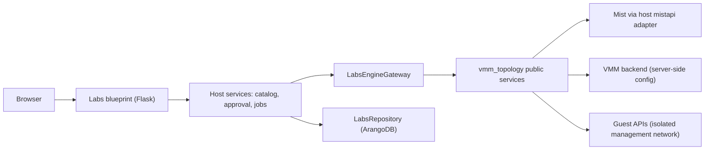

# Implementation Plan: Dynamic JVD Labs in the Operations Portal

**Branch**: `4504-dynamic-jvd-labs-planning` | **Date**: 2026-10-30 | **Spec**: [spec.md](spec.md)

**Input**: Numeric specification from `specs/numbered/0/0/1/2/1/0/0/4/4504-dynamic-jvd-labs-planning/spec.md`.

This plan authorizes no implementation and no live operation. Every task in
[tasks.md](tasks.md) stays unchecked.

## Summary

Add a Labs tab to the existing Flask portal. The tab offers a versioned template
catalog, YAML and JSON import, parameter forms, composition of supported JVD
building blocks, preview, qualification, approved deployment, monitoring, tests,
impairment, restoration, and exact cleanup. The lab engine is the `vmm_topology`
framework, pinned as a Git submodule. The host keeps HTTP, presentation, access
control, the Mist SDK session, and ArangoDB persistence. The engine keeps lab
rules and never imports Flask or MistHelper code.

The current framework compiler has fixed dual-hub roles. Dynamic composition
therefore needs engine work first. The host must not fake it with forms.

## Technical Context

**Language/Version**: Python 3.13 or newer on the host. The framework supports Python 3.10 or newer, so the engine must stay compatible with both.

**Primary Dependencies**: Flask (existing portal), `mistapi` (only Mist REST interface), `python-arango` through the existing host repositories, Pydantic 2, PyYAML 6, and Jinja2 3 (framework runtime). The framework dev extra pins pytest below 9, and the host needs pytest 9. Use separate test environments.

**Storage**: ArangoDB through host-owned repositories modeled on the upgrade portal `ActionRepository` and `ArangoTransactionAdapter`. Redis is a cache only and never holds ownership authority. No SQLite journal.

**Testing**: pytest unit, contract, real-backend integration, installed-package, Playwright browser, restart, and concurrency tests. Isolated live acceptance needs separate approval.

**Target Platform**: The Gunicorn portal on port 8055 in the Podman container, on Linux. Windows and macOS support offline preview. Live mutation on Windows needs an approved cross-platform lock (decision D-03).

**Project Type**: Web service feature with one new engine dependency.

**Performance Goals**: Numeric bounds are decision D-04. Examples to settle: import size, YAML depth, page size, poll interval, concurrent jobs, and job duration.

**Constraints**: Keep the existing allowlist, trusted-proxy, CSRF, and session mechanisms. Add no login, role, port, server, or frontend stack. Fetch no mutable source at startup. Use no `sys.path` change.

**Scale/Scope**: One operator group, a few concurrent labs, and a catalog of tens of templates.

## Constitution Check

Gate status before research: pass. Re-check after design: pass, with the notes below.

- **Five-item rule**: Each new package keeps five children or fewer at every level. The spec directory follows the same rule (see Project Structure).
- **Class-based architecture**: Behavior lives in named classes such as `LabsCatalogService`, `LabsApprovalService`, `LabsJobRunner`, `LabsRepository`, and `LabsEngineGateway`. No wrapper-only function exists.
- **Safety first**: Each mutation needs a typed approval word. Lab mutations are never `safe` registry operations (FR-019).
- **Deployment pipeline**: Task T032 and T033 cover the wheel, the container, and the reusable workflow gap.
- **Observability**: Each action carries info and debug log lines with ASCII output and no secret.
- **Mist transport**: Every REST call uses `mistapi`. The contract tests in T030 and T031 prove authentication, endpoint parity, failure safety, and redaction. No owned WebSocket transport exists.
- **Repository structure**: The record uses the managed `specs/numbered/` route computed from issue number 4504. It adds only its own unique feature record. Existing process-folder debt is unchanged. The commit subject and the pull request title use a Conventional Commit form. Product output stays under `data/`.
- **Spec Kit escalation**: The change touches many files and a destructive surface, so the specification is mandatory.

## Architecture



Rules for the boundary:

1. The engine exposes typed operations, typed results, capability discovery, error categories, and four compatibility versions (engine, host, schema, catalog). The CLI and the portal call the same services.
2. The portal never parses CLI output and never passes `argparse` objects.
3. The engine receives Mist, VMM, guest, persistence, and clock dependencies by injection.
4. The host supplies persistence through semantic ports, so the engine never opens a database itself.

## Phased Delivery

| Phase | Increment | Gate |
| - | - | - |
| 0 | Decisions D-01 to D-06 and evidence refresh | Maintainer approval recorded in `analysis.md` |
| 1 | Pinned runtime package, Labs tab, schemas, offline preview, drafts | Installed-package and browser tests pass |
| 2 | Read-only inventory, monitoring, capability availability | Freshness and bound tests pass |
| 3 | Scoped framework workflows with approval and recovery | Rejection and restart tests pass |
| 4 | Full-lab deployment, onboarding, convergence (new engine work) | Isolated live acceptance, separately approved |
| 5 | Impairment, restoration, complete cleanup (new engine work) | Each mutation gated independently |

## Project Structure

### Documentation (this feature)

```text
specs/numbered/0/0/1/2/1/0/0/4/4504-dynamic-jvd-labs-planning/
  spec.md
  plan.md
  tasks.md
  analysis.md
  design/
    research.md
    data-model.md
    quickstart.md
    contracts/
      template-contract.md
      engine-contract.md
      portal-contract.md
      persistence-contract.md
      delivery-contract.md
    checklists/
      requirements.md
```

### Source Code (proposed, not created by this plan)

```text
src/interfaces/portals/labs/
  routes/        # Flask blueprint and form handlers
  services/      # catalog, approval, job runner, gateway
  repository/    # ArangoDB repositories and transactions
  templates/     # Jinja pages for the Labs tab
  static/        # scripts that carry data-testid hooks
vendor/vmm-topology/   # Git submodule at an exact commit (path is decision D-01)
tests/unit/labs/  tests/contract/labs/  tests/integration/labs/  tests/e2e/labs/
```

The guard `test_labs_planning_record.py` examines this record only.

## Complexity Tracking

| Item | Why it is needed | Simpler option rejected |
| - | - | - |
| Engine work before GUI composition | The compiler has fixed dual-hub roles | Forms over the fixed roles would mislead operators |
| Host ArangoDB repositories | The user selected the existing backend | A SQLite journal conflicts with the user decision |
| Browser-bound approvals | The portal has no operator identity | A shared approval could let another browser act |
